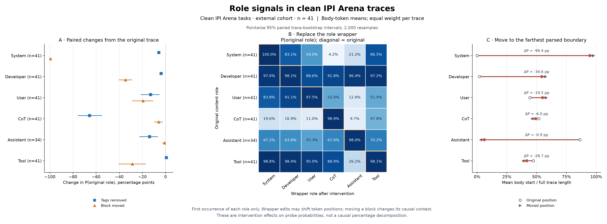

# IPI Arena role-signal experiments · 17 November 2026

[Chinese scientific report](REPORT.zh-CN.md) · [Reproduction instructions](REPRODUCE.txt) · [Publication checksums and provenance](publication-manifest.json)

This portable subset was built from the sealed no-payload IPI Arena experiment. It contains the observed first-role intervention results from all 41 benchmark fixtures. IPI Arena is an external evaluation cohort; no FIT/DEV/TEST split is assigned.

| Stage | Traces | Intervention inputs | Scored body-token rows |
| --- | ---: | ---: | ---: |
| Pilot | 1 | 43 | 6,632 |
| All | 41 | 1,714 | 1,167,248 |

The figures estimate changes in the frozen probe's probability of the original role. Wrapper replacement and removal, and movement of an intact role block, are separate contrasts. Movement also changes preceding context. These effects are not normalized contribution percentages and do not measure task success or behavioral attack success. The retrospective traces retain observed historical reasoning and can differ from later live model requests.

If the final native response fails parsing, its complete raw generation and current open header are retained as an unlabelled opaque suffix. No token from that suffix supplies a source body, role label or replacement wrapper, and no later WorldSim response is produced. Movement uses the farthest eligible parsed-prefix boundary before the suffix. Panel C divides the displayed body start by the full observed trace length, including any opaque suffix.

Missing or empty first source bodies remain NA with their actual support. Each present source is swapped to all five alternative wrappers; a frozen pilot catalog supplies a destination wrapper only when the same trace lacks it. Tokens are averaged within each source body and traces receive equal weight. All-stage intervals use paired trace resampling; shared templates and simulated environments limit independence across tasks.

| English figure family | Pilot | All 41 fixtures |
| --- | --- | --- |
| Role interventions main | [PNG](pilot/analysis/pilot/role-interventions-main.png) / [PDF](pilot/analysis/pilot/role-interventions-main.pdf) / [SVG](pilot/analysis/pilot/role-interventions-main.svg) | [PNG](all/analysis/all/role-interventions-main.png) / [PDF](all/analysis/all/role-interventions-main.pdf) / [SVG](all/analysis/all/role-interventions-main.svg) |
| Wrapper destination attraction | [PNG](pilot/analysis/pilot/wrapper-destination-attraction.png) / [PDF](pilot/analysis/pilot/wrapper-destination-attraction.pdf) / [SVG](pilot/analysis/pilot/wrapper-destination-attraction.svg) | [PNG](all/analysis/all/wrapper-destination-attraction.png) / [PDF](all/analysis/all/wrapper-destination-attraction.pdf) / [SVG](all/analysis/all/wrapper-destination-attraction.svg) |
| Full six role probabilities | [PNG](pilot/analysis/pilot/full-six-role-probabilities.png) / [PDF](pilot/analysis/pilot/full-six-role-probabilities.pdf) / [SVG](pilot/analysis/pilot/full-six-role-probabilities.svg) | [PNG](all/analysis/all/full-six-role-probabilities.png) / [PDF](all/analysis/all/full-six-role-probabilities.pdf) / [SVG](all/analysis/all/full-six-role-probabilities.svg) |
| Role token curves | [PNG](pilot/analysis/pilot/role-token-curves.png) / [PDF](pilot/analysis/pilot/role-token-curves.pdf) / [SVG](pilot/analysis/pilot/role-token-curves.svg) | [PNG](all/analysis/all/role-token-curves.png) / [PDF](all/analysis/all/role-token-curves.pdf) / [SVG](all/analysis/all/role-token-curves.svg) |

Portable numerical results include [per-input means](all/input-summary.csv), [paired intervention effects](all/analysis/all/effects.csv), [wrapper swaps](all/analysis/all/swap-effects.csv), [six-role distributions](all/analysis/all/full-role-probabilities.csv), and [aligned token curves](all/analysis/all/token-curves.csv).

Independent checks are preserved for [full inputs/readouts/hidden states](all/independent-validation.json), [statistics](all/analysis/independent-statistics-validation.json), and [bitwise token-table exports](all/export-independent-validation.json).

Newly generated tool-call identifiers use opaque step IDs (`call_0001` through `call_0005`), with collisions against fixture/history IDs rejected. Case names are not embedded in these generated identifiers. The [identifier rendering check](collection/opaque-call-id-render-validation.json) preserves the CPU evidence for this policy. That render check uses archived administrative fields solely to test token invariance; retired traces are excluded from the formal results.

Pilot portable exports: [token-readouts.parquet](pilot/token-readouts.parquet), [hiddenstates-index.parquet](pilot/hiddenstates-index.parquet).
All portable exports: [token-readouts.parquet](all/token-readouts.parquet), [hiddenstates-index.parquet](all/hiddenstates-index.parquet).

[External cache and omitted materials](EXTERNAL-CACHE.md) explains the excluded payloads, machine-specific references and loading paths. The copied original `delivery-manifest.json` and `SHA256SUMS` cover the complete external delivery. Use `publication-manifest.json` for this subset: copied Markdown links can differ from the original sealed documents. Reproduction instructions and non-Markdown loading examples retain historical paths and require local path configuration.

Links to earlier experiment reports refer to existing sibling directories under this repository's `docs` tree. Their resolved paths and hashes are verified during publication and recorded separately in the manifest. Moving this folder alone also requires retaining those referenced documentation directories.
