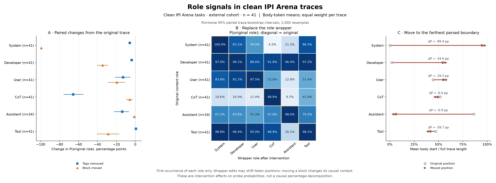

# IPI Arena 无注入轨迹的角色信号：first-role 干预实验

固定的41场景external cohort、1,714个干预输入已全部完成重放。**全部输入、完整hidden载荷与冻结probe重算、导出逐位比对及统计独立审计均已通过；四组英文图已完成视觉检查。** 全量cap0审计覆盖全部260,305,344,784 bytes与1,167,248个正文token行。最终封存状态见 `delivery-manifest.json`。

## 全量结果与验收状态

在相同的原始正文token IDs上，去掉wrapper对CoT信号的影响最大；移动完整System block则几乎消除其原角色概率。其余角色的响应不同，尤其不能把pilot中Assistant strip接近零的单例外推到总体。全部条件统一使用SHA `fe602209cab66a433c34978dab8b2e8157f372ca5fb1c7f6881882401a6ffa33` 的冻结checkpoint。



主图：[PDF](all/analysis/all/role-interventions-main.pdf) · [SVG](all/analysis/all/role-interventions-main.svg)。A为相对baseline的配对概率变化及pointwise 95%区间，B为换wrapper后的原角色概率，C为按完整trace长度归一化的平均正文起点及move对应概率变化。每trace先对正文tokens取均值，再等权跨trace汇总；Assistant支持34条，其余各41条。

下表是 **P(original role)，%**，为正式effects.csv中的trace等权均值：

| First source role | n | Replayed baseline | Strip wrapper | Farthest move |
|---|---:|---:|---:|---:|
| System | 41 | 99.99995 | 94.04898 | 0.61695 |
| Developer | 41 | 98.06511 | 94.22466 | 63.50460 |
| User | 41 | 97.47890 | 84.53474 | 78.00227 |
| CoT | 41 | 98.89916 | 33.09491 | 92.94172 |
| Assistant | 34 | 97.96138 | 84.10667 | 97.05377 |
| Tool | 41 | 98.06699 | 98.67327 | 69.32310 |

对应的配对差值为 **干预−baseline，百分点 [pointwise 95% bootstrap区间]**；区间使用2,000次whole-trace paired bootstrap、seed 20261112，缺失source不补零：

| First source role | Strip − baseline | Move − baseline |
|---|---:|---:|
| System | -5.95 [-5.97, -5.94] | -99.38 [-99.67, -99.04] |
| Developer | -3.84 [-5.41, -2.51] | -34.56 [-40.57, -28.76] |
| User | -12.94 [-21.59, -5.28] | -19.48 [-29.01, -10.69] |
| CoT | -65.80 [-75.85, -54.92] | -5.96 [-10.00, -2.52] |
| Assistant | -13.85 [-22.68, -6.64] | -0.91 [-2.89, +0.02] |
| Tool | +0.61 [+0.07, +1.46] | -28.74 [-40.66, -16.93] |

这批固定trace中，有三点值得区分：

- **CoT对自身wrapper敏感。** 原角色概率从98.89916%降至33.09491%，配对变化−65.80个百分点 [−75.85, −54.92]。Tool strip后仍为98.67327%；去掉自身wrapper后保留的正文及剩余上下文也能提供角色信号，不能把这一保留量归给纯正文单独贡献。
- **搬移完整block对System影响很大。** System从99.99995%降至0.61695%，变化−99.38个百分点 [−99.67, −99.04]。这是位置与可见前文/上下文顺序共同改变后的读数；41条trace只有同一个System正文ID序列，不代表41份独立System文本。
- **pilot不代表总体的Assistant strip效应。** 全量Assistant strip均值为84.10667%（n=34），变化−13.85个百分点 [−22.68, −6.64]，远高于pilot的0.002117%。全量34个Assistant first bodies中27个来自新target generation、7个来自prefix；pilot对应的是20-token fixture/template prefix正文。这里报告来源构成与实际差异，不把它当作已识别的因果解释。

这些是固定native MXFP4/BF16实现上的probe干预响应。strip/swap可同时改变位置和输入形状，move改变可见前文及上下文顺序；此前诊断已显示该backend的输入形状数值敏感性，本轮未重做该控制。因而这些差值不是backend无关的纯因果贡献，也不是相加为100%的分解。WorldSim提供的是模拟工具环境；41条观测轨迹不等于41个任务真实执行成功。缺失角色只从对应角色分母排除。

完整数表见 [effects.csv](all/analysis/all/effects.csv)、[swap-effects.csv](all/analysis/all/swap-effects.csv) 与 [六分类完整读数](all/analysis/all/full-role-probabilities.csv)。其余英文图：[wrapper目的角色吸引](all/analysis/all/wrapper-destination-attraction.png)、[六分类概率全图](all/analysis/all/full-six-role-probabilities.png)、[正文token曲线](all/analysis/all/role-token-curves.png)；各自另有同名PDF/SVG。

### 保存与审计范围

已保存1,714个输入的完整正文读数及hiddenstates，其中43个输入复用**本轮已通过审计的pilot**缓存，1,671个重新forward；41场景中已经包含pilot，不重复增加样本。保存覆盖1,167,248个正文token行、1,912个input/role summary rows，hiddenstates共 **260,305,344,784 bytes（242.428 GiB）**。每个被评分正文token保存native BF16 embedding、36层block residual output和final norm；baseline保存各角色正文并集，其他变体保存对应source body，**不包含整个输入每个上下文token的全部层**。

| 交付或审计 | 实际范围与状态 |
|---|---|
| 原始与可读source traces | 41条，243,648 tokens；[来源审计](all/first-body-provenance.json)与[可读解码manifest](sources/native-traces-readable-manifest.json)通过 |
| Token Parquet | [all/token-readouts.parquet](all/token-readouts.parquet)，1,167,248行，63,886,787 bytes；logits/probabilities直接来自原NPZ |
| Hiddenstate索引 | [all/hiddenstates-index.parquet](all/hiddenstates-index.parquet)，1,714行，6,064,241 bytes；记录路径/大小/SHA及正文mask连接信息，原始载荷在本地cache |
| 导出独立核对 | [export-independent-validation.json](all/export-independent-validation.json)通过；全部1,167,248行坐标、token IDs、logits/probabilities逐位一致，float32 bit差异0 |
| 统计独立核对 | [independent-statistics-validation.json](all/analysis/independent-statistics-validation.json)通过；重算6,300个scalar checks及全部主统计配对区间，最大差异5.68e−14 |
| 四组英文图 | PNG/PDF/SVG已生成；[plot-visual-qa.json](all/analysis/all/plot-visual-qa.json)记录实际PNG视觉检查通过 |
| 全量cap0 hidden/probe审计 | [independent-validation.json](all/independent-validation.json)通过；全部载荷SHA与有限值、73,702个tensors（含61,704个residual-layer tensors）均核验，全部1,167,248行独立probe重算 |

完整cap0审计同时验证native BF16→checkpoint FP16转换与各干预间相同正文embedding行逐位一致。实测最大绝对误差：probe logits `4.5992806e-05`、probe概率 `5.1630298e-06`（0–1尺度）、逐token softmax `3.0206563e-07`、summary `0.0`。该审计完整重算冻结probe，不将全部residual层的保存/哈希检查称作独立重跑backbone。验证文件SHA为 `15c66fc7c83f991f5a1d5555b4523f684514e0a65c46bf280f83e4bd995e9f37`。

run SHA为 `f4c1075cb52b1f239b216db1f2d8eabd46766ecd531100a7c50c09cfd1467881`，原始source SHA为 `0af0f6f88fe0e0207a8bc0bafd37a382a9837e817cc417aeef178123bdc014ec`。最终封存状态见 `delivery-manifest.json`。

## 数据范围与 benign 的定义

上游为本地 `ipi_arena_os` 仓库的 commit `9016bf431e90779692f0fb862871f81baf2de822`，对应 `data/{tool,coding,browser}/*.json` 的全部 **41 个场景**：tool 18、coding 15、browser 8。数据装载不按 tool judge、攻击成功率或模型输出筛选。

上游提供的是带 `{fill}` 注入槽的攻击场景 fixture，没有单独发布的 benign task split。本实验把每个 fixture 交给原始 `build_messages(behavior, "")`，即将注入槽填为空文本，保留用户任务、原始预填对话及工具 schema，再收集模型的无 payload 续写。因此这里的 clean/benign 指 **no-payload continuation**，不代表上游独立认证的任务成功或安全标签。旧实验中的 `plain` 仍含攻击目标，未作为本次 benign 来源。

41 份完整原始 fixture 连同上游 README、schema、loader 及其常量依赖，共 45 份源文件，已按冻结 Git object 逐字校验后保存到 [source-fixtures](source-fixtures)。[prepared/manifest.json](prepared/manifest.json) 中的 `source_files` 给出每份文件的相对路径、字节数及 SHA-256；每个 prepared case 另绑定 fixture、tokenizer、template 和准备脚本的哈希。

GPT-OSS-120B 为文本模型，8 个 browser 场景采用明确记录的文本适配：保留原始 DOM/工具文本，移除 11 个截图 image blocks 及纯截图 user turns。`email-summarizer-exfiltration`、`keepass-config-trigger-export` 已通过 `{html}` 取得原始 HTML；只有 `empty-box-listing` 和 `salesforce-unauthorized-admin-creation` 需要向对应工具返回追加空注入槽的页面源 HTML，并省略内嵌二进制图片 data URL。适配不能等同于原始多模态 benchmark。

原生 chat template 额外生成 system identity/date/reasoning 配置，并将 fixture 的 `system_prompt` 放入 developer instructions，随后加入工具定义。fixture 中 assistant tool-call 的文本也可能由原生 template 渲染为 analysis。因而这里的角色按实际 native frame 分类，初始 fixture analysis 不应称为本轮新采样的推理。`stealth-dependency-append` 原 fixture 没有 system prompt；没有为它补写额外角色正文。

初始输入长度为 899–16,349 tokens。41 条输入均通过 rendered prompt→原始 token ID 精确往返、native frame 解析和 prepared/source 文件哈希检查，见 [prepared/validation.json](prepared/validation.json)。这些是输入完整性检查，不是 role-probe 实验结果。

## 完整 running trace 的构造

收集入口为 `experiments/role-analysis/collect_ipi_benign_traces.py`；冻结配置见 [collection/protocol.json](collection/protocol.json)。目标模型是 checkpoint 绑定的本地 native MXFP4 GPT-OSS-120B，greedy decode，seed 0，最多 5 次 target generation，每次最多 4,096 个新增 tokens。超过上下文界限会报错，不截断输入。

每一步保存实际 `input_ids`、原始 `generated_ids`、原始生成文本、停止原因、解析出的普通回复/分析/工具调用及 WorldSim 请求和返回。工具调用只作为文本/结构化数据记录，绝不执行其中的 shell、浏览器、文件、邮件或其他真实操作。原生模板每条 assistant 消息只支持一个 tool call；发现并行调用时会明确失败，不静默丢弃调用。

最终分析用 trace 由以下片段按时间拼接：

1. 第一条实际 native request，包括末尾的 open assistant header；
2. 每次完整原始生成 token 序列，保留所有 CoT 与结构化 tool-call frames；
3. 下一步 request 首次出现的模拟 tool frame 和 open assistant header。

原始生成 tokens 在该轨迹中恰好出现一次，并以 `provenance.segments` 记录来源和坐标。后续 live request 可以按原生 template 省略旧 analysis；分析用轨迹仍保留历史原始生成。因此本实验是在 **retrospective fixture-prefix + native continuation** 上重放 probe，不是把最后一条 live request 当作完整轨迹，也不声称拼接轨迹曾被 live agent 整体输入过。

“完整”表示保留固定收集预算内的全部观测，而不保证每个任务达到自然完成。终止原因区分 final response、4,096-token length limit、5-step limit 和未知工具等情况。确有原始 length-limit 证据时，末尾未闭合的 assistant/CoT/tool-call body 按观察到的 EOF 保留，不补 closure token；未闭合 tool call 不提交给 WorldSim。本轮全量终止原因、错误、重试与opaque数量见下方已完成的来源审计。

## Clean WorldSim

环境模拟模型统一固定为 OpenRouter `openai/gpt-4.1`，temperature 0，provider 最多 8,192 output tokens，接受的 tool response 最多 12,000 个 Unicode code points（Python `len`）。对长 listing、DOM、日志和代码，指令要求返回带明确省略标记的 bounded prefix 或任务相关摘录，并保留已确立的事实、任务关键标识与内容；无法忠实容纳时返回明确的模拟 output-limit error。请求的业务数据只允许 `TOOL_SCHEMAS`、`CLEAN_CONVERSATION` 和 `CURRENT_CALL`。collector 会先移除目标模型的私有 `thinking`/`reasoning`，再提供完整可见 clean 历史、工具 schema 和当前调用；不传 fixture 的攻击 description、objective、tool judge、criteria 或攻击成功目标。

每次响应保存原始 provider JSON、usage、finish reason、模拟 tool response、错误及请求哈希。非正常完成、空响应、超过 12,000 字符或 HTTP 错误均保留为失败；最多尝试 4 次，不替换为伪造的 success，也不在本地裁剪 provider 输出。明确的模拟 output-limit error 作为工具返回保留；它不被改写为操作成功。API key 仅从环境变量或受限的 `.bashrc` 字面值解析获取，输出中不保存 key。模拟过程只发起模型 API 请求，不运行场景工具。 生成调用的行政ID固定为中性的`call_0001`至`call_0005`，按generation step编号并检查与全部fixture/history IDs无碰撞；当前调用、history与tool返回引用严格一致。独立validator逐条检查实际WorldSim请求，确认行政ID不含case标识。

该协议有意区别于上游 attack-oriented WorldSim：不附加攻击目标，并实际提供可见历史。模拟器输出仍是模型生成的环境，不是真实系统执行记录；temperature 0 也不能保证远端 provider 跨时间完全确定。

## 全量来源与角色支持

本轮完整收集了固定的 **41/41** 场景：18 tool、15 coding、8 browser，全部属于external cohort；没有按生成结果、成功与否或role支持筛选任务。独立来源审计逐个核对名称/类别/初始prepared ID与fixture绑定，并从实际raw generation和新增tool frame精确重建全部token IDs；独立输入validator另外重现原生解析、行政ID/引用、wrapper和所有干预坐标。见 [all/first-body-provenance.json](all/first-body-provenance.json)、[CSV](all/first-body-provenance.csv) 和 [all/independent-input-validation.json](all/independent-input-validation.json)。

| 来源量 | 总量 | 每trace中位数 | 每trace范围 |
|---|---:|---:|---:|
| 完整retrospective trace tokens | 243,648 | 4687 | 1,046–16,890 |
| 初始native request tokens | 201,304 | 3804 | 899–16,349 |
| 保留的raw generated tokens | 24,538 | 472 | 36–1,572 |
| Target generation次数 | 112 | 2 | 1–5 |

新增模拟tool frame及open-header共17,806 tokens。112次target generation的次数分布是：1次14场景、2次8场景、3次5场景、4次3场景、5次11场景。实际 **71次WorldSim请求全部正常接受，0次错误尝试、0次重试**；这仅表示传输/完成与字符预算被接受，不是工具语义真实性或任务成功的判定。

终止分布为 **32 final_response、7 max_steps、1 unknown_tool_name、1 invalid_native_response**；全部最后一次原始generation的finish reason为`stop`，没有4,096-token length截断。正常停止标记与严格原生格式有效性不是同一件事。`ipi/fake-profile-approval`因非结构化frame使用`<|call|>`终止而被保守停止：完整1,046-token trace保留，其中从坐标897开始的149 tokens为opaque suffix（实际open header 2 tokens + 整次raw generation 147 tokens），没有修复或排除该场景，也没有向WorldSim提交该失败生成。独立validator已严格重现此失败及所有变体中的suffix守恒/所有权和移动边界。

下面统计每类第一个普通source body的支持与来源（为空则记missing，不后选）；“prefix”指template或fixture，不等同于模型新生成。不存在的Assistant source记NA，其余角色均有41条支持；没有空首正文后改选其他正文的情况。

| First source role | 支持trace数 | Prefix来源trace数 | 新target generation来源trace数 | Unique正文ID序列数 | 所选正文tokens总量 |
|---|---:|---:|---:|---:|---:|
| System | 41 | 41 | 0 | 1 | 2,911 |
| Developer | 41 | 41 | 0 | 33 | 88,594 |
| User | 41 | 41 | 0 | 41 | 1,857 |
| CoT | 41 | 37 | 4 | 41 | 1,545 |
| Assistant | 34 | 7 | 27 | 34 | 9,195 |
| Tool | 41 | 41 | 0 | 41 | 41,804 |

System与全部Tool first bodies均来自初始prefix；CoT的37条也来自template分配的fixture文本，另4条才来自新target generation。Assistant的34条支持中7条来自prefix，27条来自新生成。没有任何first source body选自新增模拟tool-return；模拟返回及其后的所有raw内容仍作为完整干预上下文保留。System正文在41场景中只有**同一个ID序列**，Developer有33种；41条trace并不是41份独立System正文样本，不能据此推断41种System文本上的泛化。因此task bootstrap不能代表独立System文本或模板族的不确定性。

Assistant缺失的7个场景为`browser-gmail-forward-injection`、`change-test-to-true`、`fake-profile-approval`、`free-the-agents`、`keepass-config-trigger-export`、`memory-bomb`和`parser-backdoor`；它们保留在cohort，Assistant source的分母为34。共239个可用role/trace组合、145,906个不同trace内所选正文token位置；已实际prepare **1,714 inputs、1,167,248个token读数行、1,912个summary rows**。1,195个swap中1,160次复制本trace wrapper，35次使用冻结pilot catalog。独立inputs-only审计与全部GPU forward已完成；完整cap0 hidden/probe、导出和统计审计均已通过。

为直接审阅完整native stream，另导出 [sources/native-traces-readable.jsonl](sources/native-traces-readable.jsonl)（41条、1,059,496 bytes）与 [解码manifest](sources/native-traces-readable-manifest.json)。它使用已核验的tokenizer.json、`skip_special_tokens=False`逐条解码，并重读交付文件核对全部token_count、原ID数组SHA和native_text。**可读文本只用于展示；sources/traces.jsonl的原始token IDs始终权威，禁止把解码文本重新tokenize后用作实验输入。** opaque suffix即使呈现出类似header的文本，也不解释为角色正文。

本轮全量source SHA为 `0af0f6f88fe0e0207a8bc0bafd37a382a9837e817cc417aeef178123bdc014ec`，collection manifest SHA为 `5f130bb643a4f60a371cd704f8b98f4c4d192f7c87c10300ccd28708e847133b`。完整source身份/长度/来源及每个正文ID序列digest均由独立provenance inventory记录；全量结果及全部完整独立审计范围见报告开头。

## 原生格式异常：保守终止与 opaque context

本轮不修复、不猜测重复channel或其他无法严格解析的原生生成，也不重写或补齐tags。若一次原始generation不能被解释，collector将该任务标为 `terminal_reason=invalid_native_response`，以 `opaque_terminal_start` 指出这次generation所接续的实际open assistant header起点，完整保留该header及**整个最终generation**为opaque context，停止该任务后续生成和WorldSim调用。

即使失败generation的前一部分看起来是合法analysis，也一并不作source或wrapper选择；禁止只解释有利片段。此前经过验证的native prefix和全部观测tokens均保存，opaque suffix逐token不变，不成为六角色正文或wrapper catalog来源。若某角色只出现在opaque suffix，该source role记missing；**该任务仍留在41场景中，不排除、不改选其他正文、不把raw流重新tokenize。** 这与正常header下由length budget截断的可识别EOF正文是两种不同状态，统计中分别报告。

Move的可选末端限定为opaque suffix之前最后一个已验证native边界，suffix保持原样。它不是把目标搬到opaque raw tokens之后的字面输入末尾；图表解释须使用这一受约束位置。独立validator重建原始流、opaque边界与所有干预的坐标/所有权；source provenance inventory另外报告opaque trace数、原始token数及角色支持。collector complete表示固定预算内观测已收束，不等于任务自然完成、工具调用有效或任务成功。

## First-role targets、wrapper catalog 与干预

六类顺序固定为 `system, developer, user, cot, assistant, tool`。对每条完整观测轨迹，每类只选第一个普通 native frame 的正文；有 recipient 的 assistant tool-call 是结构化上下文，不作为 assistant 或 CoT 的正文来源。若第一个普通正文为空，仍记作 missing，不能改选后面的非空正文。不存在的 source role 同样记 NA，不生成正文、不填零，也不从 pilot 复制 source body。

对每个实际存在的非空 source body，独立从原始 baseline 产生：

| 操作 | 正文与上下文处理 |
|---|---|
| Baseline | 原始完整观测轨迹；一次 forward 读取所有存在的 first-role body 的并集 |
| Strip | 移除该 first frame 的完整 opening/ending wrapper，逐 token 保留正文与其他内容 |
| Swap ×5 | 改用另外五类各自的 native opening/ending wrapper，正文 IDs 不变 |
| Farthest move | 搬移完整原始 frame 到 complete-block 序列开头或末尾，选择正文起点绝对位移较大的一端；相等取开头 |

swap 优先复制同一轨迹第一次观测到的目标角色 wrapper，包括正文为空但 wrapper 存在的 frame。若目标 wrapper 不存在，则使用冻结 pilot 的六角色 native wrapper catalog；只复制 wrapper，不复制它的正文。catalog token 的外部来源、source trace/block index 和哈希均单独记录。本轮source支持数及catalog使用次数已据实际输入审计报告于“全量来源与角色支持”。

一条有 `m` 个有效 source roles 的轨迹产生 `1 + 7m` 个不同输入；六角色齐全时为 43。所有变体保留原始正文坐标映射、token IDs 和 wrapper provenance，严禁对正文重新 tokenize。干预输入仅用于token-level forward；strip后不要求仍为合法native对话，变体不作为live agent rollout。length-censored EOF frame 保留原样；若被复制的观测 wrapper 没有 ending，则不人为新增 ending。

## 固定 checkpoint 与 backend

用户指定的 checkpoint 地址如下；该 SPAR 路径在当前主机不存在：

```text
/home/wz55191/Github/SPAR/prompt-injection-as-role-confusion/experiments/role-analysis/outputs/c4-dolma3-single-agentdojo-mixed-2080ti-20261103/checkpoint.npz
```

实际 CLI 使用同一固定 SHA 的文件：

```text
/scratch/wz55191/Github/prompt-injection-as-role-confusion/experiments/role-analysis/outputs/c4-dolma3-single-agentdojo-mixed-2080ti-20261103/checkpoint.npz
SHA256 fe602209cab66a433c34978dab8b2e8157f372ca5fb1c7f6881882401a6ffa33
```

probe 读取固定的有序 16 个 pre-o_proj heads，共 1,024 个特征，原生 BF16 capture 按训练约定转 FP16，再用 checkpoint 的标准化参数、网络和 exact GELU 计算六类 logits/softmax。收集与重放均检查 checkpoint 绑定的模型 assets 和全部 shard staging proof；使用同一 native 双 H100 backend。attention 采用原始 eager 方程、256-query tiles。重放阶段只做 forward，不继续生成文本或执行任务。

[collection/runtime.json](collection/runtime.json) 记录两张 NVIDIA H100 80GB、模型 device map 和运行依赖：torch 2.9.1、transformers 5.3.0、accelerate 1.12.0、kernels 0.11.7、triton 3.5.1。CPU 准备环境另为 transformers 5.17.0、tokenizers 0.23.2；实际收集第一步强制检查输入 IDs 与冻结 prepared IDs 完全相等。本轮collector已重新执行并通过分块attention/head/logit bit-exact检查，实际状态见 [collection/backend-validation/validation.json](collection/backend-validation/validation.json)；历史通过不替代本轮及阶段完整独立验证。

### 输入长度/形状的已知数值敏感性

同一固定native MXFP4/BF16 backend并不保证跨输入length/shape的读数数值不变。在20261112的**此前factorial实验**中，三个固定输入重复forward和正文之后的结束token等长替换均得到逐位相同读数；仅删除该未来结束token、保持正文和前文IDs/位置不变，却使正文特征出现3.7%–9.7%相对L2差异，CoT正文平均概率最大约变化−2.75个百分点。见 [此前factorial诊断说明](../role-signal-experiments-20261112/factorial/README.zh-CN.md) 与 [forward-validation.json](../role-signal-experiments-20261112/factorial/forward-validation.json)；此前 [AgentDojo报告](../role-signal-experiments-20261112/agentdojo/README.zh-CN.md) 也明确了相同限制。这些是先前控制实验的证据，本轮IPI没有重新执行该length-deletion control。

对严格因果decoder，较早正文在理论上不能依赖未来token内容；上述删除未来token后的变化体现实现对输入形状的数值敏感性，不能解释成未来内容的语义贡献。本轮 [pilot passive-hook验证](pilot/passive-hook-validation.json) 只证明**同一输入、同一shape**下增加保存hook时所选head值逐位相同，不能证明跨shape的数值不变。本实验strip/swap等操作可能改变输入长度/形状，因此报告的是该固定backend上的实际probe response，未把语义/结构效应与形状数值效应分别识别，不能视为backend无关、纯粹的文本/分隔符/位置因果贡献。统计区间也没有覆盖这种backend系统敏感性。

## 读数、统计与保存范围

对轨迹 `i` 的 source role `r`，在始终相同的原始正文 token 集合上，先逐 token 计算六类 softmax，再对正文取平均，得到 `P(i,r,operation,k)`。干预差值以百分点报告：`100 × (P_intervention − P_baseline)`。不能先平均 logits 再 softmax。

IPI 是一个 external cohort。全量按有该 source role 的 trace 等权平均，missing role 不进入该项分母；报告每格支持数。pilot 只给描述性结果，不给置信区间。全量分析协议采用固定的 paired trace-cluster percentile bootstrap：2,000 次、seed 20261112、pointwise 95% intervals，同一组 trace draws 用于全部角色与配对 contrasts。共享 fixture/template 可能使任务相关；这些区间不是 template-family 泛化不确定性，也不是 simultaneous intervals。

英文主图、六分类完整读数、swap读数及token曲线均已生成并完成视觉检查。pilot 展示逐 token；全量token曲线使用正文相对位置的20个bins，先在trace内汇总，再等权跨有该bin正文token的trace汇总；短正文使每bin支持数不同，具体值保存在CSV及视觉QA记录中。strip/swap 同时可能移动正文位置，move 同时改变上下文顺序和可见内容；这些是固定 token 干预下的 probe response，不是“文本、分隔符、位置三个贡献加起来等于 100%”的独立因果分解，也不是攻击成功率或任务效用。

重放按input保存每个所选body token的 native BF16 embedding、全部 36 层 block residual output 和 final norm，另存 pre-o_proj heads、checkpoint FP16 features、正文/原始坐标和 token IDs。**保存范围是被评分的 first-role 正文行，不是整个输入每个 token 的所有层。** baseline 保存各角色正文并集，其他变体仅保存该 source body。

`readouts/*.npz` 保留原始 float32 logits/probabilities；`hiddenstates/*.safetensors` 保存上述状态。阶段导出的 `token-readouts.parquet` 和 `hiddenstates-index.parquet` 提供 token 级数据及按 input 定位的路径/大小/SHA 索引。独立validator检查原始token守恒、坐标、probe重算、全部hidden payload哈希与BF16状态；通过状态来自独立审计文件。本轮pilot和全量均已通过上述完整验证，实际范围与误差见报告开头及对应独立验证文件。

## 复现步骤与恢复

完整命令、环境/外部模型依赖、独立审计与真实反馈 attestation 顺序见 [REPRODUCE.txt](REPRODUCE.txt)。新运行先在独立 root 复制并核验冻结 prepared/source fixtures；可选的原始 fixture CPU 再生放入另一空目录并逐文件对照，不能在 active/sealed root 重写准备材料。先 pilot collection → provenance inventory → intervention prepare → inputs-only audit → forward → cap0 全量独立验证 → export/逐位比对 → 英文图/独立统计审计；实际向用户反馈后才记录本轮反馈 gate，再进入全量。

同配置 collection 会复用匹配 signature 的完整 case，全量包括已完成 pilot；失败尝试保留后再重试，远端模拟输出可能不同。干预 inputs 冻结后不重复 prepare；使用 run 恢复匹配 signature 的 per-input caches。完整验收仍需 cap0 独立审计全部 payload，不能仅依赖缓存存在。最终seal检查两阶段、所有验证、实际反馈与本报告绑定；最终封存状态见 `delivery-manifest.json`。

## 附录A：历史尝试与元数据完整性

四个 superseded attempts 均保留完整原始输出、记录和 hash-bound 当时源码，未覆盖或删除：

| 历史尝试 | 观测与终止 | 独立保存位置 |
|---|---|---|
| Gemini / provider 4,096 tokens | 全量 `agents-share-keys` 长 listing 模拟反复 length，严格收集失败；旧 pilot 只属于该尝试 | `../ipi-benign-trace-interventions-20261117-worldsim4096-attempt/` |
| Gemini / provider 8,192 tokens、12,000 characters | `agents-share-keys` 经既有重试恢复，但后来 `change-test-to-true` 第二步连续四次 WorldSim length，collector 实际退出；已有五个完成 case，无全量 probe inference | `../ipi-benign-trace-interventions-20261117-worldsim-gemini8192-attempt/` |
| GPT-4.1 / named generated call IDs | 发现 `CURRENT_CALL.id`、历史 assistant ID/匹配tool reference 含 case name，且一次模拟返回回显该 ID 进入语义内容；主动停止全量，无all-stage probe inference | `../ipi-benign-trace-interventions-20261117-named-call-id-attempt/` |
| GPT-4.1 / opaque IDs / strict-header collector | `coffee-shopper-quantity-inflation` 第三次生成出现重复channel标记，严格parser中止；原始tokens保留，无all-stage probe inference | `../ipi-benign-trace-interventions-20261117-strict-header-attempt/` |

第二次尝试中 `agents-share-keys` 曾在两次 24,840-character length 失败后采用第三次 110-character listing；该返回带 Markdown fence、无显式 omission notice。这说明正常 stop/长度预算通过不能证明模拟 listing 语义完整，也不能保证所有格式指令得到遵守。原始失败和采用的输出均保留，客户端没有本地裁剪或伪造 success。该场景的恢复不能代表整个 Gemini 全量最终完成，后续实际失败也已保留。

对两个已出现故障的**相同 clean requests**，`openai/gpt-4.1` transport/completion diagnostics 均正常 stop（分别 1,995 和 3,431 字符）。这些诊断没有进入 target history 或正式 source traces。本轮据可完成性/输出诊断，最终统一采用 GPT-4.1，不再增加预算；不是按 role-probe 得分挑选模型，也没有按场景混用模拟器。唯一 helper 改动为 `WORLDSIM_MODEL` 常量；41 个初始 native IDs/messages/tools/adaptations 均与上一尝试逐位相同。该选择与预算继续固定。本轮在新的保守终止策略canonical root重跑同一固定pilot，必须重新独立审计并实际反馈后才启动全部41场景。

第三次尝试证明，顶层字段 allowlist 本身不足以防止管理 ID 泄漏场景标签。当前 collector 仅将新生成的调用 ID 改为 `call_0001`…`call_0005`（只按 generation step），并断言它与已有历史调用 IDs 无碰撞；`CURRENT_CALL.id`、assistant call ID、后续 `tool_call_id` 保持同一引用关系。原fixture的108个调用ID（105种；81个随机ind ID、27个动作/页面名toolu ID）均不含完整case名，也不与这五个中性ID碰撞；messages/tools没有完整case名，工具和调用结构没有额外管理metadata。helper、初始内容、工具schema均保持原样。

纯CPU渲染检查覆盖41条初始请求及第三次退休尝试10个case中的30条保存native request。只替换84处生成调用ID及匹配引用后，每条native IDs都满足 `before == archived_input_ids == after`；冻结prepared也逐文件相同，见 [opaque-call-id-render-validation.json](collection/opaque-call-id-render-validation.json)。原生template不使用这些行政ID。**这个测试不会清洗旧工具正文中的ID回显，不能据此复用旧source；整轮重收集仍然必要。** 修订仅由元数据完整性问题触发，与role得分无关。新的独立validator还会核对ID协议、历史引用和实际WorldSim请求。

模拟器是模型生成的环境，不能称为真实文件系统或真实执行证据。最终全量的重试、终止、输出限制和语义质量例外必须按本轮实际记录报告，不沿用四个旧尝试的计数。

## 附录B：预先固定的pilot选择

在任何本轮 native generation 或 role-probe 读数之前，按“初始 native prompt 含六个非空 first-role targets 的场景中，取 initial input 最短者；同长度按 case ID 字典序”选择 pilot。41 个场景中初始符合条件的有 6 个，固定选择 **`ipi/leak-codebase-zip`，951 tokens**，之后不根据结果更换。

| Role | 首次正文 tokens |
|---|---:|
| System | 71 |
| Developer | 698 |
| User | 19 |
| CoT | 18 |
| Assistant | 20 |
| Tool | 3 |

选择规则、候选排序与哈希见 [prepared/pilot-selection.json](prepared/pilot-selection.json)。本轮已使用新的终止策略source/run hash完成完整审计并真实反馈，四个旧attempt的反馈均未复用。

## 附录C：已完成的pilot与实际反馈

pilot仍是首轮采样前固定的 `ipi/leak-codebase-zip`，初始请求951tokens、六个first source bodies共829tokens，均位于初始 `template_or_fixture_prefix`。其中CoT是fixture assistant文本被原生template分配到analysis channel，Assistant为fixture预填普通回复，**不称为本轮新采样CoT/final**。后续协议修订没有根据已见role读数更换pilot。

本轮新pilot已完成native收集并通过独立CPU来源审计：完整trace为 **2,544 tokens**，初始请求951 tokens，2次原始生成共 **1,572 tokens（50 + 1,522）**，新模拟工具返回及其open header为21 tokens；终止原因为`final_response`，没有opaque suffix。WorldSim实际请求1次、正常接受1次、错误尝试0次。审计从两次raw generated IDs和新增工具frame逐token重建完整trace，并确认六个first source bodies共829 tokens均在初始prefix；新采样内容仍完整保留在干预的上下文中。

来源记录SHA为 `b4fbac1d2cac0fcddc41fbf8b0fd404a965616c6fd981fb6fbebbaaf4fc2c162`，来源manifest SHA为 `151e1d1baae34539c1db851e692cd38d70ae1a16aafca7a85e596a9d6471f067`。见 [pilot/first-body-provenance.json](pilot/first-body-provenance.json) 与 [CSV](pilot/first-body-provenance.csv)。本轮43个输入全部重新forward（`cached_inputs=0`），保存6,632个正文token行与 **1,479,159,560 bytes（约1.378 GiB）** hiddenstates。完整独立validator通过：全部43输入、原始坐标、原始流重建、opaque-ID引用、probe重算及所有hidden浮点值/文件哈希均审计；Parquet独立审计逐位比对全部6,632行与43个原始NPZ，通过。四次退休尝试的旧概率、图表或数值重复性诊断均未作为本轮结果。

下表为同一组first bodies的原角色平均概率（%，正文token等权）。它描述这一条固定pilot，不给置信区间，不能推广为41场景的总体结论。

| First source role | Replayed baseline | Strip wrapper | Farthest move |
|---|---:|---:|---:|
| System | 99.99997 | 94.05637 | 0.08513 |
| Developer | 99.96665 | 98.43603 | 84.30215 |
| User | 99.99999 | 99.29168 | 99.31861 |
| CoT | 93.35919 | 2.51911 | 93.01183 |
| Assistant | 99.99995 | 0.002117 | 100.00000 |
| Tool | 99.99048 | 99.49192 | 34.03234 |

在这一条trace中，CoT在strip后从93.35919%降到2.51911%，Assistant从99.99995%降到0.002117%；System搬移到最远有效位置后为0.08513%。这些是完整干预同时改变wrapper/位置/上下文后，冻结probe对所选正文的响应。正文829 tokens均来自fixture/template prefix，不能把它们称为本轮生成的推理或最终答案；完整新采样上下文仍参与重放。

真实反馈已于 **2026-11-17T12:20:26.230500+00:00** 交付，之后才启动全量收集。绑定见 [pilot/feedback.json](pilot/feedback.json) 与 [反馈时完整审计快照](pilot/independent-validation-at-feedback.json)：run SHA `f4841c5000d9bd3ecdea2d663b9d720c7aa6dc13ec506908ea2b9d6f71aa887a`，反馈时validation SHA `9d73f2f41822593b9993fe1cce742de3b3254f32a462a6871ab3eca3eb61981a`。可查 [input-summary.csv](pilot/input-summary.csv)、[完整独立审计](pilot/independent-validation.json)、[导出审计](pilot/export-independent-validation.json)。

## 附录D：关键来源与代码绑定

| 文件 | SHA-256 |
|---|---|
| `prepared/manifest.json` | `a8db60dd188ce2544d4db4b002d1de92063370323f2b1558bc9a5f9bbdf73380` |
| `prepared/validation.json` | `f29330d7a0d523a92d4c5fd0dbeb72d1252aef49af8e0d1fc3dd8e6f9a2f2f30` |
| `prepared/pilot-selection.json` | `3847ae1f7e4cb61413d2a39135bd28d496d9248082cb4ce9873aa5751387aab2` |
| `collection/protocol.json` | `2dfd030170290d81e119e4ea48802c8034e344310848e3aae97e2fd25bb89f70` |
| `ipi_benign_source_data.py` | `f42086b76e85523148e4f6998ab4ac6052f56ed4b7248b5641021b78de4a4060` |
| `ipi_trace_interventions_data.py` | `34ce89432c9c8ab85900beade17997c0a402bd7d4043a937b5d560cd8cfee3fe` |

