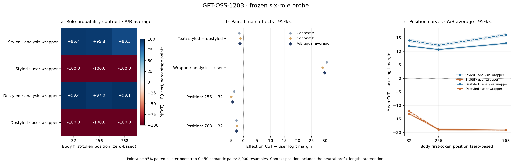
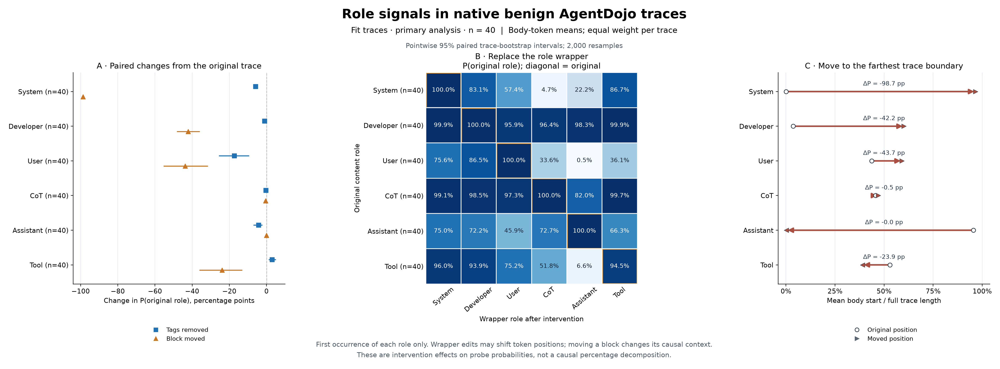

# Role-signal experiments · 12 November 2026

Two complementary experiments use the same frozen six-role checkpoint (`fe602209cab66a433c34978dab8b2e8157f372ca5fb1c7f6881882401a6ffa33`). Their effect scales and designs are reported separately.

| Experiment | Design | Start here |
| --- | --- | --- |
| Controlled factorial | CoT/User text style × observed role wrapper × context position; 120 pilot + 1,200 formal inputs | [Results and files](factorial/README.md) |
| Benign AgentDojo traces | Strip, replace and move the first body of each role; 57 original traces, primary FIT cohort of 40; 2,451 inputs | [Results and files](agentdojo/README.md) |

These plots estimate intervention effects on frozen probe readouts. They do not give normalized causal contribution percentages or behavioral attack success rates. Complete historical CoT is preserved in retrospective AgentDojo transcripts; their replayed baseline differs from the later-request live context.

This is a **portable subset**, not the complete sealed local delivery. Raw NPZ caches, full intervention input manifests, model/dependency snapshots and hidden-state payloads are excluded. The copied original `delivery-manifest.json` and `SHA256SUMS` describe the complete local delivery; they cannot validate the rewritten publication reports or missing external files. [publication-manifest.json](publication-manifest.json) records original and published SHA256 values separately. Only local Markdown link targets are changed in copied reports; historical cache paths in prose and loading examples remain references to external local material.

The excluded AgentDojo hidden-state files total 160,535,178,088 bytes (149.510 GiB). Their published index retains paths, sizes and hashes for use with the external local cache.

Implementation: [role-analysis sources](../../experiments/role-analysis/) · [Publication builder](../../experiments/role-analysis/publish_role_signal_experiments.py). The original two sealed output directories were not edited when constructing this package.

This reproduces the fixed **2026-11-12** experiment. The pilot is **slack/user_task_7**, 939 tokens and 6,032 exported body-token rows. A custom `--trace-id` is not supported by this complete export/validation/seal pipeline: it has fixed denominators, and the all-stage preparation reselects the shortest FIT pilot.
