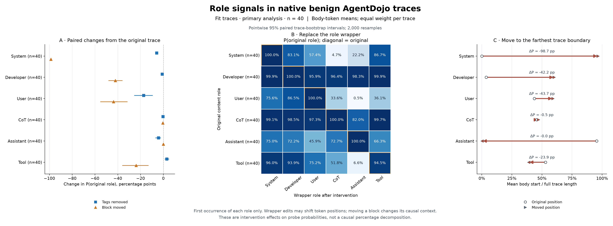

# Benign AgentDojo role interventions

[Chinese report](README.zh-CN.md) · [English conclusions](all/conclusions.en.txt) · [English caption](all/figure-caption.en.txt) · [Single-trace pilot](PILOT.zh-CN.md)

The primary outcome is the mean token-level **probability of the original role**, averaged equally over the 40 FIT traces. The complete 57-task cohort is reported separately. Every intervention preserves the original target body token IDs.

Figures for [FIT 40](all/analysis/fit/) and [all 57](all/analysis/all/) include PNG, PDF and SVG versions of the main effects, wrapper destination attraction, full six-role distributions and token curves.

Portable data: [FIT effects](all/analysis/fit/effects.csv), [wrapper swaps](all/analysis/fit/swap-effects.csv), [all six-role probabilities](all/analysis/fit/full-role-probabilities.csv), [per-input means](all/input-summary.csv), [719,832 token readouts](all/token-readouts.parquet), [hidden-state index](all/hiddenstates-index.parquet), and [exact chronological source trace IDs](sources/traces.jsonl).

The trace JSONL schema contains `trace_id`, `source_split`, exact `input_ids`, `allow_terminal_body`, and token-level provenance. It is sufficient, with the committed intervention builder, to reconstruct the excluded 107 MB all-stage input manifest. The original DEV banking/9 restart and FIT travel/19 length-censored terminal body remain explicitly represented.

Audits: [all inputs/readouts/hidden states](all/independent-validation.json), [independent statistics](all/analysis/independent-statistics-validation.json), and [bitwise Parquet/NPZ comparison](all/export-independent-validation.json). Logits and probabilities in the portable Parquet are bit-exact copies of all 2,451 NPZ readouts, as recorded by that comparison.

Reproduction: [instructions](REPRODUCE.txt), [requirements](reproduction/requirements.freeze.txt), [environment and dependency paths](reproduction/environment.json), [external assets](reproduction/external-materials.json), [protocol](all/protocol.json). The instructions preserve historical machine paths as provenance; update `REPO`, `MODEL`, `SOURCE`, `ARCHIVE` and the fresh output path to match your environment. The generated postprocessing shell script also contains historical absolute paths and is a record of the original execution environment.

This is the fixed 2026-11-12 pipeline: pilot **slack/user_task_7**. Custom `--trace-id` values are outside the complete export/validation/seal contract (fixed 6,032 pilot token rows; all-stage preparation reselects the shortest FIT pilot).

Hidden-state paths in the index are relative to the **external original experiment root**, not to this publication folder. For a local cache, use the published index to select an entry and join `entry.path` to that external root. [Loading example](all/hiddenstates-loading-example.txt) preserves the original local root and must be adjusted for another machine. The 160,535,178,088 bytes of BF16 hidden-state payloads are not bundled here.

This is a **portable subset**, not the complete sealed local delivery. Raw NPZ caches, full intervention input manifests, model/dependency snapshots and hidden-state payloads are excluded. The copied original `delivery-manifest.json` and `SHA256SUMS` describe the complete local delivery; they cannot validate the rewritten publication reports or missing external files. [publication-manifest.json](../publication-manifest.json) records original and published SHA256 values separately. Only local Markdown link targets are changed in copied reports; historical cache paths in prose and loading examples remain references to external local material.
