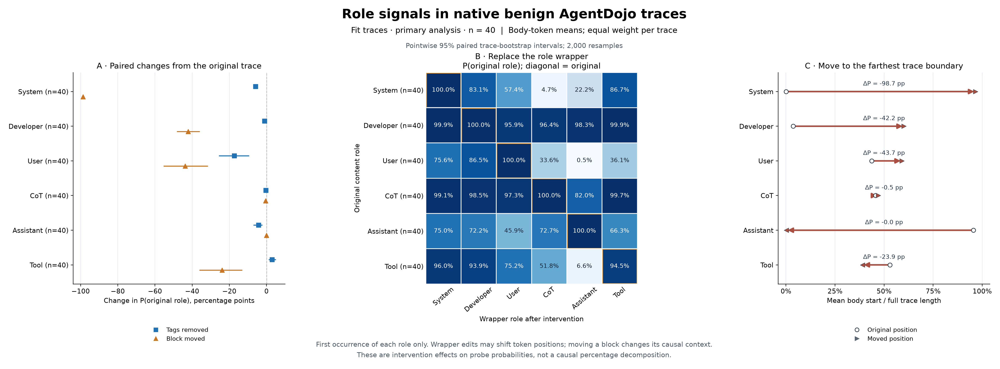

# Benign AgentDojo traces 的角色包装与位置干预

在单条试运行结果反馈之后，完成全部 57 条原始 benign 任务的 2451 个条件。主分析对 checkpoint 实际 FIT 的 40 条训练 trace 等权平均；另对完整 57 条（FIT 40、DEV 8、TEST 9）单独汇总。每条 trace 只选每种角色第一次出现的普通正文。

[英文主图 PDF](all/analysis/fit/role-interventions-main.pdf) · [新包装角色概率](all/analysis/fit/wrapper-destination-attraction.pdf) · [完整六类分布](all/analysis/fit/full-six-role-probabilities.pdf) · [逐 token 曲线](all/analysis/fit/role-token-curves.pdf)

去标签后原角色概率下降最多的两类是 User（-17.35 pp）、System（-5.91 pp）；整体移到最远边界后下降最多的是 System（-98.69 pp）、User（-43.70 pp）。 这些差值反映具体干预下的冻结 probe 读出变化。

去标签的影响因角色而异：保留原正文与前文上下文时，Developer 与 CoT 的原角色概率仍分别为 98.99% 和 99.60%；User 为 82.65%（-17.35 pp）。Tool 则变化 +3.03 pp，说明正确包装并非对所有正文都表现为统一的概率增益。

保留完整正文与正确包装、整块移动时，System 从 100.00% 变为 1.31%；Developer 与 User 分别变为 57.84% 和 56.30%。CoT 与 Assistant 则仍为 99.53% 和 99.99%。因此，完整正确包装本身不足以保证位置与上下文变化后的原角色读出保持稳定。

更换为 Assistant 包装时，User 正文的 P(User) 为 0.52%，P(Assistant) 为 98.92%；Tool 正文的 P(Tool) 为 6.59%，P(Assistant) 为 93.07%。正文 token 不变时，包装可以强烈改变这些角色的读出；这种敏感度并不在六类正文之间一致。

## 40 条训练 trace 的主结果

表中 P 均为目标正文对其原角色的平均概率；pp 为百分点，方括号内是 95% 配对 trace-cluster percentile bootstrap 区间。每条正文先对 token 求均值，再对 trace 等权平均，2000 次重采样、seed 20261112；同一 trace 的全部干预始终保留在同一重采样单元内。区间为逐项区间，不作多重检验显著性声明。重采样未按共享 system/developer/schema 模板家族聚类，因此不能把区间解释为模板独立的不确定性评估。

| Role | Replayed baseline P | Tags removed P | Change in pp | Farthest moved P | Change in pp |
| --- | ---: | ---: | --- | ---: | --- |
| System | 100.00% | 94.09% | -5.91 [-5.93, -5.90] | 1.31% | -98.69 [-99.00, -98.34] |
| Developer | 100.00% | 98.99% | -1.01 [-1.14, -0.88] | 57.84% | -42.16 [-48.24, -35.88] |
| User | 100.00% | 82.65% | -17.35 [-25.60, -9.31] | 56.30% | -43.70 [-55.37, -31.55] |
| CoT | 100.00% | 99.60% | -0.40 [-0.53, -0.27] | 99.53% | -0.47 [-1.30, -0.03] |
| Assistant | 100.00% | 95.76% | -4.24 [-7.01, -2.22] | 99.99% | -0.01 [-0.03, +0.00] |
| Tool | 94.49% | 97.52% | +3.03 [+1.19, +5.02] | 70.62% | -23.87 [-36.18, -13.09] |



主图 C 先用每个输入的完整 token 长度归一化正文起点，再对 trace 求平均。箭头连接平均相对位置，不代表每条 trace 都朝同一方向移动。

## 更换角色包装

下表行是正文原角色，列是替换后的包装角色，数值为 **P 原角色**。对角线是原始正确包装；每个非对角单元对应一次独立替换，不进行累计改写。`wrapper-destination-attraction` 图另外显示 **P 新包装角色**，完整六类分布保存在 CSV 与逐 token readouts 中。

| Original content role / replacement wrapper | System | Developer | User | CoT | Assistant | Tool |
| --- | ---: | ---: | ---: | ---: | ---: | ---: |
| System | 100.0% | 83.1% | 57.4% | 4.7% | 22.2% | 86.7% |
| Developer | 99.9% | 100.0% | 95.9% | 96.4% | 98.3% | 99.9% |
| User | 75.6% | 86.5% | 100.0% | 33.6% | 0.5% | 36.1% |
| CoT | 99.1% | 98.5% | 97.3% | 100.0% | 82.0% | 99.7% |
| Assistant | 75.0% | 72.2% | 45.9% | 72.7% | 100.0% | 66.3% |
| Tool | 96.0% | 93.9% | 75.2% | 51.8% | 6.6% | 94.5% |


逐 token 变化见 `role-token-curves` 图：单条试运行按原始正文 token 对齐，全量按正文相对位置分成 20 个区间，先在每条 trace 内取均值，再对有该区间 token 的 trace 等权平均。短正文可能没有覆盖所有区间；CSV 逐格记录实际支持数。

## 全部 57 条 trace 的平均

| Role | Replayed baseline P | Tags removed P | Change in pp | Farthest moved P | Change in pp |
| --- | ---: | ---: | --- | ---: | --- |
| System | 100.00% | 94.09% | -5.91 [-5.93, -5.90] | 1.25% | -98.75 [-98.99, -98.47] |
| Developer | 100.00% | 98.99% | -1.01 [-1.12, -0.89] | 57.17% | -42.83 [-48.32, -36.75] |
| User | 99.99% | 81.68% | -18.31 [-25.83, -11.61] | 58.85% | -41.14 [-51.42, -31.55] |
| CoT | 100.00% | 99.56% | -0.43 [-0.57, -0.32] | 99.62% | -0.38 [-0.95, -0.05] |
| Assistant | 100.00% | 96.38% | -3.62 [-5.61, -2.16] | 99.98% | -0.02 [-0.04, -0.00] |
| Tool | 92.60% | 96.15% | +3.56 [+1.57, +5.52] | 70.35% | -22.24 [-32.13, -12.40] |


去标签的影响因角色而异：保留原正文与前文上下文时，Developer 与 CoT 的原角色概率仍分别为 98.99% 和 99.56%；User 为 81.68%（-18.31 pp）。Tool 则变化 +3.56 pp，说明正确包装并非对所有正文都表现为统一的概率增益。

保留完整正文与正确包装、整块移动时，System 从 100.00% 变为 1.25%；Developer 与 User 分别变为 57.17% 和 58.85%。CoT 与 Assistant 则仍为 99.62% 和 99.98%。因此，完整正确包装本身不足以保证位置与上下文变化后的原角色读出保持稳定。

更换为 Assistant 包装时，User 正文的 P(User) 为 0.50%，P(Assistant) 为 98.82%；Tool 正文的 P(Tool) 为 5.88%，P(Assistant) 为 93.74%。正文 token 不变时，包装可以强烈改变这些角色的读出；这种敏感度并不在六类正文之间一致。

完整数据的均值与 FIT 主分析分开报告，不把包含训练来源的结果当作未见任务泛化表现。[全 57 条主图 PDF](all/analysis/all/role-interventions-main.pdf) · [逐 token 曲线](all/analysis/all/role-token-curves.pdf)。

## 来源与运行轨迹

使用用户上传的 `/home/wz55191/full57_no_payload_first_occurrence_probe_v7_20261027.tar.gz`。压缩包 SHA256 为 `a903675f210a5695060f6418d6d62360f27190cbf1dad8b12934321b7eff1078`。1673 个原始封存文件与源清单逐个核验一致，checkpoint 实际消费的 1080 个来源文件也匹配。数据共 57 个唯一 benign 任务、359 次模型调用和 58 次 native pass，没有注入 payload。

“完整 running trace”由第一份原生提示、每次原始生成 token（含 CoT 和工具调用）以及后来首次可见的原生工具返回按时间拼接。保存所有 79552 个原始生成 token，且每个只出现一次；不重复加入后续请求中重渲染过的工具调用。342 个首次角色正文与训练位置逐 token 对应；原训练保留的全部 155103 个普通正文位置均能在轨迹中追溯。原始 API 会在后续请求里删除早期 CoT，所以这里是保留完整思考过程的回顾性轨迹重放，不能把新 baseline 当作历史实时调用概率。

DEV 的 `banking/user_task_9` 包含两次真实 pass，重置边界明确记录。FIT 的 `travel/user_task_19` 有一个真正因 1024-token 上限而截断的终端 assistant 正文；保留可见正文及缺失结束标签的状态，不补造 token，也不删除这个样本。替换或移动均按该包装原样操作，这一例在来源清单和输入中有标记。

## 三类干预定义

1. 脱标签：只移除目标正文现有的完整起始 header 和结束标记，正文原始 token IDs 不变。
2. 换标签：复制同一条 trace 中另一角色首次正文的完整原生包装，保留原正文；每个原角色覆盖其余五类。assistant 的结构化工具调用 JSON 保留在上下文中，不当作普通 Assistant 目标。CoT 对应 assistant analysis channel，Assistant 对应普通 final/commentary 正文。
3. 最远移动：把目标完整包装与正文作为整体移到 trace 两端中 token 位移最大的边界，距离相同则移到开头；其他内容的相对顺序不变。独立检查与所有剩余消息边界比较，确认距离最大。

每条 trace 共 1 baseline、6 次脱标签、30 次换标签、6 次移动。干预分别从原始 trace 出发；从不把一个干预结果当作下一个的输入。所有输入完整前向，没有截断、mask padding、文本生成或真实工具执行。

## Checkpoint 与数值接口

统一使用指定 checkpoint 的本地同源副本，SHA256 `fe602209cab66a433c34978dab8b2e8157f372ca5fb1c7f6881882401a6ffa33`。它绑定原生 MXFP4 GPT-OSS-120B、固定顺序的 16 个 pre-o_proj 注意力头和 1024 维特征，六类顺序为 System、Developer、User、CoT、Assistant、Tool。BF16 原生特征按原接口转换为 FP16，再以 FP32 标准化并经冻结的 MLP256 exact GELU 输出 logits 和 softmax。模型与 probe 均为 eval 状态，没有重新训练或选择 checkpoint。

新 baseline 和全部干预都用同一个冻结 probe、同一运行后端重算，未使用源归档旧 probe 的概率作基准。原生 MXFP4/BF16 在输入形状变化时可能存在数值差异；本实验报告该固定实现上的实际读出。

## Hidden states 与可复现文件

本阶段涉及 2451 个输入，hidden states 总量 149.51 GiB。每个输入保存目标正文 token 的 embedding、全部 36 层 post-block residual states 和 final norm 输出，使用原生 BF16；另存有序 16-head pre-o_proj BF16 特征、实际 probe 输入 FP16 特征及 token 位置。baseline 保存六种首次正文的并集，单个干预保存被干预正文。它们不是全 trace 每个上下文 token 的激活缓存。

原始文件位于 `/scratch/wz55191/Github/prompt-injection-as-role-confusion/experiments/role-analysis/outputs/agentdojo-trace-interventions-20261112/hiddenstates/`。`all/hiddenstates-index.parquet` 提供路径、SHA256、字节数和条件索引；正文 mask 和完整输入 IDs 在 `all/inputs.jsonl`，逐 token logits/概率在 `all/token-readouts.parquet` 与共享 `readouts/` 中。原始训练 trace 与映射位于 `sources/`。

[Hidden states 索引](all/hiddenstates-index.parquet) · [逐 token 读出](all/token-readouts.parquet) · [读取示例](all/hiddenstates-loading-example.txt) · [复现说明](REPRODUCE.txt)

```python
from safetensors.torch import load_file
states = load_file("/absolute/path/to/hiddenstates/INPUT_ID.safetensors")
layer12 = states["residual_layer_12"]  # [scored_body_tokens, 2880], torch.bfloat16
positions = states["positions"]      # exact token indices in the modified trace
features = states["probe_features_fp16"]  # [scored_body_tokens, 1024]
```

被动 hiddenstate hooks 已在 pilot baseline 上与不带这些 hooks 的前向逐位比较，16-head 特征完全一致。独立审计核验每个输入的 token 来源、标签改写、最大距离移动、所有 hiddenstate 文件哈希、38 组浮点状态的形状/dtype/有限性，以及实际 BF16→FP16 读出特征；还用独立 NumPy 与 math.erf 重算所有已保存 token 的 probe 概率，并复核输入均值。统计表由另一份不导入分析器的实现独立重算。Parquet 中全部 719,832 行的坐标、token ID、logits 和概率也与原始 NPZ 逐位比较一致。记录见 `all/independent-validation.json`、`all/analysis/independent-statistics-validation.json` 和 `all/export-independent-validation.json`。

## 结论范围

脱标签或换标签也可能改变正文的绝对起始位置；最远移动同时改变可见前文和位置。因此这些是包装干预与上下文位置干预的效应。去标签后仍保留高 P，只能说明剩余正文、位置和上下文共同足以支持该 probe 读出，不能单独计算“文本贡献百分比”。不同角色使用不同来源正文和长度，角色间差值也不等于纯因素贡献分解。

训练 trace 是用户指定的分析对象，且多个任务共享系统提示、开发者提示和工具 schema；这里描述固定来源上的模型内部读出，不据此推断 ASR、指令优先级、未见模板泛化或其他模型。
