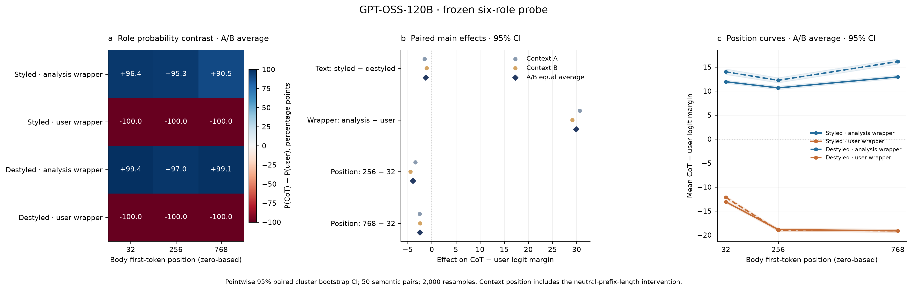

# Controlled role-signal factorial

[Chinese report](README.zh-CN.md) · [English figure caption](figure-caption.en.txt) · [Reviewer response](reviewer-response.en.txt) · [Main PDF](figures/role-signal-main.pdf)

The primary outcome is the body-token mean CoT−User **logit margin**. Text style, observed role wrapping, context position, interactions and family/length sensitivities are reported as separate contrasts.

Portable data: [effects](effects.csv), [condition means](condition-means.csv), [interactions](interactions.csv), [family sensitivity](effects-family-sensitivity.csv), [length sensitivity](length-sensitivity-effects.csv), [per-input means](input-summary.csv), [all token readouts](token-readouts.parquet), [source pairs](pairs.jsonl).

Reproduction: [original script](reproduce.sh), [requirements](requirements.txt), [protocol](protocol.json), [independent validation](validation-independent.json). Run the commands from the repository with the model/checkpoint prerequisites available; set `ROLE_SIGNAL_MODEL` and `ROLE_SIGNAL_PYTHON` as appropriate. The full readout NPZ caches remain external.

This is a **portable subset**, not the complete sealed local delivery. Raw NPZ caches, full intervention input manifests, model/dependency snapshots and hidden-state payloads are excluded. The copied original `delivery-manifest.json` and `SHA256SUMS` describe the complete local delivery; they cannot validate the rewritten publication reports or missing external files. [publication-manifest.json](../publication-manifest.json) records original and published SHA256 values separately. Only local Markdown link targets are changed in copied reports; historical cache paths in prose and loading examples remain references to external local material.
