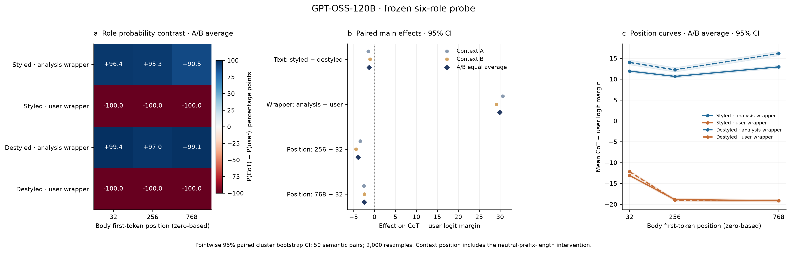

# 文本风格 角色包装与上下文位置对角色读出的影响

2026 年 11 月 12 日完成。主实验为 CoT 与 User 的配对交叉设计，使用指定 checkpoint 的同源本地文件，完成 **1200 条正式输入、120 条独立 pilot 和 12 条新中性正文包装检查**；另补跑 **1200 条正式输入的数值敏感性检查**。24 条临时输入只做构造检查。在本设计中，完整角色包装产生最大的平均角色读出变化，受控思考式表达相对客观推理表达的变化为负。下表单位为正文平均 `z_cot − z_user` 的变化；正值表示相对向 CoT 移动，负值表示相对向 User 移动。两套中性前文先在语义单元内等权平均。

| 对比 | 估计 | 95% 区间 |
| --- | ---: | --- |
| 文本风格 styled 减 destyled | -1.272 | [-1.515, -1.024] |
| 角色包装 analysis 减 user | +29.883 | [+29.581, +30.216] |
| 上下文位置 256 减 32 | -3.911 | [-4.112, -3.711] |
| 上下文位置 768 减 32 | -2.463 | [-2.689, -2.248] |

## 实验设置与 checkpoint

原请求路径 `/home/wz55191/Github/SPAR/prompt-injection-as-role-confusion/experiments/role-analysis/outputs/c4-dolma3-single-agentdojo-mixed-2080ti-20261103/checkpoint.npz` 在本机不存在。使用同一实验归档的本地文件 `/scratch/wz55191/Github/prompt-injection-as-role-confusion/experiments/role-analysis/outputs/c4-dolma3-single-agentdojo-mixed-2080ti-20261103/checkpoint.npz`，SHA256 为 `fe602209cab66a433c34978dab8b2e8157f372ca5fb1c7f6881882401a6ffa33`，与归档 `SHA256SUMS`、`artifact-validation.json` 以及既有 scorer 常量一致。

该 checkpoint 绑定 GPT-OSS-120B 原生 MXFP4 backbone、16 个固定顺序的 pre-o_proj 注意力头和 1024 维特征，经 MLP256 与 exact GELU 输出 `system, developer, user, cot, assistant, tool` 六类 logits。特征转换保持 BF16 → FP16 → FP32。模型和 probe 均冻结，不训练或按结果更换 checkpoint。计划默认的 20B 第 12 层五角色设置因此改为指定 checkpoint 的原有接口；没有将它错误应用于单独层，也没有混合历史五角色概率。

正式 50 个语义单元分别具有第一人称思考式版本和客观推理版本。所有前提、推导和结论保持一致，仅替换六处表达过渡。正文长度 148–193 tokens。每个单元覆盖两种风格、两种原生包装、三个位置和两套中性前文，共 24 条输入。文本属于新编写的受控推理表达，不能称为自然生成的模型 CoT。62 个来源单元的配对语义和算术已独立审核，见 `pair-review-independent.json` 及 `role_signal_pairs-audit.json`。

固定短 system 前缀为 `You are a helpful assistant.`；显式使用原生 Harmony 特殊 token 构造最小消息格式，避免 chat template 自动长前缀超过最早位置。CoT header 为 assistant/analysis，长度 5 tokens；user header 长度 3 tokens。两者都用 `<|end|>` 结束。前置完整 user 消息包含中性描述；用可复现的句子前缀与自然结句达到精确位置，补偿两种 header 的 2-token 长度差。每条实际前文、正文范围、header 起点和完整原始 IDs 均保存在 `inputs.jsonl`。正文跨边界混合 token 排除数为 0。

10 个 pilot 与 50 个正式来源互不重合。正式样本数、输入和主分析在正式读出前冻结，pilot 不用于选择 probe 或检验显著性。条件按固定 seed 在每个阶段随机执行。所有输入单条完整前向，无 padding 或截断；硬件为两张 H100 80GB，使用原始 eager attention 的 query tiling。主实验前向流程耗时 235.0 秒，完整长度敏感性补跑耗时 142.0 秒，详见 `runtime.json`、`run-manifest.json` 与 `numerical-length-sensitivity/run-manifest.json`。

## 主效应 交互和不确定性

每条输入先在预定义正文 token 内平均原始 logit 差，再对语义单元等权平均。Text 和 Wrapper 效应在其余因素水平间等权平均；Position 报告 256 对 32 和 768 对 32。原始六类概率全部保留，辅助图的概率变化以百分点表示。没有从平均概率反推 token logits，也没有计算总和为 100% 的贡献比例。

按 50 个完整语义单元进行 2000 次配对 cluster bootstrap，seed 为 20261112。每次同时保留该单元全部条件和 A/B 两套前文，因此 A/B 不作为 100 个独立样本。区间是逐项 95% percentile 区间，不作同时覆盖或多重检验显著性声明。`effects.csv` 和 `interactions.csv` 分别保留 A、B 和等权汇总。

Text × Wrapper 定义为 `(styled − destyled) 在 analysis 包装下的效应 − (styled − destyled) 在 user 包装下的效应`。对应 logit-margin 结果为：

| 对比 | 估计 | 95% 区间 |
| --- | ---: | --- |
| Text × Wrapper 在 32 | -1.152 | [-1.782, -0.545] |
| Text × Wrapper 在 256 | -1.706 | [-2.205, -1.178] |
| Text × Wrapper 在 768 | -3.201 | [-3.695, -2.708] |
| 交互差值 256 减 32 | -0.554 | [-1.078, -0.008] |
| 交互差值 768 减 32 | -2.050 | [-2.667, -1.435] |

正式单元共享 20 种推理家族和相同的风格过渡模板。补充分析重抽 20 个完整家族，按抽中语义单元数归一化，保留原有的等语义单元点估计；这改变不确定性的假设。其主效应区间如下，家族间仍共享的风格模板限制了总体外推。

| 对比 | 估计 | 95% 区间 |
| --- | ---: | --- |
| 文本风格 styled 减 destyled | -1.272 | [-1.656, -0.888] |
| 角色包装 analysis 减 user | +29.883 | [+29.406, +30.361] |
| 上下文位置 256 减 32 | -3.911 | [-4.186, -3.685] |
| 上下文位置 768 减 32 | -2.463 | [-2.778, -2.178] |

## 测量检查

每类用两个新中性正文做原生格式检查，下表对两个正文等权平均。此诊断仅 2 个正文，不是新的泛化基准。Developer 与 Tool 在这些最小上下文中表现较弱，应保留这一测量限制；主实验仅比较 CoT 和 User。

| 角色 | 正确角色平均概率 | token argmax 比例 |
| --- | ---: | ---: |
| system | 0.9999 | 1.0000 |
| developer | 0.5977 | 0.6365 |
| user | 1.0000 | 1.0000 |
| cot | 0.9088 | 0.9555 |
| assistant | 1.0000 | 1.0000 |
| tool | 0.3273 | 0.3001 |

独立验证已通过：逐条检查完整 12 或 24 条件、精确正文 token IDs 与三个位置、原生 header、逐 token softmax、全部输入汇总和全部效应及 bootstrap 区间；另对 10 个固定抽样输入使用独立 NumPy 与 math.erf 实现重算 probe。独立 probe 最大 logit 差 1.56e-05，最大概率差 1.62e-06。正文总读出 token 数为 229,452。单条重放和移除正文后结束符的数值诊断见 `forward-validation.json`。

## 运行后端的输入长度敏感性

三个事先固定的输入重复前向得到完全相同的特征和读出。把正文后的结束 token 等长替换成 return 特殊 token 或普通 token，三条输入的正文特征、logits 和概率也全部逐位一致。删除这一 token 改变输入长度后，正文特征出现 3.7%–9.7% 的相对 L2 差异；正文平均 margin 改变约 +0.043、+0.591 和 +0.466，其中 CoT 平均概率最大改变约 −2.75 个百分点。原生 MXFP4 与 BF16 计算因输入形状改变而产生的数值变化不能按近零误差处理；等长替换检查仅支持这三条输入没有未来内容泄漏，不能作为全局证明。

据此新增事后数值敏感性实验：对全部 1200 条正式输入仅移除正文后的结束 token，保留全部正文及其前文 IDs、位置和条件。原主实验数据和冻结分析均保持不变。替代读出与主读出采用同一批语义单元和同一组 2000 次配对 bootstrap，直接对效应差值计算区间。

| 对比 | 原主估计 | 无结束符估计 | 改变 | 改变的 95% 区间 |
| --- | ---: | ---: | ---: | --- |
| 文本风格 styled 减 destyled | -1.272 | -1.297 | -0.024 | [-0.090, +0.038] |
| 角色包装 analysis 减 user | +29.883 | +29.929 | +0.046 | [-0.023, +0.113] |
| 上下文位置 256 减 32 | -3.911 | -3.881 | +0.030 | [-0.030, +0.094] |
| 上下文位置 768 减 32 | -2.463 | -2.497 | -0.034 | [-0.111, +0.051] |

四项主效应方向全部一致。完整四项主效应、五项交互、A/B 前文和全部概率指标的原估计、替代估计与差值区间见 `length-sensitivity-effects.csv` 和 `length-sensitivity-interactions.csv`。这项检查量化了该长度扰动的影响；它不能消除风格版本本身多 13 tokens 的混杂，也不能证明其他运行后端或序列长度下的数值一致性。

## 图与复现文件

主图为 `figures/role-signal-main.pdf`，PNG 便于预览，SVG 便于编辑。补充图包括所有六类概率、概率效应、交互、两套前文的完整位置曲线，以及家族 bootstrap 和输入长度敏感性。所有图均有 PDF、PNG 和 SVG。可直接使用的英文图注为 `figure-caption.en.txt`，review 回复草稿为 `reviewer-response.en.txt`。

原始输入见 `inputs.jsonl`；逐 token logits、概率和特征见 `readouts/`；可重新汇总的长表见 `token-readouts.parquet`；逐输入均值见 `input-summary.csv`。`protocol.json` 保存冻结身份和口径，`validation-independent.json` 保存独立复核，`export-manifest.json` 与 `SHA256SUMS` 保存来源和产物哈希。代码快照见 `code/`，复现命令见 `reproduce.sh`。

## 结论范围

这些效应仅描述指定冻结 probe 在该受控语义集合和模板设计上的角色读出。角色包装同时改变角色文字、channel、特殊 token 和为匹配位置所作的中性前文微调；长度补偿可替换前文的结尾句，并非仅在相同前文后添加两个 token。user 条件包含相邻的中性 user 消息和目标 user 消息。上下文位置同时改变可见前文长度与内容。因此不能称为特殊 delimiter token 或纯位置编码的独立贡献。正文样式只覆盖六处受控表达变化，styled 版本固定长 13 tokens，不能将该效应解释为完全独立于长度的纯文风贡献。

本次完成计划推荐的 CoT/User 双前文主实验。User/Tool、System/User 以及 delimiter 结构 token 的独立消融属于后续扩展；本次不据此推断 ASR、指令优先级或其他角色对比。指定 checkpoint 是跨层联合读出，没有与各层分别匹配的同一 checkpoint probe，因此不生成会混淆测量接口的逐层贡献图。
