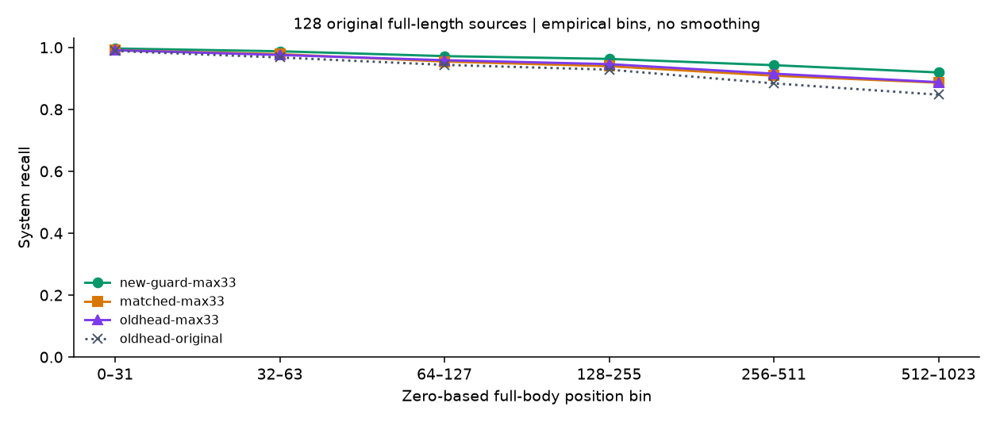
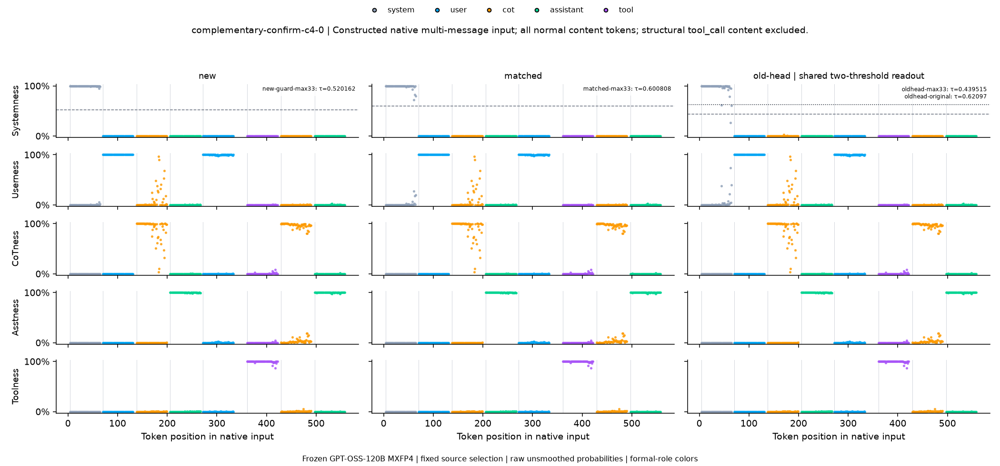
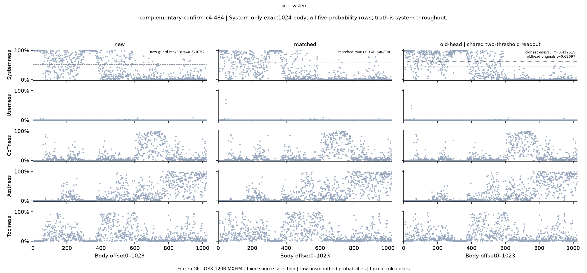
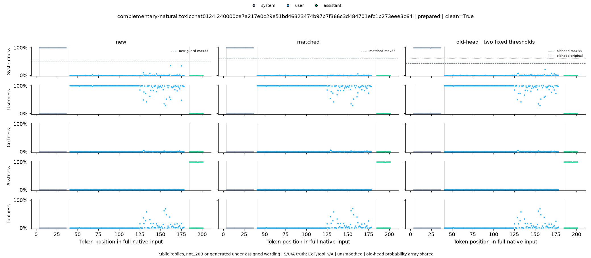

# 从原文章到当前最优 checkpoint：GPT-OSS-120B 角色分类器训练指南

这份文档回答三个问题：原文章怎样训练角色分类器；我们在它的基础上改了什么；怎样按实际训练顺序重建当前方案，以及怎样检查结果。

这里的“从零”是指**从官方已经预训练好的 GPT-OSS-120B 出发，训练旁边的小分类器**。120B 本体一直冻结，没有进行全参数微调或 LoRA。4 张 A40 主要负责运行大模型、读取内部信号；后面的分类器训练只更新少量参数。

本文以结果提交 `f261688` 的记录为准。“最优”指本轮候选、数据和预定选择规则下通过独立确认的版本，不代表所有角色、每篇文章或所有分布上都最好。

零基础可以先读第一至五节，理解方法和效果；准备动手时，再看第六至八节的命令、前置条件和文件核验。

## 一、原文章是怎么做的？

原文章是 Charles Ye、Jasmine Cui、Dylan Hadfield-Menell 的 [《Prompt Injection as Role Confusion》](https://arxiv.org/html/2603.12277v6)，作者还有一篇[通俗版说明](https://role-confusion.github.io/)。本文关注它的角色探针训练，不重现其中的攻击生成和攻击成功率实验。

作者想研究：**一段文字明明放在工具返回里，大模型为什么可能把它当成用户命令，或者当成自己的推理？**

他们的测量方法可以理解为“给大模型接一个角色仪表”：

1. 找一段普通网页文字。
2. 正文保持不变，分别放进 system、user、CoT、assistant、tool 等角色格式。
3. 大模型保持冻结，读取正文每个 token 的内部向量。token 是模型处理文字的小单位，不一定对应一个汉字或一个单词。
4. 训练一个线性分类器，根据这些向量猜角色。
5. 再把分类器用于真实对话，以及“去掉标签”“统一包进 user”等测试，观察角色分数怎样变化。

同一正文配不同角色，是为了减少“只看文章内容猜角色”的捷径。**训练输入保留角色标签，但训练样本只取正文位置，不把标签 token 本身当成需要分类的正文。**这是两件不同的事。[方法来源：论文 §4、附录 G](https://arxiv.org/html/2603.12277v6)。

### 作者公开代码里的具体设置

以下细节来自[作者原始代码提交 `0af1464`](https://github.com/role-confusion/prompt-injection-as-role-confusion/tree/0af14644db45120963896c18bf2c2cf82162fad4)，不把本地后续修改倒算成原文设置。

| 项目 | 作者代码的做法 |
|---|---|
| 训练正文 | C4 与 Dolma3 的普通预训练文本，每条最多 1024 token |
| 数量 | 论文描述为 250 条；代码分别对 25% 和 75% 取整，实际为 62＋187＝249 条 |
| 五角色版本 | 249 条正文可构成 1245 个角色包装序列；不同角色子集另训探针 |
| 输入特征 | GPT-OSS 的 `post_attention_layernorm` 输出，即进入 MLP 前的内部向量 |
| 分类器 | 带 L2 正则的多项逻辑回归，可以理解成简单的线性打分器 |
| 数据划分 | 原代码按包装后的 prompt 做 90/10 划分；同一正文的不同角色版本可能跨划分 |
| 角色组合 | 原始模板正常支持 system；原公开 notebook 的 120B 默认只训 UA（user＋assistant）／UAT（再加 tool）子集，CoT 与 system 的扩充分支放在 20B 条件中。我们把 120B 也明确扩到五类；这不等于论文所有 120B 实验都只有这两个子集 |

角色含义如下。CoT 和 assistant 是同一个模型的不同输出通道，不是两个模型。

| 角色 | 这里的含义 |
|---|---|
| system | 系统消息正文 |
| user | 用户消息正文 |
| cot | assistant 的 `analysis` 推理通道正文 |
| assistant | assistant 的 `final` 回答正文 |
| tool | 工具返回的正文 |

### 原文章的效果图：正常标签与去标签

下面两张是作者原仓库里的图，文件与作者原始提交逐字节一致，**不是本次重新绘制的图**。


*图 1：作者原始 tomato 对话，保留正常标签。模型为 GPT-OSS-20B，使用零基第 12 层、SUCA（system／user／CoT／assistant）四类线性探针。蓝色是原 user 正文，橙色是原 CoT，绿色是原 assistant。每行的高度表示分类器给该角色的分数；颜色表示文字原来的角色。*


*图 2：同一段对话的 No tags 测试。作者观察到，去掉标签后，很多角色分数仍会随内容风格变化。无标签输入没有可直接照标签计算的正式角色真值，不能把颜色当成正常包装测试的准确率标签。*

读这两张原图时，注意三个细节：

- 原绘图先不显示 system 消息正文，因此顶部 Systemness 接近 0 **不能作为 system 识别失败的证据**。
- 每段只画前 160 个 token，再重新排列横轴；这不是完整长文的真实位置曲线。
- 图中选择的是四类探针，没有 tool 概率行；这不等于作者整个方法只支持四类。

原图出处：[正常标签](https://github.com/role-confusion/prompt-injection-as-role-confusion/blob/0af14644db45120963896c18bf2c2cf82162fad4/docs/tomato-role-space-projections2-Correct%20tags.png)、[No tags](https://github.com/role-confusion/prompt-injection-as-role-confusion/blob/0af14644db45120963896c18bf2c2cf82162fad4/docs/tomato-role-space-projections2-No%20tags.png)。仓库 `experiments/role-analysis/plots/` 下的同名图是后来本地 20B 复现，本文没有把它们冒充作者原图。

## 二、我们继承了什么，又改变了什么？

继承的是基本思路：**保持大模型不动，利用其内部信号训练角色分类器。**

我们进一步关注：在正常角色格式下，能否把 system 识别得更稳，特别是长文后半段，同时控制其他能力的退步。

| 方面 | 原方法／原代码 | 我们最终采用的方案 |
|---|---|---|
| 大模型 | 作者有多个模型的实验 | 本轮固定 GPT-OSS-120B，原生 MXFP4，4×A40 |
| 角色 | 按模型配置不同子集 | 120B 明确包含 system、user、cot、assistant、tool |
| 正文来源 | 中性网页文本，真实对话主要用于泛化检查 | C4 角色样本，后来另加 255 个干净的公开自然对话训练来源 |
| 划分方式 | 包装后的 prompt 划分 | C4 按原文划分，同一原文的不同角色版本留在同一组 |
| 观察位置 | 某一层的整体内部向量 | 筛选注意力头，最终读取 10 个头、共 640 维信号 |
| 分类器 | 线性分类器 | 先训练五类小 MLP，再冻结它，增加 system 专用修正模块 |
| 选择标准 | 原文的探针有效性检查 | 分别考核短文、多轮、长文和尾部，另设防退步条件 |
| 最终验收 | 原文的角色混淆与行为实验 | 本轮做新的正常标签角色分类测试，不声称完成行为防注入验证 |

这里也有研究目标上的变化：加入自然对话训练后，分类器可能利用对话风格线索。我们不再把最终分类器描述成“只从中性文本学到、完全隔离内容风格的线性测量工具”。**正式角色分类更准，与完全复现原文的可解释性和攻击结论，是不同的事情。**

## 三、从零到一的训练主线

先看模型本身需要的主线，后面的命令表再说明归档代码还有哪些前置依赖。

```text
官方已预训练的 120B（冻结）
    ↓ 读取正文内部信号
C4 角色训练样本，补上真正的长文和后半段
    ↓ 在训练来源内部筛选 8 个注意力头
512 维特征 → 从初始化训练五类 MLP 基础分类器
    ↓ 保留这份已训练权重
追加 2 个互补头，并加入 255 个干净自然对话训练来源
    ↓ 冻结基础分类器，只训练 system 修正模块
new.npz
    ↓ 用验证集选择 system 门槛
固定权重、头顺序、门槛和测试样例
    ↓ 全新 C4＋自然对话确认
最终报告＋30 对 PNG/PDF 图
```

### 第 1 步：准备环境和大模型

归档训练使用的关键版本包括：Torch `2.9.1+cu128`、Transformers `5.3.0`、Accelerate `1.12.0`、Triton `3.5.1`、NumPy `2.2.6`。依据是[依赖清单](requirements-local-4xa40.txt)、[完整包记录](outputs/local-gptoss120b/environment-freeze.txt)和[实际推理记录](outputs/local-gptoss120b/systemness-complementary-confirmation/inference/inference-complete.json)。

在训练机上，从仓库根目录创建独立环境。下面 Python 版本选择沿用 120B runner 的 3.11 说明；不要把当前系统 Python 或原文 README 的环境直接当作已配置好的本轮环境。

```bash
cd /root/prompt-injection-as-role-confusion
uv venv .venv --python 3.11
uv pip install --python .venv/bin/python --index-strategy unsafe-best-match \
  -r experiments/role-analysis/requirements-systemness.txt

export CUDA_VISIBLE_DEVICES=0,1,2,3
export HF_HOME=/root/.cache/huggingface-role-probe
export ROLE_ANALYSIS_LOAD_PATH=/dev/shm/role-analysis-gptoss120b
export PYTHONDONTWRITEBYTECODE=1
export OPENBLAS_NUM_THREADS=4
export OMP_NUM_THREADS=4
export MKL_NUM_THREADS=4

nvidia-smi
df -h /dev/shm
```

从最早的 notebook 数据准备开始，还需要 `datasets`、`nbformat`、`nbclient`、`IPython` 等依赖；`requirements-systemness.txt` 是后续训练阶段的精简清单，不是原始 notebook 全流程的完整锁文件。原 20B 流程另见 [LOCAL-A100.md](LOCAL-A100.md)，不要把两个环境清单不加检查地混装。

本轮官方模型 revision 为 `b5c939de8f754692c1647ca79fbf85e8c1e70f8a`；MXFP4 内核 revision 为 `9fbc1b48e710ac8abf18ea2650ee690d52dc3859`。模型分片合计约 60.77 GiB，另需环境、数据和各阶段特征缓存空间。

当时 `/workspace/gpt-oss-120b` 的 FUSE 挂载读取阻塞，实际改用 `/dev/shm/role-analysis-gptoss120b` 中按官方 SHA 校验的快照。**没有完成与不可读挂载的逐字节比较。**这些是本次运行的具体路径，不是模型下载后自然就会出现的文件。详见[模型来源校验](outputs/local-gptoss120b/checkpoint-cache-verification.json)。

4 张 A40 上每张放 9 层，共 36 层；大模型使用 MXFP4 专家后端，其他计算包含 BF16。采集特征保存为 FP16，小分类器参数保存为 FP32。**`new.npz` 是 FP32 小分类器文件，不是 MXFP4 的 120B 权重文件。**实际加载与后端证明见 [model-backend.json](outputs/local-gptoss120b/systemness-complementary-confirmation/inference/model-backend.json)。

### 第 2 步：准备有正确答案的训练样本

同一段普通正文分别套入不同角色，是基础练习题。例如 system 输入保留：

```text
<|start|>system<|message|>这里是一段普通正文<|end|>
```

GPT-OSS 的 CoT 和可见回答还要正确区分 `assistant ... analysis` 与 `assistant ... final`。这些格式由 [systemness_data.py](systemness_data.py) 的 `native_message()` 构造，不能只把字符串里的 `system` 改成 `cot`。

C4 的主划分为 1200 个训练原文、200 个验证原文、400 个早期测试原文。训练内部再构造单消息、多轮和长文视图。**一篇原文的五个角色版本不是五个独立来源。**

长度检查曾发现：旧长文训练子集的 200 篇中，真正达到 1024 token 的只有 26 篇；原 1200 个 FIT 训练来源中共有 132 篇够长，原 200 个 validation 验证来源中有 31 篇够长。后来使用这些真正够长的来源，并增加对正文后半段的采样。这里的 132 篇是原训练集的子集，不是额外 132 篇新原文。

最终残差训练每轮用下面这些正文位置。这里的“行”是**一个被选中的 token 位置**，不是一整篇文章。

| 组成 | 每轮行数 |
|---|---:|
| C4 单消息 | 192,000 |
| C4 构造多轮 | 189,290 |
| 原长文变体 | 27,840 |
| 真正 1024 正文的采样位置 | 168,960 |
| 原 C4 训练合计 | **578,090** |
| 新增干净自然对话的 S/U/A 内容位置 | **63,403** |
| 最终每轮合计 | **641,493** |

自然对话原计划 256 个训练来源，发现一个来源与历史内容重复后，整篇排除，没有换一个好样本补上，所以实际为 **255 个**。自然对话补充只有 system/user/assistant 真值，没有伪造 CoT 或 tool；每条消息正文最多保留 192 token。

原始 FIT 行中还有 4,160 行旧稀疏长文位置没有进入最终训练。更晚试过的额外 256 篇长文来源也**没有**加入最终这轮的训练行，不能把所有准备过的数据都算作最终训练数据。

[训练标签审计](outputs/local-gptoss120b/systemness-complementary-guard-confirmation-preparation/training-system-tags/audit.json)核对了 122,740 个 system 正例对应的 2,961 个训练输入：其 system 消息 header 均正常保留；另完整重编码检查了其中 64 个输入的位置。只对正文位置计分，不意味着输入删掉标签。

### 第 3 步：筛选观察窗口，先训出五分类基础模型

注意力头可以粗略理解为模型内部的不同观察窗口。本轮读取的是 **`o_proj` 之前，每个 query head 的 64 维输出**，与原文的整层 pre-MLP 向量不同。

先扫描 36 层×64 个头。在训练来源内部，把原 132 篇长文分成 101 篇统计训练、31 篇选头，再筛选 8 个头。没有拿最终新测试集选头。

8 个头按固定顺序拼成 `8×64＝512` 维，比较简单分类器及不同大小 MLP，选中：

```text
512 维输入 → 128 个隐藏单元 → 5 个角色分数
```

这一步才是从初始化训练原五分类基础模型，使用 578,090 行 C4 FIT、五类交叉熵损失。原基础模型实际训练 12 轮，保留第 4 轮的最佳版本。它保存在：

```text
experiments/role-analysis/outputs/local-gptoss120b/systemness-head-probes/models/joint-mlp128.npz
```

输入先做标准化，相当于把大小差别很大的信号调到相近尺度。均值和尺度只用训练行计算，不用验证或测试行。参数与选择记录见 [search-plan.json](outputs/local-gptoss120b/systemness-head-probes/search-plan.json)、[selection.json](outputs/local-gptoss120b/systemness-head-probes/selection.json)。

### 第 4 步：追加两个互补头

仅有原 8 个头时，独立长文测试的尾部召回仍不足。于是继续在训练来源内部寻找能补充信息的头：先固定 32 个候选，再比较 496 对，选中 `247` 和 `2248`。

最终输入顺序如下，**不能随意排序**：

```text
458, 462, 2045, 460, 459, 2047, 456, 997, 247, 2248
```

编号从 0 开始，`头编号＝层编号×64＋层内头编号`。每头 64 维，总输入从 512 维变成 **640 维**。新 128 维的标准化统计也只用原 578,090 个训练位置拟合。

原 8 头特征库约 0.720 GiB，新增 2 头特征库约 0.214 GiB。这只是这些库本身，不是整个复现过程的磁盘需求。源映射、头选择及缓存形状见[互补头设计](outputs/local-gptoss120b/systemness-complementary-head-readout-preparation/root-prospective-design.json)。

### 第 5 步：冻结基础模型，专练 system 修正模块

直接拿自然对话重训全部五类分数时，曾出现 CoT 识别明显退步。因此最终保留原五类模型，另加一个小模块：

```text
原五分类器：前 8 个头的 512 维 → 原来的 5 个打分（冻结）
system 修正器：全部 10 个头的 640 维 → 32 个隐藏单元 → 1 个修正值（训练）
```

修正只加到 system 的原始打分上，其他四类原始打分保持原值。修正量为 `4×tanh(g)`，被限制在约 −4 到 ＋4；这是加到 **logit 原始分数**，不是给百分比直接加 4。之后再转成五类概率。

末层从零初始化，所以一开始相当于没有修正，再逐步学习。训练目标专门问“这个位置是不是 system”，使用二元 BCE 损失。精确形式见后面的技术补充。

这仍不保证其他角色完全不受影响：system 分数改变后，可能把原来的 user 等预测抢成 system。因此还要检查误报率、五类准确率和退步幅度。

| 最后一轮训练项 | 实际设置 |
|---|---|
| 可训练参数 | **20,545**，只属于 system 修正模块 |
| 冻结部分 | 120B、本来的五分类 MLP、原 512 维标准化参数 |
| 每轮训练行 | 641,493 |
| 优化器 | AdamW，学习率 `0.001`，weight decay `0.001` |
| batch size | 4096；每轮 157 次更新，末批 2517 行 |
| 普通 dropout | `0.1`，训练时随机暂时关闭部分单元；不是整头 dropout |
| 梯度裁剪 | `5.0` |
| 随机种子 | `20261021` |
| 最大／最少轮数 | 45／10 |
| 提前停止 | 8 轮没有足够改善时停止；只看原五组验证 system 平均 F1 |
| 实际训练／最终采用 | 跑了 **11 轮、1727 次更新**；采用 **第 3 轮、471 次更新**的版本 |

所以“训练了 11 轮”不等于“最终使用第 11 轮”。训练预算见 [training/new.json](outputs/local-gptoss120b/systemness-complementary-head-readout/training/new.json)。

我们还训练一个同大小的对照：把原来的前两个头重复一遍，凑到 640 维，让它拥有相同参数量、相同数据和初始权重，却不获得那两个新头的信息。最终测试里称为 `matched`。重复坐标仍会改变信号条件与正则化效果，所以这不是能完全隔离单一原因的理想消融。

### 第 6 步：训练结束后，再选 system 门槛

训练负责得到分数；门槛决定什么时候说“它是 system”。门槛太低容易误报，太高容易漏报。

这里分两种输出，不能混在一起：

- **五类分类**：五个概率里取最大者，输出 system/user/cot/assistant/tool。
- **system 二分类**：单独判断 `system 概率 ≥ 门槛`。最终门槛为 **`0.5201616161616162`**。

门槛是在验证集选的，最终新测试不参与选择。校准不更新权重，也不改变五类 argmax。

这一步还保留了一次失败：原门槛约 `0.51512` 的最弱组成绩稍高，但旧自然组 system F1 下降约 2.06 个百分点，超过预定 2 点上限，仍记作失败。随后在复用验证集诊断后，单独提出“先满足保护条件，再挑门槛”的校准试验；492 个原网格门槛里有 37 个符合条件，最终选中约 `0.52016`。旧自然组 F1 为 96.22%，比原来的 98.07% 下降约 1.85 点，在允许范围内。

这不是把失败记录改成成功，而是**同一份权重上的一次新校准决策**。因为反复看过开发验证，它还必须通过后面的全新数据确认。[校准记录](outputs/local-gptoss120b/systemness-complementary-guard-calibration/root-result-summary.json)。

### 第 7 步：封存方案，再打开全新测试集

可以把训练、验证、测试理解为：练习题、模拟考试、最后封存的新考卷。模型、头顺序、门槛和图库来源都先固定，再评估新考卷。

- 新 C4：400 个一般来源＋另 128 个真正 1024 正文来源，共 **528 个独立原文**。64 个配对长变体是那 400 个来源的子集。
- 新自然对话：64 个 OASST＋64 个 ToxicChat，共 **128 个来源**，分配到 32 个新 system 措辞家族。
- 共 **1,320,938 个正常内容评分位置**。最终新测试按全部正常正文位置评分；不要倒推成早期训练也逐 token 全覆盖。
- C4 的尾部、位置分箱、角色版本重复使用原文，不能重复计为新独立样本。
- 自然对话按共享措辞和重复回复关系形成依赖组件，不能把相同 system 措辞下的许多 token 当成许多独立证据。

C4 的 5 个主组与 6 个位置箱、自然的 all/clean×总体/OASST/ToxicChat 分层，均检查 system precision、recall、balanced accuracy 点估计是否达到 90%。区间用 2000 次文档或依赖组件配对 bootstrap 计算。

自然回复来自公开原记录，不是本轮 120B 新生成，也不是在新 system 措辞下生成。因此这里测的是角色分类，不是“是否服从这些新指令”；自然数据没有 CoT/tool 真值，这两项记 N/A。

## 四、效果到底改善了多少？

先把三个容易混淆的词翻译成大白话：

- **Precision（精确率）**：被判成 system 的位置里，有多少确实是 system。
- **Recall（召回率）**：真正的 system 位置里，有多少被找出来。
- **Balanced accuracy（平衡准确率）**：同时照顾“找对 system”和“正确排除非 system”，避免类别数量不平衡掩盖问题。
- **F1**：把 precision 和 recall 合在一起看；只把其中一项做高，F1 通常仍会受另一项拖累。

下文的“点估计”就是在这批样本上算出的数字；“置信区间”用重复抽样估计统计结果的波动范围，不是保证每篇文章都落在其中。

### 4.1 同一批新测试上的公平比较

下面的 old 是**我们项目之前训练的 8 头五分类器**，不是论文作者的 20B 原探针。三者在相同新测试输入上比较，不能用作者旧图和我们新图之间的视觉差异计算提升百分点。

| 新 C4 分组 | 旧 8 头原阈值 recall | 同大小 matched recall | 最终 new recall | 最终 new precision |
|---|---:|---:|---:|---:|
| 单消息 | 97.11% | 98.02% | **99.12%** | 99.33% |
| 构造多轮 | 99.50% | 99.61% | **99.83%** | 99.79% |
| 配对长文子集 | 93.41% | 95.03% | **96.50%** | 97.11% |
| 真正 1024 正文 | 88.07% | 90.89% | **93.84%** | 94.49% |
| 正文 512–1023 | 84.73% | 88.61% | **91.92%** | 92.91% |

长文后半段，new 相对旧分类器的召回提高 **7.19 个百分点**，配对 95% 区间为 **[5.11, 9.44]**；相对同大小 matched 提高 **3.31 点**，区间 **[1.82, 4.79]**。[原始指标](outputs/local-gptoss120b/systemness-complementary-confirmation/report/metrics.csv)、[配对比较](outputs/local-gptoss120b/systemness-complementary-confirmation/report/paired-comparisons.csv)。



*图 3：128 篇新长文的分位置结果。绿色 new，橙色 matched，紫色是旧分类器重新校准门槛，灰色虚线是旧分类器原门槛。横轴是 6 个不等宽位置箱，连线只帮助阅读，不是平滑拟合，也不是每隔相同 token 距离测一个点。末段对应上表的 91.92%／88.61%／84.73%。*

### 4.2 固定多轮样例：怎样读五行、三列图？



*图 4：三个已冻结读出在同一个新样例上的结果。三列依次是 new、matched、old-head；五行是预测 system、user、CoT、assistant、tool 的概率。灰蓝、蓝、橙、绿、紫分别表示正文的真实角色，而不是模型的预测。横轴是原生输入的真实 token 位置，竖线是消息边界；未评分的 header 和结构性 tool-call 内容保留为空白。顶部虚线是 system 门槛，不能用它判断其他四行。*

右边 old-head 列只有一份概率，同时画两个门槛：原门槛和重新校准门槛。它们不是两个独立模型。

### 4.3 保留一个失败得很明显的长文样例



*图 5：这篇预先固定的第 84 号长文，1024 个正文 token 的真值全部是 system，所以所有点都用灰蓝色。理想情况是顶行一直高、其他行一直低；实际在中后段仍有大量错误。new 在这一篇的 system recall 只有 **37.30%**，matched 为 26.66%，旧原门槛为 35.35%；旧重校准门槛反而有 42.38%。总体变好，不等于每篇文章都变好，也不等于 system 问题已经解决。这里讨论的是该 system-only 输入的 recall，不能把另四个角色版本参与汇总的 precision 直接套给这张图。*

### 4.4 自然对话结果

128 个新自然来源上，new 的 system precision 为 **99.83%**、recall 为 **100%**、balanced accuracy 为 **99.99%**。五类输出的 argmax 准确率为 **98.53%**，但这批真值只有 S/U/A。



*图 6：真实标签只有 system、user、assistant，仍展示全部五个输出概率。CoT/tool 有概率曲线不等于它们有测试真值；这两类 recall 为 N/A。图中个别 user 位置有较高 Toolness，也说明分类仍会混淆。公开回复的生成模型不是这轮 120B，不能据图评价 120B 在新 system 指令下的回答质量。*

这张图对应的完整英文对话已导出为 [conversation JSON](examples/fresh-natural-06.messages.json)；[案例说明](examples/fresh-natural-06.md)给出了中文转述、逐角色判对数量和来源核对方法。本例最优分类器判对 185/188 个正文 token，五类 argmax 准确率为 98.40%。

自然组并非所有数字都由 new 领先：matched 的总体 system F1 比 new 高约 **0.024 个百分点**，差异区间跨 0。所以我们选择的是更好满足整体目标、尤其补足长文短板的方案，不是逐项全胜的方案。

### 4.5 这轮结论的边界

全部预声明分层的 system P/R/BAcc **点估计**通过 90% 目标。但尾部 precision 的 95% 区间为 **[89.74%, 95.64%]**，recall 为 **[88.46%, 95.01%]**；不能说两者的 95% 置信下界也已经超过 90%。

我们还没有证明：分类器在所有分布上都最优；它的分数等于大模型内心的可信概率；大模型因此更服从 system；或者这套分类器已经能抵御提示注入。正常角色可解码性和行为安全能力需要分别测量。

[全部 30 对固定 PNG/PDF 图](outputs/local-gptoss120b/systemness-complementary-confirmation/final-gallery.md)包含 28 个样例图和 2 个汇总图。本文展示好读的样例，也保留困难样例；总体数字来自全部固定测试来源，而不是这些截图。

## 五、哪些尝试没有进入最终模型？

这些实验帮助定位问题，但不能把它们都列成当前提升的原因。

| 尝试 | 观察与最终处理 |
|---|---|
| 角色／位置分组均衡 CE、Focal Loss、Group DRO | 当时配置没有通过选择要求，没有采用；分组均衡不等于挖掘困难负例 |
| 大幅增加长文训练占比 | 部分长文指标改变，但旧自然能力退步，没有采用 |
| 四个随机种子的模型平均 | 最弱组有改善，但未通过尾部不退步要求，没有采用 |
| 加自然对话后直接重训五类 | 旧自然 CoT recall 从约 79.57% 降到 64.05%，改用受限 system 修正方向 |
| 只用原 512 维训练 system 修正 | 最弱组约 89.91%，仍不足，继续寻找互补信号 |
| 固定长文比例、替换更多长文来源 | 没有通过全部门槛；这些额外训练来源没有加入最终 640 维方案 |
| GRU／利用前面若干位置／整头 dropout | 后续建议，当前版本未实施 |

最终采用的是一个经过筛选的组合，不能把整体提升精确分摊成“某个单独修改贡献了几个百分点”。历史记录在 [SYSTEMNESS-120B.md](SYSTEMNESS-120B.md)，应结合其顶部最终摘要阅读，末尾早期进度不是当前运行状态。

## 六、按归档代码重建：执行入口与前置条件

**阅读本节前先分清三件事：**

1. 上面讲的是训练配方；下面讲的是这次实际代码和产物的依赖顺序。
2. 仓库保存了模型、方案、报告和图，巨大的模型权重、原始数据与临时激活库没有全部放进 Git。
3. 这些脚本为保存科研记录，绑定了旧文件 SHA、控制模型和独立审计证书。它们不是一个空目录下载完代码就能一路跑到底的通用 runner。

文档编写时，旧 `.venv` 以及记录中的 `/dev/shm` 模型与特征库已经不存在。**有 `complete.json` 记录不等于本机仍有训练所需的缓存。**现有结果可直接核查；重新计算需要恢复数据、环境和缓存。

真正新训时，应先建立新的实验输出路径和协议，让生产者与独立核验使用新结果的指纹，保留历史产物。不能为绕过报错而直接替换旧 SHA 常量，也不能删除旧失败记录。当前仓库没有把所有历史固定路径统一参数化为一条从空目录运行的命令；本文不把分阶段入口冒充已经完成的一键复现工具。

### 6.1 从原始数据走到 512 维基础模型

下面从仓库根目录调用；`$PY` 指上面新建并确认依赖齐全的解释器。表中同一行有多个动作时，按列出的顺序执行。只列主接口，不调用内部 worker。

```bash
export PY=/root/prompt-injection-as-role-confusion/.venv/bin/python
```

| 顺序 | 入口及参数 | 这一步做什么／需要什么 |
|---|---|---|
| 1 | `prepare_local_data.py` | 从原 notebook 构造原始中性文本、用户请求；还需 notebook/datasets 依赖 |
| 2 | `run_local_gptoss20b.py --stage conversations`；`--stage training` | 生成或恢复历史 20B 对话、CoT/final 与原始输入表；20B 不是最终模型的一部分。精确复现历史指纹优先使用归档数据，重新生成不保证相同 |
| 3 | `run_local_gptoss120b.py --stage prepare`；`--stage extract --batch-size 8`；`--stage fit` | 本地 120B 原线性基线；继续正常包含 system。它不是最后的 `new.npz` |
| 4 | `evaluate_fresh_feature_probes.py --stage prepare` | 建立历史 100 来源排除锚点与固定 C4 原始档案 |
| 5 | `systemness_data.py` | 准备 1200/200/400 来源划分及正文位置；直接运行，无阶段参数 |
| 6 | `systemness_challenges.py` | 准备补充长变体；必须在 expansion 的 `selection.json` 出现前运行 |
| 7 | `systemness_extract.py --part development --batch-size 8`；`--part augmentation --batch-size 8` | 提取早期 16/20/24 层的 8640 维特征 |
| 8 | `systemness_probes.py --stage search`；`--stage select` | 得到早期读出和后续比较基准 |
| 9 | `systemness_components.py` → `systemness_attention.py` → `systemness_attention_probes.py` | 注意力分支试验与完整注意力基准；三者直接运行。中间还需要经核验的分支选择记录，单跑脚本不会自动生成所有批准证书 |
| 10 | `systemness_long_data.py --prepare` → `systemness_long_extract.py --extract` → `systemness_long_probes.py` | 准备真正长文及 755282 行的宽特征库；旧提取器有特定缓存复用／退役逻辑，不能当作空目录通用初始化器 |
| 11 | `systemness_paired_probes.py --train` → `systemness_final_select.py --declare`；`--select` | 形成历史配对损失控制与冻结选择；不是最终模型组成 |
| 12 | `systemness_head_scan.py --stage all` | 在 FIT 中选原 8 头；包含 scan、validate |
| 13 | `systemness_head_extract.py --stage extract` | 提取原 8 头 512 维特征 |
| 14 | `systemness_head_probes.py --train` | **从初始化真正训练五分类基础模型**，选出 `joint-mlp128.npz` |

表中脚本均位于 `experiments/role-analysis/`。例如第 14 步的实际命令形状为：

```bash
"$PY" experiments/role-analysis/systemness_head_probes.py --train
```

原文 20B 复现另见 [LOCAL-A100.md](LOCAL-A100.md)。若只重建后续最优训练方法，可以使用已核验的历史基础数据和基础 checkpoint，避免重跑所有早期方法搜索；但应明确写“复用已训练基础模型”，不能说整个分类器从随机初始化只训练了一次。

### 6.2 走到最终 640 维模型

| 顺序 | 入口及参数 | 必须先具备的产物 |
|---|---|---|
| 15 | `systemness_natural_sources.py --stage prepare`；`--stage verify` | 固定公开来源快照、历史排除信息及已核验来源方案 |
| 16 | `systemness_natural_transcripts.py --stage prepare-dev`；`--stage verify-dev` | 只材料化开发来源，保留正常 S/U/A，隔离一个重复 FIT 来源 |
| 17 | `systemness_natural_dev_extract.py --stage declare`；`--stage extract`；`--stage verify` | 已完成的原 8 头与基础模型；得到自然开发 512 维库 |
| 18 | `systemness_long_augmentation_data.py --stage declare`；`--stage prepare`；`--stage verify` | 原长文方案与历史来源排除；准备 256 FIT＋96 validation 来源 |
| 19 | `systemness_long_augmentation_extract.py --stage declare`；`--stage extract` | 额外长文 512 维库及独立 bank 证书；最终只使用其中 96 篇 validation，不加入这 256 篇 FIT |
| 20 | 历史负控制链，见下面说明 | 后续代码固定引用的对照模型、结果和独审证书 |
| 21 | `systemness_complementary_head_scan.py --stage declare`；`--stage scan`；`--stage verify` | 原 8 头统计与干净自然 FIT；选择新增的 2 头，之后需独审 |
| 22 | `systemness_complementary_head_extract.py --stage declare`；`--stage extract`；`--stage verify` | 原库、自然库、C4 验证库和选头证书；保存新增 128 维，之后需独审 |
| 23 | `systemness_complementary_head_readout.py --declare`；`--train` | 原五类基础模型、全部训练特征、对照链、独审证书；训练 new/matched 残差 |
| 24 | `systemness_complementary_guard_calibration.py --declare`；`--actual` | 第 23 步训练终态和独立实际结果审计；固定权重选择门槛，之后再做独审 |

第 20 步的归档控制链按顺序为：

```text
systemness_long_augmentation_probes.py
→ systemness_multiseed_ensemble.py
→ systemness_natural_fit_probes.py
→ systemness_binary_residual.py
→ systemness_long_mix_residual.py
```

这些入口均有 `--declare`、`--train`；各阶段之间还要生成真实的独立审计证书。它们保存尝试失败的证据、强对照及来源历史。**最终预测不是把这些模型投票，但当前归档代码的完整性检查会引用它们。**所以不能删除这些步骤后，声称现有硬绑定代码仍能从空目录直接跑通。

### 6.3 冻结后确认与作图

先用 `systemness_complementary_guard_confirm_snapshot.py --declare` 声明模型快照，并通过重复 `--runtime-source` 绑定 C4 builder、自然 builder、推理器和两个报告器；`--verify` 后面接快照 JSON 路径。此时才允许选择新测试 ID 和准备正文。

快照闭合且数据入口各自的前置门槛满足后，执行顺序如下。两套 GPU 推理依次运行。

```bash
"$PY" experiments/role-analysis/systemness_complementary_confirmation_data.py --stage declare
"$PY" experiments/role-analysis/systemness_complementary_confirmation_data.py --stage prepare
"$PY" experiments/role-analysis/systemness_complementary_confirmation_data.py --stage verify

"$PY" experiments/role-analysis/systemness_complementary_natural_data.py --stage declare
"$PY" experiments/role-analysis/systemness_complementary_natural_data.py --stage prepare
"$PY" experiments/role-analysis/systemness_complementary_natural_data.py --stage verify

"$PY" experiments/role-analysis/systemness_complementary_confirmation_infer.py --infer --dataset c4
"$PY" experiments/role-analysis/systemness_complementary_confirmation_report.py --report
"$PY" experiments/role-analysis/systemness_complementary_confirmation_report.py --verify

"$PY" experiments/role-analysis/systemness_complementary_confirmation_infer.py --infer --dataset natural
"$PY" experiments/role-analysis/systemness_complementary_natural_report.py --write
```

C4 报告是 `--report`，自然报告是 `--write`，不是同一个参数。正式完成后，还要独立重算指标和核验图集，不能只凭进程启动或一张曲线判断训练完成。

上面的代码块说明已核对的接口和顺序，**本次编写文档没有重新运行训练、下载 60 GiB 权重或重建缓存**。完整结果身份见[最终确认清单](outputs/local-gptoss120b/systemness-complementary-confirmation/final-confirmation.json)。

## 七、最终 checkpoint 在哪里，怎样验明身份？

最优完整角色读出为 [new.npz](outputs/local-gptoss120b/systemness-complementary-head-readout/models/new.npz)：

```text
/root/prompt-injection-as-role-confusion/experiments/role-analysis/outputs/local-gptoss120b/systemness-complementary-head-readout/models/new.npz
```

| 项目 | 必须配套使用的值 |
|---|---|
| 记录名 | `new-guard-max33` |
| 模型 SHA256 | `ef92b421007b7d0c7a11f13e91008e6d2e39b34b730c6ca7d6ecbf03590236ff` |
| 输入 | 上文指定顺序的 10 头、每头 64 维、共 640 维 |
| 标准化 | NPZ 中的 `mean`、`scale`，不能重新用测试集拟合 |
| 五类列顺序 | `system, user, cot, assistant, tool` |
| system 二分类门槛 | `0.5201616161616162` |
| 原五类基础模型 | `systemness-head-probes/models/joint-mlp128.npz`，权重已嵌入 `new.npz` |

`new.npz` 内有 `metadata`、`mean`、`scale` 和 `weight::...` 参数数组。它同时输出五类概率，其他四种角色没有各自单独的 checkpoint。

只做文件身份检查，不需要 GPU：

```bash
python - <<'PY'
from pathlib import Path
import hashlib

path = Path('/root/prompt-injection-as-role-confusion/experiments/role-analysis/outputs/local-gptoss120b/systemness-complementary-head-readout/models/new.npz')
expected = 'ef92b421007b7d0c7a11f13e91008e6d2e39b34b730c6ca7d6ecbf03590236ff'
actual = hashlib.sha256(path.read_bytes()).hexdigest()
assert actual == expected, (actual, expected)
print('checkpoint 身份一致：', path)
PY
```

实际使用还要用同一版 120B、同一特征采集位置、同一头顺序和标准化规则取得 640 维输入。输入原始文本或随便挑一层向量，不能直接交给这个 NPZ；它也不是给 `AutoModelForCausalLM.from_pretrained()` 加载的大模型目录。精确模型构造、加载和标准化实现见 [推理代码](systemness_complementary_confirmation_infer.py) 的 `make_portable()`、`load_portables()`、`cpu_probabilities()`。

重新训练即使同种子也不承诺得到相同 SHA：环境、GPU 算子和数据状态都可能影响数值。新结果应记录自己的指纹并重新确认，不能把历史 checkpoint 的 SHA 当成通过伪造或修改常量就能得到的结果。

## 八、技术补充与可查证的记录

给需要核对实现的人，最终模型的精确形式是：

```text
x = 按 NPZ mean/scale 标准化后的 640 维特征
z = frozen_base(x[:512])                    # 原来的 5 个 raw logits
delta = 4 * tanh(correction(x))             # correction: 640→32→1
z_new = [z_system + delta, z_user, z_cot, z_assistant, z_tool]
probabilities = softmax(z_new)

训练损失 = mean BCEWithLogits(
    z_system + delta - logsumexp(z_non_system),
    正式角色是否为 system
)
```

注意：未改其他四类 raw logits，不等于其他四类 softmax 概率完全不变；它们共享归一化分母。也不等于五类 argmax 永远不变。当前新测试中“非 system 换成另一个非 system”的计数为 0，仍不排除非 system 被改判为 system。

| 要核对的内容 | 权威记录 |
|---|---|
| 作者的方法及原图 | [论文](https://arxiv.org/html/2603.12277v6)、[作者固定代码](https://github.com/role-confusion/prompt-injection-as-role-confusion/tree/0af14644db45120963896c18bf2c2cf82162fad4) |
| 原基础模型训练 | [search-plan](outputs/local-gptoss120b/systemness-head-probes/search-plan.json)、[selection](outputs/local-gptoss120b/systemness-head-probes/selection.json) |
| 最终残差的预先设计 | [root-prospective-design](outputs/local-gptoss120b/systemness-complementary-head-readout-preparation/root-prospective-design.json) |
| 实际训练过程 | [training/new.json](outputs/local-gptoss120b/systemness-complementary-head-readout/training/new.json)、[独立开发结果审计](outputs/local-gptoss120b/systemness-complementary-head-readout/actual-audit/actual-development-audit.json) |
| system 正常标签 | [训练标签审计](outputs/local-gptoss120b/systemness-complementary-guard-confirmation-preparation/training-system-tags/audit.json) |
| 门槛选择 | [校准摘要](outputs/local-gptoss120b/systemness-complementary-guard-calibration/root-result-summary.json)、[独立校准审计](outputs/local-gptoss120b/systemness-complementary-guard-calibration/actual-audit/actual-calibration-audit.json) |
| 新测试前封存 | [readout-snapshot](outputs/local-gptoss120b/systemness-complementary-confirmation-preparation/readout-snapshot.json) |
| 新 C4 全部成绩 | [正式报告](outputs/local-gptoss120b/systemness-complementary-confirmation/report/report.txt)、[独立复算](outputs/local-gptoss120b/systemness-complementary-confirmation/actual-result-audit/audit.json) |
| 新自然对话全部成绩 | [正式报告](outputs/local-gptoss120b/systemness-complementary-natural-confirmation/report/report.txt)、[独立复算](outputs/local-gptoss120b/systemness-complementary-natural-confirmation/actual-result-audit/audit.json) |
| 模型、测试量、60 个图文件指纹与限制 | [final-confirmation.json](outputs/local-gptoss120b/systemness-complementary-confirmation/final-confirmation.json) |

这些记录支持的是“本轮分类器按预定规则通过了新数据上的确认”。已知精确正文、前缀和 URL 去重，不等于证明语义完全无重复或来自不同领域；早期 249 条原始数据也缺少完整 URL／行身份。阅读结果时应保留这些边界。
