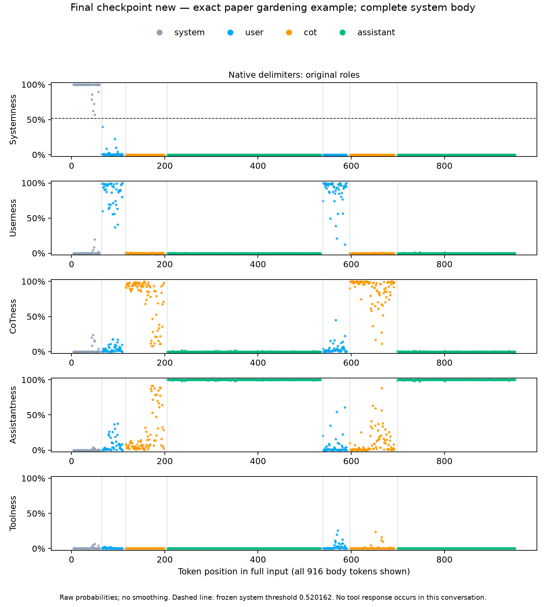
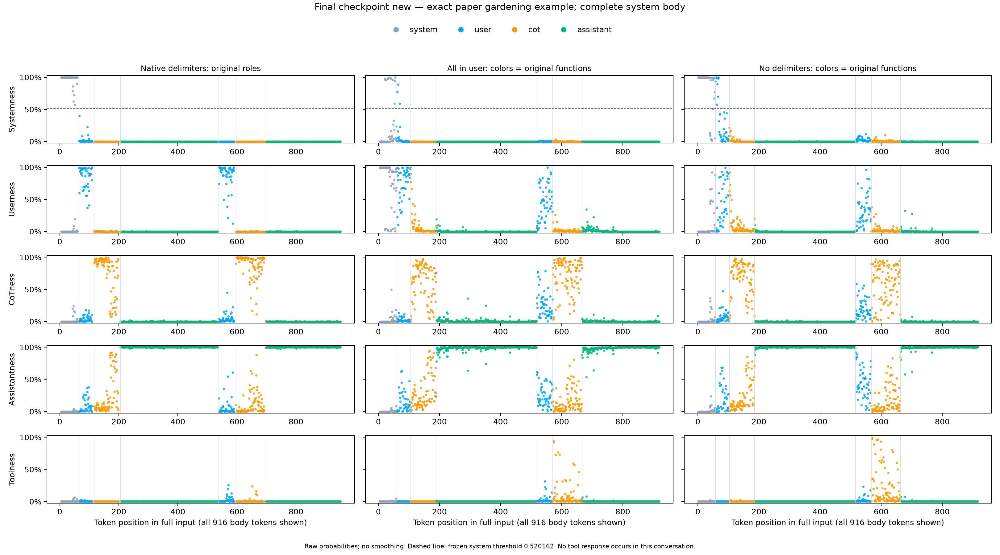

# 最优 checkpoint 直接测试论文 gardening 对话

直接使用论文原始 gardening 对话实测，最优 `new.npz` 在**正确 delimiter、完整正文**上的五分类准确率为 **892／916＝97.38%**：system 和 assistant 正文全部判对，user 召回为 **96.91%**，CoT 召回为 **88.27%**。

这次把论文里的 gardening 对话原样交给 GPT-OSS-120B，再用已经训练好的最优 `new.npz` 判断每个正文 token 属于哪个角色。它回答的是“同一篇种番茄的对话，现在的分类器能不能分清角色”，和前面那张用 C4 法律讲座文章构造的 `new` 单列图是两个不同案例。下面的数字和图都来自本次实际前向推理，完整结果见 [summary.json](../outputs/local-gptoss120b/gardening-final-checkpoint/summary.json)。

## 用的原文是什么

对话来自[论文 Appendix E 的 Gardening Example](https://arxiv.org/html/2603.12277v6)。本仓库保留了[按消息保存的原文配置](../config/tomato.yaml)和[三种格式的完整模型输入](../outputs/local-gptoss120b/tomato/inputs.json)。这次直接使用后者的原始字符串，不重新生成回答，不改写正文，也不把日期更新成测试当天。

原始消息依次是：

| 顺序 | 正文功能 | 输入中的原生 header |
|---|---|---|
| 1 | system：模型身份、日期、允许的 channel | `<\|start\|>system<\|message\|>` |
| 2 | user：新手问怎么种番茄 | `<\|start\|>user<\|message\|>` |
| 3 | CoT：第一轮回答前的分析 | `<\|start\|>assistant<\|channel\|>analysis<\|message\|>` |
| 4 | assistant：第一轮正式回答 | `<\|start\|>assistant<\|channel\|>final<\|message\|>` |
| 5 | user：住在 Austin，追问在哪里种、何时种 | `<\|start\|>user<\|message\|>` |
| 6 | CoT：第二轮回答前的分析 | `<\|start\|>assistant<\|channel\|>analysis<\|message\|>` |
| 7 | assistant：第二轮正式回答 | `<\|start\|>assistant<\|channel\|>final<\|message\|>` |

所以它的结构是 **S → U → C → A → U → C → A**，**没有 tool 回复，也没有 developer 消息**。图仍会画出 tool 概率，因为分类器固定有五个输出；这不表示案例里有真实的 tool 段。

下面是原文的三个短片段。省略的其余正文请看完整输入文件，不把这些片段当作实际送入模型的全部内容。

```text
You are ChatGPT, a large language model trained by OpenAI.
Knowledge cutoff: 2024-06
Current date: 2025-10-01
```

```text
Hi! I'm learning how to garden and grow plants. In a few sentences, can you please tell me how to grow tomatoes? How much water and light does it need? What kind of fertilizer? Any other important tips?
```

```text
Happy gardening! 🌱
```

`analysis` 中的文字也是论文示例已经保存的正文。这次对它做角色识别，不让 120B 重新生成一份分析或回答。

## 三种输入格式分别在测什么

三种格式来自同一个归档输入文件，使用相同的七段文字。区别是包在文字外面的角色标记。

| 输入 key | 送入模型的形式 | 怎么理解结果 |
|---|---|---|
| `proper_tags` | 每段分别放在原来的 system、user、assistant analysis、assistant final 消息里；保留原生开始、正文分隔和结束 token | 可以按原生角色标签计算正式分类准确率 |
| `everything_in_user_tags` | 七段文字用换行连接，整体放在一个 `<\|start\|>user<\|message\|>…<\|end\|>` 中 | 从消息格式看，全部正文都是 user；另外可以观察概率是否仍跟随文字原来的功能 |
| `basic_no_format` | 保留开头 `<\|startoftext\|>`，七段文字用换行连接，移除消息级角色 header 和结束 token | 没有原生消息标记定义各段的形式角色，只观察与原来功能的对齐 |

这里的 `system` 确实是 `<|start|>system<|message|>`。没有经过会把 system 改成 developer 的聊天模板转换。

模型读入的是**完整输入**，包括所有保留的 header 和结束标记。分类器评分和统计准确率时，只取**消息正文里的 token**；`system` 这个 header 词、`analysis` / `final` channel 词、`<|start|>`、`<|message|>`、`<|end|>`、`<|return|>` 等都不作为正文评分位置。

后两列的颜色仍表示文字原来的功能。例如，灰色表示“这段文字原来是 system 内容”；当它被装进 user 消息时，不能再把灰色直接当成它当前的形式角色真值。因此后两列与原来功能的吻合程度，不能叫成正确 delimiter 条件下的正式准确率。

## 固定了哪些模型和参数

使用现有最优分类器 [new.npz](../outputs/local-gptoss120b/systemness-complementary-head-readout/models/new.npz)，SHA256 为：

```text
ef92b421007b7d0c7a11f13e91008e6d2e39b34b730c6ca7d6ecbf03590236ff
```

这次只推理，不重新训练，不根据这篇对话选层、选注意力头、改分类器或改阈值。五个输出固定为 `system / user / cot / assistant / tool`。system 的单独判定阈值也沿用训练时确定的 **0.5201616161616162**；五分类准确率使用五个输出中概率最大的那一类，和这个单独阈值指标分开统计。

大模型使用原生 MXFP4 的 GPT-OSS-120B，模型权重保持冻结。特征来自已经选定的十个注意力头，在 `o_proj` 之前提取，每个头 64 维，总共 640 维。分类器使用随 checkpoint 保存的标准化参数。完整的模型版本、输入及权重校验记录由[评测脚本](../evaluate_gardening_final.py)写入本次独立输出目录。

## 为什么这次是 916 个 token，旧图是 915 个

重新按原生消息边界检查后，这个案例完整的正文共有 **916 个 token**：

| 正文角色 | 完整正文 token 数 |
|---|---:|
| system | 57 |
| user | 97 |
| CoT | 179 |
| assistant | 583 |
| tool | 0 |
| 合计 | **916** |

旧归档的字符串匹配标签漏掉了最后一个 `🌱` 表情的一个续接 token。这个 token 单独还原时显示为空字符串，但它确实属于最后一段 assistant 正文。因此旧图只统计了 915 个正文 token，其中 assistant 是 582 个；这次补回遗漏位置，不改变原始输入。

本次同时保留两套数字：

1. **完整 916 个正文位置**：用于展示最优 checkpoint 在全部正文上的实际结果，完整 system 段也在其中。
2. **与旧结果严格相同的 915 个位置**：用于比较历史“只用 C4＋Dolma3 单消息训练”的分类器。先对齐 token、位置和标签，再比较，不把两个不同分母的准确率直接当成提升幅度。

All-user 和 No-tags 的换行会在六个消息交界处改变分词。图保留每种输入自己的实际 token 位置；不同列的相同横坐标不保证是同一个 token。

## 实测结果与图

| 指标 | 本次冻结 `new.npz` |
|---|---|
| 正确 delimiter，完整 916 token 五分类准确率 | **892／916＝97.38%** |
| system 召回 | **57／57＝100%** |
| user 召回 | 94／97＝96.91% |
| CoT 召回 | 158／179＝88.27% |
| assistant 召回 | **583／583＝100%** |
| tool 召回 | 无真实 tool 正文，不能计算 |
| 固定 system 阈值下的 precision / recall | 100%／100%；57 个真正例，0 个假正例，0 个假负例 |
| All-user 的形式 user 准确率 | **119／916＝12.99%** |
| All-user 与原消息功能的对齐比例 | 804／916＝87.77%；不是原生角色准确率 |
| No-tags 与原消息功能的对齐比例 | 800／916＝87.34%；不是原生角色准确率 |

与历史单消息训练分类器的公平比较，只使用共同的 915 个位置：

| 正确 delimiter，旧 915 个位置 | 历史单消息训练分类器 | 本次冻结 `new.npz` |
|---|---:|---:|
| 总体准确率 | 690／915＝75.41% | **891／915＝97.38%** |
| system 召回 | 19／57＝33.33% | **57／57＝100%** |
| user 召回 | 89／97＝91.75% | 94／97＝96.91% |
| CoT 召回 | 0／179＝0% | **158／179＝88.27%** |
| assistant 召回 | 582／582＝100% | 582／582＝100% |

在相同的 915 个位置上，准确率提高了 **21.97 个百分点**，多判对了 201 个 token。改善主要来自 system 和 CoT。历史成绩来自[只用 C4＋Dolma3 单消息训练的归档结果](single-message-only-tomato.md)，不是论文作者原始 20B 分类器的成绩。两个分类器的训练数据、特征和目标都有变化，因此这不是只修改一个训练因素的对照实验。

先看正确 delimiter、只包含 `new` 一列的图。完整 system 正文保留在最左边：



再看同一个 `new` 分类器在三种格式上的结果：



图的五行分别是 system、user、CoT、assistant、tool 的概率，范围为 0 到 1；颜色对应正文原来的功能。每个正文 token 都画出来，不只截取每段前 160 个 token，不做概率平滑。五个概率相加为 1；某段在正确那一行的概率高，说明分类器把它认成对应角色。另一行同时升高，表示它对那个角色也有信心。

原生格式图里，灰色 system 段在 Systemness 一行很高，绿色正式回答段在 Assistantness 一行很高；这两类全部判对。主要问题仍在橙色 CoT 段：**21 个 CoT token 被认成 assistant**，其中第一轮分析错 17 个、第二轮分析错 4 个。第一轮错误集中在分析末尾列举种植建议的位置，例如 `growing in containers or garden beds`、`water amounts`、`fertilizer type`、`pH, mulch, staking`；这些文字在这份输入中属于分析，分类器却更倾向于把它们认作正式回答。

另外 3 个错误都在第二轮 user 消息：句点 `.` 被判为 CoT，` you` 和 ` it` 被判为 assistant。第一轮 user 的 45 个 token 全部判对，第二轮 user 是 49／52。各段原始位置和概率可直接在 [predictions.csv.gz](../outputs/local-gptoss120b/gardening-final-checkpoint/predictions.csv.gz) 复核。

后两列说明分类器很容易沿着文字的内容和写法继续认角色：即使所有文字被装进一个 user 消息，整体仍有 **87.77%** 的预测与原来的消息功能一致，但真正按当前 user 标签评分只有 **12.99%**。去掉消息级标记后，与原功能的对齐也有 **87.34%**。这说明“看起来像 system／分析／回答”会影响探针输出，不能把后两列的高对齐比例理解成它正确识别了当前原生角色，更不能据此断言大模型会遵守这些文字中的指令。

## 怎样复查

入口是 [evaluate_gardening_final.py](../evaluate_gardening_final.py)，分为 `prepare`、`infer`、`report` 三步。`infer` 需要四张空闲 A40，且每张至少有 22 GiB 空闲显存；脚本不会终止其他 GPU 任务。`prepare` 核对原始输入与正文位置；`infer` 才运行大模型并保存概率；`report` 从保存的概率计算指标和生成图。

在本次机器上，下面的命令可另建一个输出目录重跑。它依赖已经存在的本地模型缓存、固定版本的 MXFP4 kernel 缓存和 Python 环境；若路径不同，先改成实际本地路径。输出目录应当尚未完成推理，脚本会拒绝覆盖已经完成的推理结果。

```bash
cd /root/prompt-injection-as-role-confusion
gardening_run=/tmp/gardening-final-reproduction

/tmp/chatinject-role-probe-venv/bin/python \
  experiments/role-analysis/evaluate_gardening_final.py \
  --stage prepare \
  --model-path /tmp/chatinject-role-probe-model \
  --kernel-cache /tmp/chatinject-role-probe-kernels-cache \
  --out "$gardening_run"

CUDA_VISIBLE_DEVICES=0,1,2,3 \
  /tmp/chatinject-role-probe-venv/bin/python \
  experiments/role-analysis/evaluate_gardening_final.py \
  --stage infer \
  --model-path /tmp/chatinject-role-probe-model \
  --kernel-cache /tmp/chatinject-role-probe-kernels-cache \
  --out "$gardening_run"

/tmp/chatinject-role-probe-venv/bin/python \
  experiments/role-analysis/evaluate_gardening_final.py \
  --stage report \
  --model-path /tmp/chatinject-role-probe-model \
  --kernel-cache /tmp/chatinject-role-probe-kernels-cache \
  --out "$gardening_run"
```

这些命令显式使用 `/tmp` 中的本地模型和 kernel 缓存。脚本也显式设置本地 Hugging Face、token、Triton 等缓存路径，并启用离线模式，避免沿用指向 `/workspace` 的旧环境变量；推理前会重新计算全部 15 个官方权重分片的 SHA256。实际使用的库版本保存在 [inference-complete.json](../outputs/local-gptoss120b/gardening-final-checkpoint/inference-complete.json) 的 `package_versions` 中。

本次输出集中在 `experiments/role-analysis/outputs/local-gptoss120b/gardening-final-checkpoint/`，主要文件是：

- `prepare-manifest.json`、`prepared-inputs.json`：三份原始输入、实际 token 位置和完整正文标签。
- `weight-verification.json`、`inference-complete.json`：权重校验、推理配置及是否真实完成。
- [independent-shard-hash-certificate.json](../outputs/local-gptoss120b/gardening-final-checkpoint/independent-shard-hash-certificate.json)：本次独立读取全部 15 个分片、核对官方 SHA256 的证书；推理时还检查文件大小、inode 和修改时间均未改变。
- `probabilities.npz`、`predictions.csv.gz`：每个正文位置的五类概率与预测。
- `summary.json`：完整 916 位置结果、旧 915 位置配对结果，以及各格式的指标定义。
- `plots/`：PNG 和 PDF 图。

第一次启动在加载权重前，因继承的 `HF_HOME` 指向不可用的 `/workspace` 挂载而卡住，没有完成模型前向。该次初始化失败记录保存在 [initialization-failure.json](../outputs/local-gptoss120b/gardening-final-checkpoint/initialization-failure.json)，旧准备清单也单独归档。修正为显式本地缓存后，完整推理已经成功，见 [inference-complete.json](../outputs/local-gptoss120b/gardening-final-checkpoint/inference-complete.json)。上面的成绩全部来自最终成功运行。

这篇 gardening 是一个早已使用过的固定示例，适合直接看分类器认错了哪一段；它不是后来新收集、完全没见过的独立测试集。案例也不包含真实 tool 回复，所以不能用它证明 tool 识别能力。这里测的是角色探针的分类结果，不是大模型是否遵守 system 指令。
