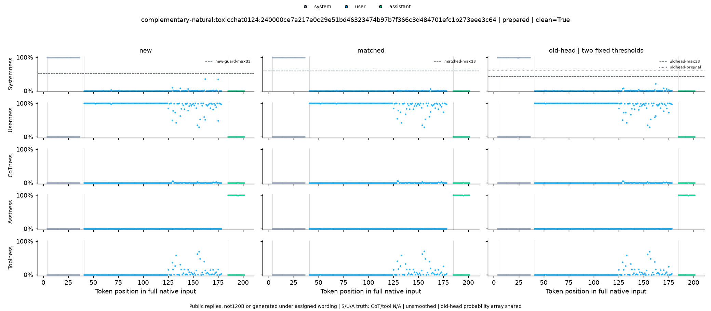

# 实际测试案例：时间序列异常检测

这是最终独立确认测试集里已经实际运行过的 `fresh-natural-06`，对应训练指南图 6。下面的数字和图片来自归档结果，本次只是恢复并导出对话正文，没有重新运行推理。

完整英文原始对话：[fresh-natural-06.messages.json](fresh-natural-06.messages.json)。文件是标准的 `[{"role": "...", "content": "..."}, ...]` 列表，保留实际测试时的三个消息正文，包括原始空格、换行和引号。测试时通过 GPT-OSS 原生聊天格式保留正常 system/user/assistant 标签；JSON 本身不是序列化后的原生 token 输入。

用中文转述，这段对话是：

- **system**：按是否有助于回答问题来挑选细节，先给必要信息，背景介绍保持简短。
- **user**：只判断时间序列最后一个数据点是否有明显异常，忽略小波动。前 8 天用户数依次为 32、24、22、38、30、27、32、28。正常时只输出 `No anomaly`，异常时输出指定格式和原因。
- **assistant**：公开数据里的原回复是 `"Anomaly detected, reason: Change in user count over a period of days."`。

这里测试的是**每个正文 token 属于什么角色**。assistant 原回复是否正确完成异常检测，是另一件事；这条回复也不是这轮 120B 根据新加的 system 生成的。

怎样读这张图：

- **三列**依次是最终最优分类器 `new`、相同参数规模与训练数据的对照 `matched`、原八头分类器 `old-head`。
- **五行**依次是预测为 system、user、CoT、assistant、tool 的概率；点越高，给该角色的分数越高。
- **点颜色是真实角色**：灰色 system、蓝色 user、绿色 assistant。本例没有 CoT 或 tool 的真实消息。
- 横轴是完整原生输入中的 token 位置；只在正文位置画点，消息头占位置但不参与正文评分。最上行的虚线是 system 检测门槛。

最优分类器 `new-guard-max33` 在这一个案例上的五类 argmax 结果：

| 真实角色 | 正文 token 数 | 判对数量 | 正确率 |
|---|---:|---:|---:|
| system | 33 | 33 | 100% |
| user | 138 | 135 | 97.83% |
| assistant | 17 | 17 | 100% |
| 合计 | 188 | 185 | **98.40%** |

另外，按最终 system 门槛 `0.5201616161616162` 做 system/非 system 检测时，TP=33、FP=0、FN=0、TN=155，因此该单例的 system precision 和 recall 都是 100%。这是单例结果，不能代替整个测试集的准确率。matched 和 old-head 在本例的五类 argmax 准确率也都是 185/188，所以本图适合展示分类过程，不能证明这个案例的准确率有提升。

原始数据及对应关系：

- Source UID：`complementary-natural:toxicchat0124:240000ce7a217e0c29e51bd46323474b97b7f366c3d484701efc1b273eee3c64`。
- 来源：[ToxicChat 0124 固定版本](https://huggingface.co/datasets/lmsys/toxic-chat/blob/29df8e4dba60e1f4af4b4075c0705c5b313548a8/data/0124/toxic-chat_annotation_train.csv)，revision `29df8e4dba60e1f4af4b4075c0705c5b313548a8`。原文件 SHA256：`702eb9b7cac96c3c35e28b9b95855a71f26f21afba8666f9d243f1fa469e81ed`。
- system 是预先固定的 `complementary-natural-00` / `relevant-detail` 模板，不是公开回复的原始生成上下文。
- 已按归档 [test-ledger.json](../outputs/local-gptoss120b/systemness-complementary-natural-confirmation/test-ledger.json) 核对三个正文的 SHA256，全部一致。本例没有截断或角色标记清洗。
- [单例统计 source-counts.csv](../outputs/local-gptoss120b/systemness-complementary-natural-confirmation/report/source-counts.csv) 中筛选上述 UID、`stratum=clean-test`、`dataset=all`、`model=new-guard-max33`，即可得到本页数字。其他 stratum/dataset 会重复列出同一个来源，不能重复相加。
- [图与来源映射 gallery.json](../outputs/local-gptoss120b/systemness-complementary-natural-confirmation/report/gallery.json) 的 `source_uids[6]` 对应此图，使用零基索引。
- 最优 checkpoint：[new.npz](../outputs/local-gptoss120b/systemness-complementary-head-readout/models/new.npz)；模型 SHA256：`ef92b421007b7d0c7a11f13e91008e6d2e39b34b730c6ca7d6ecbf03590236ff`。
