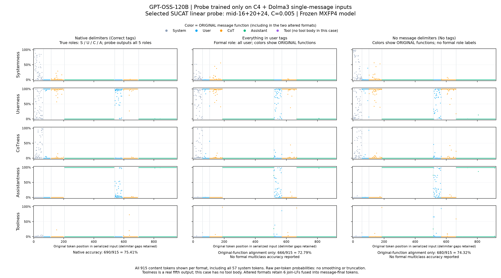

# 只用 C4＋Dolma3 单消息训练，实际做到了什么？

在已经完成的线性探针搜索中，五分类模型在新增单消息测试上的准确率达到 **78.31%**。但把它直接用于固定的 tomato 多轮对话，CoT 召回仍为 **0/179＝0%**。这说明单消息测评的提升，没有自动解决多轮对话中的角色识别。

这是对归档结果的复查和重新作图，没有重新训练或运行大模型，也不能据此认定 78.31% 是只用单消息训练的能力上限。

## 训练数据和选中的模型

- 原始语料池是 **249 篇正文：62 篇 C4＋187 篇 Dolma3**，每篇最多取 1024 token，再分别包装成 system、user、CoT、assistant、tool 的单消息输入。
- 按原文分为 199 篇训练、25 篇验证、25 篇测试。验证集选型后，用训练＋验证共 **224 篇**重新拟合；25 篇测试原文不进入训练。
- 不加入 C4 构造多轮、自然对话或后来的长文补充训练。正常角色 delimiter 保留。
- 已完成的搜索比较了 22 种特征，初筛 176 个配置，再用全部训练 token 复核。选中零基第 16、20、24 层的 `mid` 特征拼接，即注意力后的归一化前残差。
- 分类器是标准化后的 **L2 多项逻辑回归，C＝0.005**，五个输出是 S/U/C/A/T。

模型文件：[final-document-sucat-mid-16+20+24-0.005.pkl](../outputs/local-gptoss120b/feature-search/models/final-document-sucat-mid-16+20+24-0.005.pkl)。SHA256：`ddba6ed427f4381a86e4848e6856516abf5aca56ff5cd5bc73adfd281904b51e`。这是历史单消息训练模型；当前包含多轮训练的最优 `new.npz` 属于另一轮实验。

## 单消息测试的效果

| 测试数据 | 同数据训练的单层基线 | 验证集选中的多层模型 |
|---|---:|---:|
| 原语料池中保留的 25 篇测试原文 | 67.81% | **74.60%** |
| 冻结模型后新增的 100 篇 C4 | 70.93% | **78.31%** |

新 100 篇 C4 只用于确认，不加入训练或选参数。其五个角色召回分别为 system **56.41%**、user **88.98%**、CoT **70.71%**、assistant **89.51%**、tool **85.93%**。system 仍是明显短板。

这些分数是单消息测试的正文 token 五分类准确率，不能直接当成多轮对话成绩。对应结果见 [历史报告](../outputs/local-gptoss120b/feature-search/report.txt)、[选择记录](../outputs/local-gptoss120b/feature-search/selection.json)和[新增测试指标](../outputs/local-gptoss120b/feature-search/fresh/metrics.csv)。

## 同一模型用于 tomato 多轮对话

这张新图直接使用已经保存的五分类概率：**保留 system 正文、展示全部正文位置、不截取每段前 160 个 token，也不平滑分数**。它与历史四行 SUCA 图使用不同的分类器，不能互换指标。

- 三列是同一模型的三种输入格式：正确 delimiter、全部放进一个 user 消息、去掉消息级 delimiter。
- 五行表示被判为 system、user、CoT、assistant、tool 的概率。
- 颜色表示文字**原来的消息功能**：灰 S、蓝 U、橙 C、绿 A、紫 T。该案例只有 S/U/C/A 正文，**没有真实 tool 消息**；五个输出不代表五类真值都存在。
- 横轴使用归档的 `token_in_prompt_ix`，各格式分别保留其输入位置；不同格式的相同横坐标不保证对应同一个 token。
- 两个非原生格式中，各个非末消息的末 token 会连带一个分隔换行，共 6 处。图直接使用归档 token 和概率，没有把这些位置伪装成与原生格式完全相同的分词。
- 只有正确 delimiter 列按 S/U/C/A 标签报告正式分类准确率。All-user 的形式角色全部是 user；No-tags 没有原始消息 delimiter 定义的形式角色，后两列只观察与原消息功能的对齐。

正确 delimiter 下，完整 915 个正文 token 的结果是：

| 真实角色 | 判对／正文 token | 召回率 |
|---|---:|---:|
| system | 19／57 | 33.33% |
| user | 89／97 | 91.75% |
| CoT | 0／179 | **0%** |
| assistant | 582／582 | 100% |
| tool | 0／0 | N/A |
| 总体准确率 | 690／915 | **75.41%** |

图里绿色 assistant 段能很好地对上 Assistantness；橙色 CoT 段的 Userness 却很高、CoTness 很低。逐 token 重算，179 个 CoT 中 **178 个被判为 user、1 个被判为 tool**。因此 75.41% 的总体准确率不能掩盖 CoT 完全失败的问题：这个案例中 assistant 正文占了 582/915，本身就超过六成。

这一个固定案例不代表所有多轮对话的表现。它能确证的是：**在这轮仅用单消息训练的选中模型上，单消息上的提高没有迁移成这个多轮案例的 CoT 识别能力。**若要判断扩大 C4＋Dolma3 单消息数据量、改用注意力头或 MLP 能否进一步提高，需要另外做受控实验；不能套用包含多轮训练的当前最优模型成绩。

原始输入见 [tomato/inputs.json](../outputs/local-gptoss120b/tomato/inputs.json)，完整统计见 [role-accuracy.csv](../outputs/local-gptoss120b/feature-search/tomato/role-accuracy.csv)与[overall-accuracy.csv](../outputs/local-gptoss120b/feature-search/tomato/overall-accuracy.csv)。图及核对摘要可用 [plot_single_message_tomato.py](../plot_single_message_tomato.py)从归档 `projections.csv.gz` 重新生成，不需要加载模型或使用 GPU。
