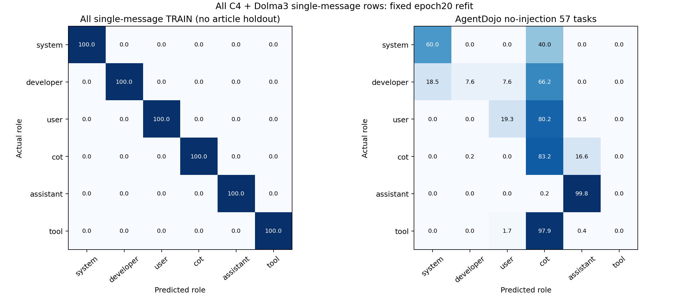

# 全部单消息训练 → AgentDojo 57 任务测试

将原单消息 FIT、DEV、TEST 合并为训练集；仅 C4＋Dolma3，546,304 个 token 位置、5,632 篇来源。没有独立的文章验证集或测试集。

沿用上一轮已定的 MLP256、seed29 和 20 个 epochs，重新随机初始化，重新计算全部训练数据的 mean/std。每轮无放回打乱并遍历全部样本。取第 20 轮最终 checkpoint，没有按 AgentDojo 成绩选模型。

| 数据 | Accuracy | Macro-F1 |
|---|---:|---:|
| 全部单消息训练集（仅训练集成绩） | 99.9973% | 99.9973% |
| AgentDojo 57 任务：全部单消息训练 | 41.8000% | 28.8697% |
| AgentDojo 57 任务：上一轮仅 FIT 训练 | 56.0860% | 47.6949% |

| AgentDojo 分组 | token | Accuracy | Macro-F1 |
|---|---:|---:|---:|
| actual_generated | 67,192 | 85.1292% | 76.1798% |
| actual_input | 87,911 | 8.6826% | 13.6976% |

| 角色 | token | Precision | Recall | F1 |
|---|---:|---:|---:|---:|
| system | 4,047 | 17.6650% | 60.0445% | 27.2988% |
| developer | 61,085 | 97.4942% | 7.5796% | 14.0657% |
| user | 2,969 | 10.2303% | 19.2994% | 13.3722% |
| cot | 59,285 | 43.5765% | 83.1728% | 57.1897% |
| assistant | 7,907 | 44.2271% | 99.7976% | 61.2917% |
| tool | 19,810 | N/A | 0.0000% | 0.0000% |

AgentDojo 沿用原始 359 次调用、155,103 个首次普通正文位置的激活与 mask；没有重跑 agent。该 57 任务集已被观察，是历史回归集。

固定 16 头／1024 维仍沿用 v7，历史选头曾使用混合上下文。此次分类器和标准化器只由全部单消息训练。

checkpoint：`checkpoint.npz`；训练方案：`protocol.json`；数据审计：`data-audit.json`；设备记录：`gpu-training.json`；独立复核：`independent-validation.json`。
