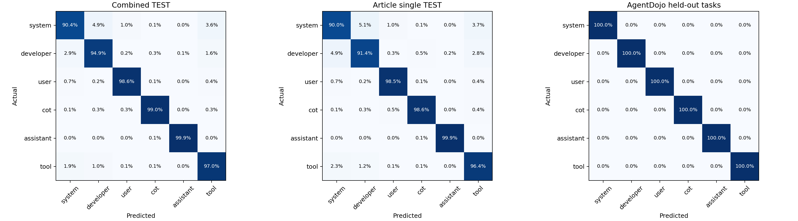

# C4＋Dolma3 单消息与 AgentDojo 无注入数据混合训练

新训练 probe：`mlp256-seed43`，最佳 epoch 12。随机初始化；只用 DEV 选模并冻结后评估 TEST。

按约 70%／15%／15% 重新划分。文章按来源聚类并按语料、角色分层；AgentDojo 按完整任务划分并按 suite 分层。不同集合的文章来源、任务均不重叠。

| 集合 | 单消息文章数 | 单消息 token | AgentDojo 任务数 | AgentDojo token | 合计 token |
|---|---:|---:|---:|---:|---:|
| FIT | 3,942 | 382,374 | 40 | 105,724 | 488,098 |
| DEV | 840 | 81,480 | 8 | 29,621 | 111,101 |
| TEST | 850 | 82,450 | 9 | 19,758 | 102,208 |

| 最终 TEST | token 数 | Accuracy | Macro-F1 |
|---|---:|---:|---:|
| 合并 | 102,208 | 96.6128% | 96.6081% |
| agentdojo | 19,758 | 100.0000% | 100.0000% |
| c4_dolma3 | 82,450 | 95.8011% | 95.7989% |

## 合并 TEST 的各角色结果

| 角色 | token 数 | Precision | Recall | F1 |
|---|---:|---:|---:|---:|
| system | 14,413 | 92.2554% | 90.4184% | 91.3277% |
| developer | 23,242 | 95.8801% | 94.9230% | 95.3991% |
| user | 14,142 | 98.1418% | 98.5928% | 98.3668% |
| cot | 18,714 | 99.4044% | 99.0007% | 99.2022% |
| assistant | 15,111 | 99.7819% | 99.9140% | 99.8479% |
| tool | 16,586 | 94.0805% | 96.9734% | 95.5050% |

## agentdojo 的各角色结果

| 角色 | token 数 | Precision | Recall | F1 |
|---|---:|---:|---:|---:|
| system | 639 | 100.0000% | 100.0000% | 100.0000% |
| developer | 9,468 | 100.0000% | 100.0000% | 100.0000% |
| user | 465 | 100.0000% | 100.0000% | 100.0000% |
| cot | 4,940 | 100.0000% | 100.0000% | 100.0000% |
| assistant | 1,434 | 100.0000% | 100.0000% | 100.0000% |
| tool | 2,812 | 100.0000% | 100.0000% | 100.0000% |

## c4_dolma3 的各角色结果

| 角色 | token 数 | Precision | Recall | F1 |
|---|---:|---:|---:|---:|
| system | 13,774 | 91.8885% | 89.9739% | 90.9211% |
| developer | 13,774 | 92.9996% | 91.4331% | 92.2097% |
| user | 13,677 | 98.0789% | 98.5450% | 98.3114% |
| cot | 13,774 | 99.1897% | 98.6424% | 98.9153% |
| assistant | 13,677 | 99.7591% | 99.9049% | 99.8320% |
| tool | 13,774 | 92.9151% | 96.3555% | 94.6040% |

训练时两个来源等概率采样，再均衡六角色；每轮抽样量等于 FIT 行数，有放回抽样。标准化器只由 FIT 的原始 token 特征拟合。
AgentDojo 只保留原有首次出现普通正文 mask，包含实际输入和实际生成；标签由原生消息角色／channel 确定。排除重复上下文、结构性工具调用 JSON 与未 forward 的停止符。

NVIDIA RTX 2080 Ti，训练和选模耗时 3.73 分钟，峰值 allocated 2459.6 MiB。

这次 AgentDojo 已参与训练；其 TEST 是从 57 个历史任务中留出的任务，不能当作完整 57 任务的外部测试。任务间仍共享 system／developer 模板及工具环境，结果不代表未见模板或新 benchmark 的泛化。

沿用原 v7 的 16 个 pre-o_proj 注意力头（1024 维）；原选头使用混合上下文 pilot FIT，本次只重新划分 probe 数据并训练 probe，未重新选头或运行 120B。

权重：`checkpoint.npz`；具体任务／文章划分：`split-assignment.json`；原始指标与置信区间：`evaluation-summary.json`；独立复核：`independent-validation.json`。

## 独立复核与相同特征诊断

独立复核全部通过：核验 1,972 个来源／派生文件，由原始缓存逐行重建特征和标签，重新计算 FIT 标准化器，并以独立 NumPy/SciPy forward 复核全部预测。CPU 与 GPU 的 argmax 差异为 0；最大概率差约 2.09e-6。原始分类器的 16 项单元测试也全部通过。

c4_dolma3 的 TEST 中，48 个向量与 FIT 特征字节完全相同；排除这些向量后，剩余 82,402 个位置的 Accuracy 为 95.7986%。

agentdojo 的 TEST 中，904 个向量与 FIT 特征字节完全相同；排除这些向量后，剩余 18,854 个位置的 Accuracy 为 100.0000%。

这是模型冻结后的额外诊断，不改变主 TEST 的样本或指标。相同前缀内容和提示模板仍可能产生相似但非逐字节相同的状态；此诊断不等同于模板独立测试。详情见 `exact-feature-overlap.json`；AgentDojo 每个留出任务的 token 数和结果见 `agentdojo-test-per-task.csv`。

