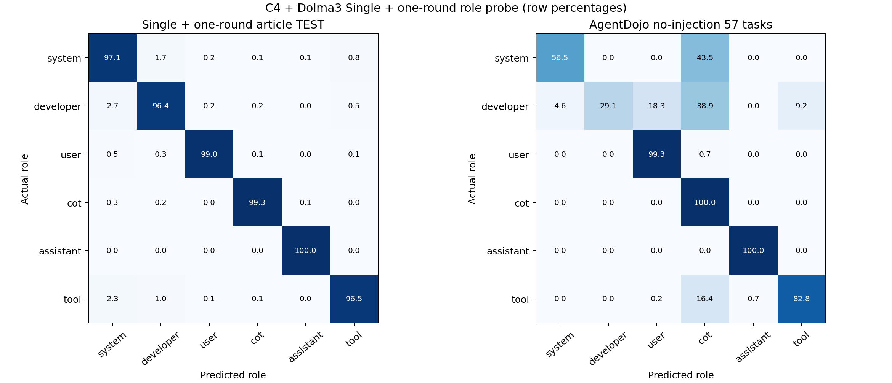
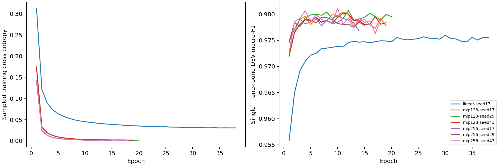

# C4＋Dolma3 单消息＋单轮六角色 probe：2080 Ti 本地训练

选中候选：`mlp256-seed43`，最佳 epoch 10，实际训练 18 轮。只按单消息＋单轮 DEV 选择，之后冻结，再评分 TEST 和 AgentDojo。

原 v7 的来源划分保持不变；只保留 single, one_round，排除其余 profile。标准化器只由单消息＋单轮 FIT 拟合，分类器随机初始化。

| 划分 | token 位置 | 来源 | accuracy | macro-F1 |
|---|---:|---:|---:|---:|
| FIT 单消息＋单轮 | 995,328 | 4,096 | 99.9870% | 99.9872% |
| DEV 单消息＋单轮 | 124,416 | 512 | 98.0830% | 98.1108% |
| TEST 单消息＋单轮 | 248,832 | 1,024 | 98.0392% | 98.0975% |

| TEST 子集 | token 位置 | Accuracy | Macro-F1 |
|---|---:|---:|---:|
| one_round | 149,504 | 99.5706% | 99.5725% |
| single | 99,328 | 95.7343% | 95.7711% |

| AgentDojo 57 任务 | accuracy | macro-F1 |
|---|---:|---:|
| 本次单消息＋单轮 probe | 68.7105% | 64.6011% |
| 原混合训练 probe（缓存基线） | 62.6100% | 61.5264% |

| AgentDojo 分组 | token 位置 | accuracy | macro-F1 |
|---|---:|---:|---:|
| actual_input | 87,911 | 44.7999% | 52.0009% |
| actual_generated | 67,192 | 99.9940% | 99.9857% |

| 角色 | AgentDojo 支持 token | precision | recall | F1 |
|---|---:|---:|---:|---:|
| system | 4,047 | 45.0158% | 56.4616% | 50.0932% |
| developer | 61,085 | 100.0000% | 29.0710% | 45.0465% |
| user | 2,969 | 20.8369% | 99.2927% | 34.4453% |
| cot | 59,285 | 67.3032% | 99.9983% | 80.4560% |
| assistant | 7,907 | 98.3452% | 99.9621% | 99.1470% |
| tool | 19,810 | 74.5170% | 82.7511% | 78.4185% |

使用原始缓存中 359 次调用、155,103 个首次普通正文位置；沿用原去重复上下文 mask。没有重跑 agent，不能据此推断任务成功率变化。
57 任务只有 1 种 system 和 3 种 developer 提示模板，属于已观察的历史回归集。

**特征限制：** 本次沿用 v7 的固定 16 头／1024 维缓存；这些头最初由混合上下文 pilot FIT 选出。本次的 probe 参数、标准化器和选模只使用单消息＋单轮。

本次在 NVIDIA GeForce RTX 2080 Ti 上依次训练七个候选，训练与选模耗时 5.30 分钟；PyTorch 峰值 allocated 为 4506.42 MiB（不含驱动与其他进程）。

独立验证见 `independent-validation.json`：重新计算 FIT 标准化器、核验原始特征向量、独立 NumPy/SciPy forward 与 GPU 概率，以及由保存的预测重算全部混淆矩阵和每角色指标。

数据审计见 `data-audit.json`，设备与显存见 `gpu-training.json`，冻结权重见 `run/best.npz`，逐角色原始指标见 `run/evaluations/test.json` 和 `agentdojo/metrics.json`。运行环境见 `requirements.txt`，复现入口见 `reproduce.sh`。
