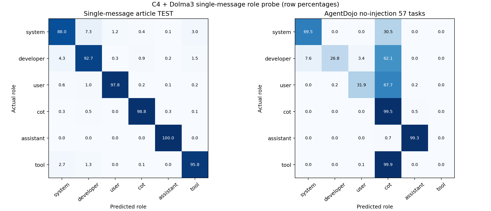
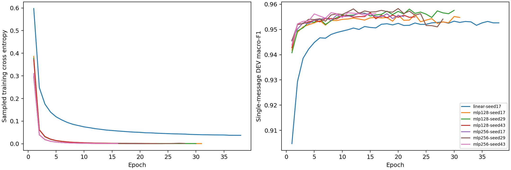

# C4＋Dolma3 单消息六角色 probe：2080 Ti 本地训练

选中候选：`mlp256-seed29`，最佳 epoch 20，实际训练 28 轮。只按单消息 DEV 选择，之后冻结，再评分 TEST 和 AgentDojo。

原 v7 的单轮、多轮样本不进入本次 FIT、DEV、TEST；标准化器只由单消息 FIT 拟合，分类器随机初始化。

| 划分 | token 位置 | 来源 | accuracy | macro-F1 |
|---|---:|---:|---:|---:|
| FIT 单消息 | 397,312 | 4,096 | 100.0000% | 100.0000% |
| DEV 单消息 | 49,664 | 512 | 95.8179% | 95.8287% |
| TEST 单消息 | 99,328 | 1,024 | 95.5209% | 95.5196% |

| AgentDojo 57 任务 | accuracy | macro-F1 |
|---|---:|---:|
| 本次单消息 probe | 56.0860% | 47.6949% |
| 原混合训练 probe（缓存基线） | 62.6100% | 61.5264% |

| AgentDojo 分组 | token 位置 | accuracy | macro-F1 |
|---|---:|---:|---:|
| actual_input | 87,911 | 22.9209% | 30.6377% |
| actual_generated | 67,192 | 99.4776% | 98.7986% |

| 角色 | AgentDojo 支持 token | precision | recall | F1 |
|---|---:|---:|---:|---:|
| system | 4,047 | 37.6959% | 69.5330% | 48.8881% |
| developer | 61,085 | 99.8842% | 26.8298% | 42.2980% |
| user | 2,969 | 30.8369% | 31.8963% | 31.3576% |
| cot | 59,285 | 49.1521% | 99.4957% | 65.7988% |
| assistant | 7,907 | 96.3567% | 99.3424% | 97.8268% |
| tool | 19,810 | N/A | 0.0000% | 0.0000% |

使用原始缓存中 359 次调用、155,103 个首次普通正文位置；沿用原去重复上下文 mask。没有重跑 agent，不能据此推断任务成功率变化。
57 任务只有 1 种 system 和 3 种 developer 提示模板，属于已观察的历史回归集。

**特征限制：** 本次沿用 v7 的固定 16 头／1024 维缓存；这些头最初由混合上下文 pilot FIT 选出。本次的 probe 参数、标准化器和选模只使用单消息。

本次在 NVIDIA GeForce RTX 2080 Ti 上依次训练七个候选，训练与选模耗时 7.57 分钟；PyTorch 峰值 allocated 为 132.42 MiB（不含驱动与其他进程）。

独立验证见 `independent-validation.json`：重新计算单消息 FIT 标准化器、核验原始特征向量、独立 NumPy/SciPy forward 与 GPU 概率，以及由保存的预测重算全部混淆矩阵和每角色指标。

数据审计见 `data-audit.json`，设备与显存见 `gpu-training.json`，冻结权重见 `run/best.npz`，逐角色原始指标见 `run/evaluations/test.json` 和 `agentdojo/metrics.json`。运行环境见 `requirements.txt`，复现入口见 `reproduce.sh`。
