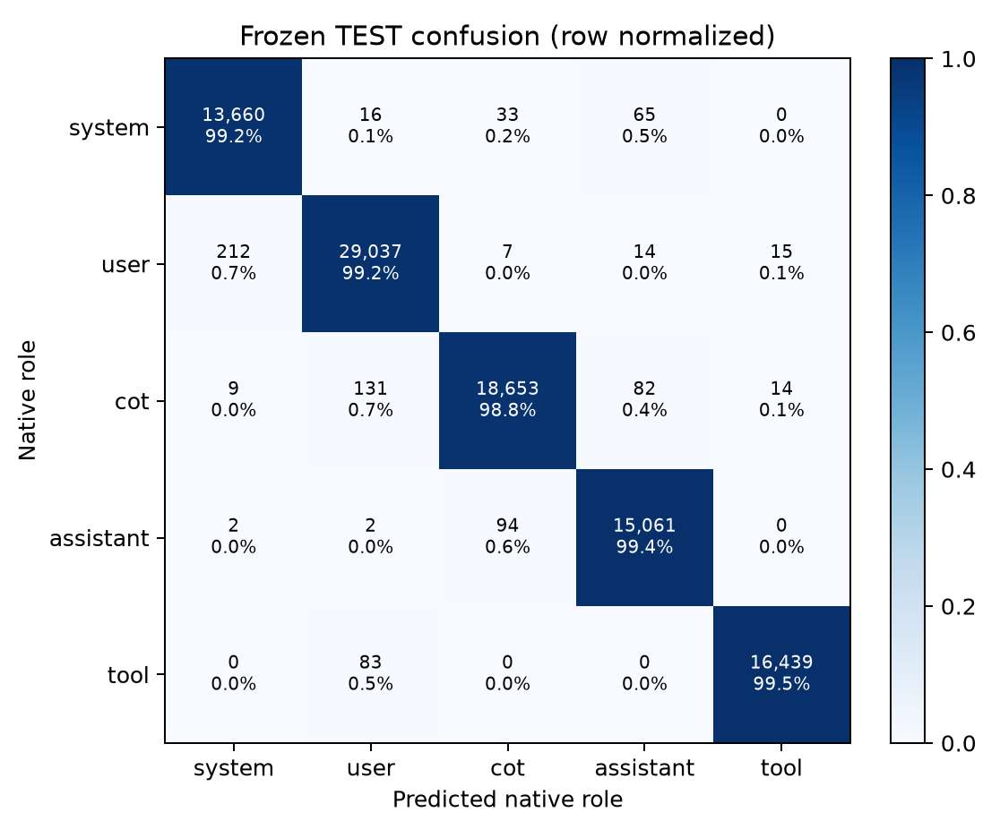
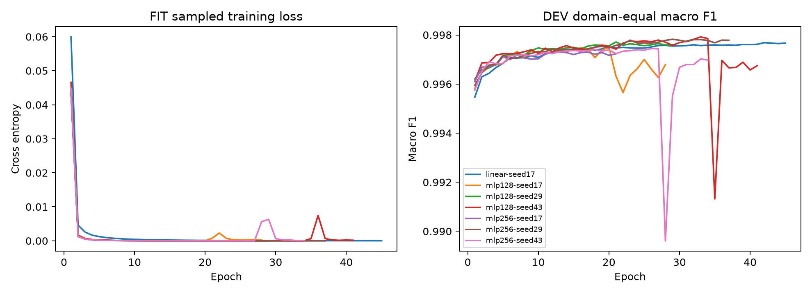

# DeepSeek V4 Flash 角色探针

状态：**训练完成，独立验证通过**。

已验证配置：`deepseek-ai/DeepSeek-V4-Flash-0731`；冻结基座，原生 packed FP4 专家与 FP8 dense 权重置于 4 张 H100。

探针读取逆 RoPE 后、`o_a_proj` 前的 16 个有序注意力头，每头 512 维，合计 8192 维。

选中候选：`mlp128-seed43`；最佳 epoch：33。

检查点：`checkpoint.npz`；SHA256：`a8b32f69fb93a0a57712e511b3a970809830c3f1e386981ad7db265a0b931221`。

标准化器仅使用 FIT 的唯一位置；训练按 domain 0.5/0.5，再按实际存在角色及唯一位置均匀有放回采样。

7 个随机初始化 linear/MLP 候选仅用 DEV 选模及早停。冻结后解封 TEST，保存的一次 TEST 输出经独立 NumPy 重算。

| TEST 范围 | 位置数 | Accuracy | Macro F1 |
|---|---:|---:|---:|
| 合并 | 93,629 | 99.1680% | 0.991575 |
| c4_dolma3 | 82,450 | 99.0552% | 0.990414 |
| agentdojo | 11,179 | 100.0000% | 1.000000 |

| 原生角色 | Precision | Recall | F1 |
|---|---:|---:|---:|
| system | 0.983937 | 0.991724 | 0.987815 |
| user | 0.992074 | 0.991532 | 0.991802 |
| cot | 0.992867 | 0.987506 | 0.990179 |
| assistant | 0.989423 | 0.993535 | 0.991475 |
| tool | 0.998239 | 0.994976 | 0.996605 |

独立审计已核验冻结文件哈希、原生标签与特征行顺序、跨 split source/family 隔离、FIT 内选头来源、两遍 F64 标准化统计、TEST 指标及小样本 CPU 预测一致性。

选头验收覆盖全部 2752 个头：从 FIT-inner 原生目标重算的各类支持为 `{'system': 776, 'user': 1485, 'cot': 2824, 'assistant': 964, 'tool': 1381}`；全部排名指标误差不超过 `1e-12`，排序及前 16 个头一致。
有序头编号：`[2326, 1160, 2323, 2321, 2715, 2324, 2349, 2744, 2327, 2749, 2732, 2728, 2714, 2733, 2692, 2338]`。

加载完整性：`load-integrity-audit.json` 状态为 `passed`。
官方逐专家权重到加载目标张量的数量关系：`67612 - 66048 + 172 = 1736`。
该审计核验完整加载与 GPU preflight，日志哈希覆盖审计时的已有前缀。

原生 kernel 性能缓存状态：`applied`。

- `down`：复用 8 token 参考输入的已测原生配置；参考搜索记录 62 个候选，原 winner 时间为 0.16140800714492798 ms。
- `gate_up`：复用 8 token 参考输入的已测原生配置；参考搜索记录 62 个候选，原 winner 时间为 0.3145599961280823 ms。

独立 GPU 对照状态：`validation_passed` / `passed`；已对照 token 长度 [8, 257, 1029, 8309]，共 8 组原 kernel 固定配置与原生 disk-cache dispatch。
记录的 finite/bitexact 全通过：`True`；验证时调用搜索：`False`。

其他真实长度复用参考配置，保留真实 `S=6×input_tokens` 及原 kernel 的网格、路由和数值格式。这不表示每个目标长度都重新做过 autotune，也不为复用条目声称新的性能测量时间。
保护的原始输入长度：`[8309]`；应用计数：`{'created': 2022, 'skipped_protected': 2}`。

适用范围与限制：

- 五分类标签为 system/user/cot/assistant/tool；developer 按官方编码归并到 user。
- 与 GPT-OSS 六分类指标比较时，需考虑标签空间和分词差异。
- AgentDojo 使用已有 GPT-OSS 轨迹做跨模型 teacher-forced replay；本结果不衡量新的 DeepSeek agent rollout 或攻击成功率。
- 全 GPU 审计覆盖用于探针的完整 43 层主干；Transformers 不加载检查点中可选的 MTP speculative-decoding 辅助模块。
- GPU/混合精度审计依据已保存的运行时快照；本工具不重新加载或执行基座模型。

完整检查结果见 `independent-validation.json`；原始 TEST 指标及 source-cluster bootstrap 区间见 `evaluations/test.json`。

