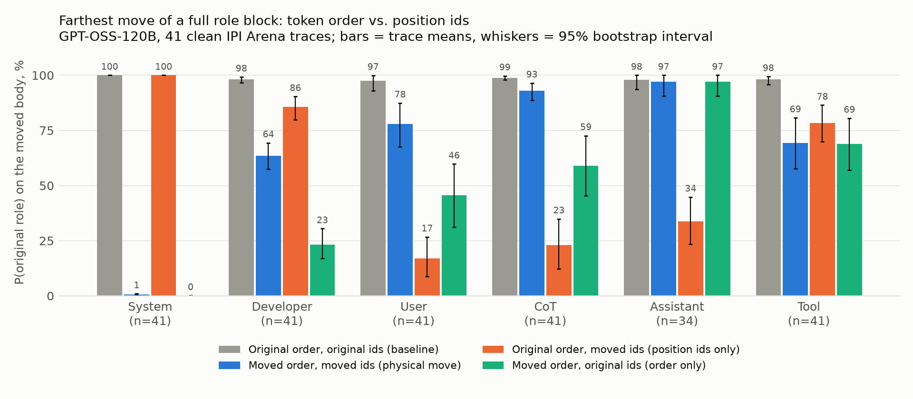
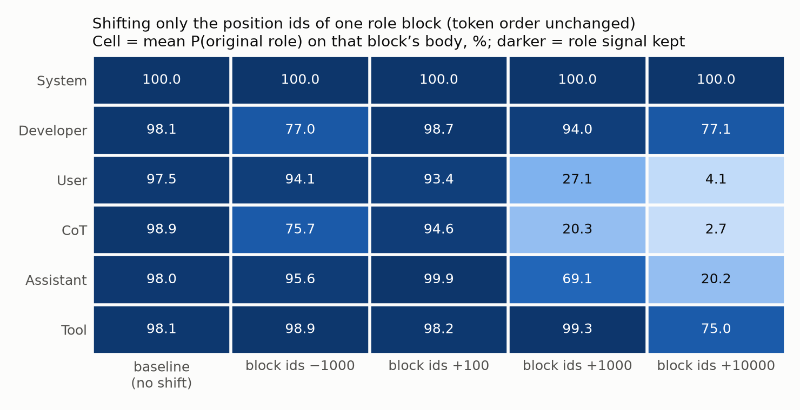

# IPI Arena 无注入轨迹：token 位置对 roleness 的影响（搬移 vs. 只改 position id）

模型 GPT-OSS-120B（native MXFP4/BF16，双 H100），roleness 由冻结 checkpoint
`outputs/c4-dolma3-single-agentdojo-mixed-2080ti-20261103/checkpoint.npz`（SHA `fe602209…a6ffa33`）读出。
数据是 2026-11-17 已封存的 41 条 IPI Arena no-payload 轨迹及其 first-role 正文（`../ipi-benign-trace-interventions-20261117`），本轮没有重新采样轨迹，也没有改动封存目录。

## 结论

1. **把整个 role block（含 delimiter）搬到最远处**：System 的原角色概率几乎归零（−99.4 个百分点），Developer −34.6、Tool −28.7、User −19.5、CoT −6.0，Assistant 基本不变（−0.9）。这部分是 11-17 封存结果，本轮原样引用。
2. **只改 position id 不能复现搬移的效果，两者的角色排序几乎相反。** 保持 token 顺序、只把 position id 换成“搬移后的 id”时，System 完全不变（0.0），而搬移时几乎不动的 CoT / Assistant / User 分别掉 −75.9 / −64.3 / −80.5。
3. **block 的 id +1000（顺序不变）**：User −70.3、CoT −78.6、Assistant −28.9、Developer −4.0，Tool 与 System 不变。+100 时最多只掉约 4 个百分点，+10000 时除 System 外全部明显下降。
4. **System 的搬移效应完全来自“前面出现了别的内容”，与 position id 无关。** 反过来只改顺序、保留原 id 时 System 同样归零（−99.95）。
5. 顺序和 position id 两个因素不可加：对 User / CoT，单独改任何一个都比两者一起改（真实搬移）伤害更大。这与“probe 特征依赖 id 和可见上下文是否自洽、而不是绝对位置”的解释一致，但本实验没有单独验证这一机制。



## 干预设计

GPT-OSS 用 RoPE（只依赖相对位置）加因果注意力，并交替使用 128-token 滑动窗口层。本实验中 **token 顺序决定可见性**（因果 mask 与滑动窗口都按下标计算），**position id 只决定 RoPE 相位**，所以两者可以独立改变。

| 条件 | token 顺序 | position id | forward 数 |
|---|---|---|---:|
| baseline | 原始 | 原始 `0..N-1` | 41（显式传入，逐位核对封存值） |
| move（封存） | 搬移后 | 搬移后 | 239（引用 11-17 结果） |
| posid_move | 原始 | 每个 token 取它在搬移后序列中的 id | 239 |
| order_move | 搬移后 | 每个 token 保留原始 id | 239 |
| block±D | 原始 | 仅该 role block（header+正文+ending）的 id 加 D，D ∈ {−1000, +100, +1000, +10000} | 4×239 |
| gap+1000 | 原始 | 该 block 及其后所有 token 的 id +1000 | 239 |
| global+1000 | 原始 | 全部 id +1000（数值对照） | 41 |

搬移规则沿用封存实验：完整 block 搬到 complete-block 序列的开头或末尾，取正文起点位移更大的一端。读数口径也相同：在固定的原始正文 token 上逐 token 做六分类 softmax，先在正文内平均，再对有该角色的 trace 等权平均；区间为 2,000 次 whole-trace 配对 bootstrap 的 pointwise 95% 区间（seed 20261112）。Assistant n=34，其余 n=41。

由因果注意力可直接推出两点，读表时需要记住：

- 正文只能看到自己和前面的 token，所以对被操作的正文而言 `gap+D` 与 `block+D` 完全等价（实测差值为 0）；它们只在下游角色上有区别。
- 对正文来说，block 的 id 平移 D 等价于“它与全部前文的相对距离改变 D，block 内部距离不变”。System block 从下标 0 开始、前面没有内容，任何 id 平移对它都是整体平移，因此 System 在所有只改 id 的条件下恒为 baseline（实测最大差 0.0002 个百分点）。

## 结果一：搬移的 2×2 分解

P(original role)，%，trace 等权均值；括号内为相对 baseline 的配对差值及 95% 区间（百分点）。

| Role | n | Baseline | 真实搬移（顺序+id） | 只改 id（posid_move） | 只改顺序（order_move） |
|---|---:|---:|---:|---:|---:|
| System | 41 | 100.00 | 0.62（−99.38 [−99.67, −99.04]） | 100.00（−0.00） | 0.05（−99.95 [−100.00, −99.87]） |
| Developer | 41 | 98.07 | 63.50（−34.56 [−40.57, −28.76]） | 85.59（−12.48 [−18.26, −7.77]） | 23.16（−74.91 [−81.31, −67.43]） |
| User | 41 | 97.48 | 78.00（−19.48 [−29.01, −10.69]） | 17.03（−80.45 [−89.23, −69.84]） | 45.56（−51.92 [−65.73, −37.80]） |
| CoT | 41 | 98.90 | 92.94（−5.96 [−10.00, −2.52]） | 23.02（−75.87 [−86.46, −64.08]） | 58.95（−39.95 [−53.62, −26.27]） |
| Assistant | 34 | 97.96 | 97.05（−0.91 [−2.89, +0.02]） | 33.69（−64.27 [−74.75, −53.26]） | 97.06（−0.91 [−2.89, +0.02]） |
| Tool | 41 | 98.07 | 69.32（−28.74 [−40.66, −16.93]） | 78.44（−19.63 [−28.87, −11.36]） | 68.81（−29.26 [−41.17, −17.52]） |

按搬移方向拆开后规律更清楚（[by-move-direction.csv](analysis/by-move-direction.csv)）：

| Role / 方向 | n | Baseline | 真实搬移 | 只改 id | 只改顺序 |
|---|---:|---:|---:|---:|---:|
| System → 末尾 | 41 | 100.00 | 0.62 | 100.00 | 0.05 |
| Developer → 末尾 | 41 | 98.07 | 63.50 | 85.59 | 23.16 |
| User → 末尾 | 24 | 96.40 | 62.56 | 17.55 | 7.21 |
| User → 开头 | 17 | 99.01 | 99.80 | 16.30 | 99.71 |
| CoT → 末尾 | 19 | 99.19 | 86.21 | 20.25 | 12.85 |
| CoT → 开头 | 22 | 98.65 | 98.75 | 25.42 | 98.76 |
| Assistant → 开头 | 33 | 97.90 | 96.96 | 32.40 | 96.97 |
| Tool → 末尾 | 17 | 98.23 | 37.60 | 92.75 | 35.70 |
| Tool → 开头 | 24 | 97.95 | 91.79 | 68.30 | 92.26 |

（Assistant → 末尾只有 1 条，未列。）

- **搬到开头**：block 前面没有任何内容，真实搬移与“只改顺序”只差一个整体 id 平移，两列数值一致；User / CoT / Assistant 的 roleness 保持在 97–100%。同样的 id 变化如果不伴随顺序变化（block 的 id 变小、但它仍看得到 id 比自己大的前文），roleness 掉到 16–32%。
- **搬到末尾**：System 和 Tool 的下降由顺序（看到了原本在后面的内容）解释，只改 id 时 System 100.00、Tool 92.75。User / CoT 则是只改 id（block 与前文之间出现一段 id 空缺）就掉到约 20%，真实搬移因为空缺被真实 token 填上，反而保住 62–86%。
- 真实搬移后丢失的概率主要流向 Assistant（System→Assistant 62.5%）；只改 id 时流向 Developer / User / Tool（User→Developer 80.2%，CoT→User 45.0%，Assistant→Tool 37.6%）。完整六分类见 [six-class-destination.csv](analysis/six-class-destination.csv)。

## 结果二：只平移一个 block 的 position id



相对 baseline 的配对差值，百分点 [95% 区间]：

| Role | block −1000 | block +100 | block +1000 | block +10000 |
|---|---:|---:|---:|---:|
| System | 0.00 | 0.00 | 0.00 | 0.00 |
| Developer | −21.06 [−26.81, −16.03] | +0.66 [+0.26, +1.19] | −4.02 [−5.44, −2.80] | −20.99 [−27.10, −16.02] |
| User | −3.33 [−7.52, −0.40] | −4.11 [−7.95, −1.02] | −70.34 [−78.58, −62.00] | −93.35 [−97.03, −88.04] |
| CoT | −23.24 [−31.77, −15.09] | −4.29 [−6.92, −2.02] | −78.62 [−85.25, −71.06] | −96.25 [−99.18, −92.25] |
| Assistant | −2.37 [−4.70, −0.49] | +1.89 [−0.32, +6.20] | −28.88 [−41.62, −17.67] | −77.72 [−86.52, −68.81] |
| Tool | +0.87 [−0.65, +3.17] | +0.12 [−1.66, +2.51] | +1.21 [−0.10, +3.49] | −23.03 [−32.36, −14.06] |

- 正向平移（block 离前文更远）有明显的剂量效应：+100 基本无影响，+1000 打掉 User / CoT，+10000 时 Tool 和 Developer 也开始下降。
- 方向不对称：−1000 对 User / Assistant 只有 2–3 个百分点，对 Developer（−21.1，其中 22.4% 流向 System）和 CoT（−23.2）较大。
- +1000 时 User 的概率主要流向 Developer（61.2%），CoT 流向 Developer（40.7%）与 User（19.3%）；+10000 时 CoT 主要变成 User（69.8%），User 变成 Developer（87.1%）。
- Tool 和 Developer 的正文长（中位 block 长度 274 / 2,274 token），对 ±1000 最不敏感；User / CoT 正文短（中位 34 / 25 token），最敏感。本实验没有区分“正文长度”和“角色本身”这两种解释。

## 下游溢出

改一个 block 的 id 也会影响它后面的其他角色正文（[spillover-downstream-roles.csv](analysis/spillover-downstream-roles.csv)，差值为下游正文 P(original role) 的均值变化）：

- **CoT 对前文的位置布局最敏感。** 把前一个 block 的 id 只 +100（与后续 token 的 id 发生重叠），下游 CoT 就下降 71–83 个百分点（来源为 Developer / User / Assistant block）。
- 在 User block 前插入 1000 的 id 空缺（gap+1000，User 与 CoT 的相对距离不变），下游 CoT 仍下降 58.0，Assistant −3.7，Tool +1.3。
- System block 的 id +1000 时，System 自身不变，但下游 Developer 下降 20.2；+100 时 −9.3。
- block 之前的正文在所有 block / gap 条件下差值严格为 0，符合因果性。

## 对照与校验

记录见 [validation.json](analysis/validation.json)。

| 检查 | 结果 |
|---|---|
| 显式传入 `0..N-1` 与封存 baseline | 41/41 条 head 特征（FP16）与 logits 逐位一致 |
| `gap+1000` 与 `block+1000` 在目标正文上 | 差值 0 |
| block 之前的正文（其 id 未被改动） | 差值 0 |
| System 的只改 id 条件 vs. baseline | 最大差 0.0002 个百分点 |
| global+1000 对照，角色均值 | 最大 \|Δ\| 0.33 个百分点（User） |
| global+1000 对照，单条 trace×角色 | \|Δ\| 中位数 0.001、95 分位 1.16、最大 6.70 个百分点 |

global+1000 在理论上应是恒等变换，实测单条 trace 最多偏 6.7 个百分点，这是 BF16 下绝对相位不同带来的数值差异。因此角色均值上小于约 0.5 个百分点、或单条 trace 上几个百分点以内的差别不应解读为位置效应；上面报告的主要效应（20–99 个百分点）远大于这一噪声。

## 局限

- 只改 id 或只改顺序都会产生训练中不存在的配置：id 重复、id 空缺、或可见的前文 id 比自己大。读数反映的是 probe 特征在这些分布外输入上的响应，不能直接等同于“位置的因果贡献”。
- order_move 中 block 仍保留原 id，但它前面的 token 的 id 比它大；这与“搬到新位置但 id 连续”的真实搬移不是同一件事，所以 2×2 不是可加分解。
- 41 条 trace 的 System 正文只有同一个 token 序列，Developer 33 种；bootstrap 区间不代表模板族层面的不确定性。
- 滑动窗口层的可见范围按 token 下标计算，没有随 position id 改变。如果想模拟“id 距离也决定窗口可见性”，需要另做一组实验。
- 只保存了 logits / probabilities，没有保存 hidden states 和 head 特征。

## 文件与复现

| 文件 | 内容 |
|---|---|
| [analysis/effects.csv](analysis/effects.csv) | 各条件 × 角色的均值、差值与区间 |
| [analysis/per-trace-target-role.csv](analysis/per-trace-target-role.csv) | 逐 trace 读数、搬移方向与位移 |
| [analysis/by-move-direction.csv](analysis/by-move-direction.csv) | 按搬移方向拆分 |
| [analysis/six-class-destination.csv](analysis/six-class-destination.csv) | 被操作正文的六分类均值 |
| [analysis/spillover-downstream-roles.csv](analysis/spillover-downstream-roles.csv) | 下游角色正文的变化 |
| [analysis/global-shift-control-per-trace.csv](analysis/global-shift-control-per-trace.csv) | global+1000 对照逐 trace 差值 |
| `readouts/*.npz` | 1,755 个输入的逐 token logits / probabilities / position ids（374 MB，仅保留在本地，未纳入 git） |

代码：`experiments/role-analysis/run_ipi_position_id_interventions.py`（forward）与 `analyze_ipi_position_id_interventions.py`（统计与图）。全量 1,755 个 forward 分两个 shard 在两组双 H100 上运行，各约 41–45 分钟。

```bash
.venv/bin/python experiments/agentdojo-first-tool/stage_model.py
```

```bash
cd experiments/role-analysis && CUDA_VISIBLE_DEVICES=0,1 ../../.venv/bin/python run_ipi_position_id_interventions.py --shard 0 --shards 2
```

```bash
cd experiments/role-analysis && CUDA_VISIBLE_DEVICES=2,3 ../../.venv/bin/python run_ipi_position_id_interventions.py --shard 1 --shards 2
```

```bash
cd experiments/role-analysis && ../../.venv/bin/python analyze_ipi_position_id_interventions.py
```

`shards/shard-0-of-1-*` 是先在 pilot trace `ipi/leak-codebase-zip` 上做的 44 个输入的试跑记录，其 readouts 已被全量运行复用。
