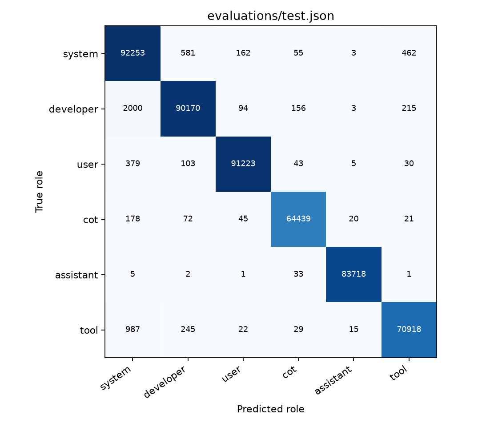
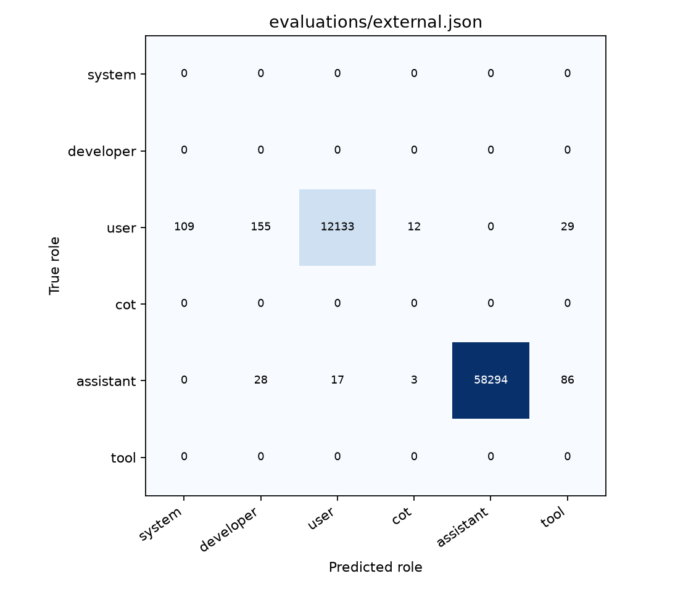

# GPT-OSS-120B 六角色实验：formal

此报告只陈述本运行目录已有产物；小试 DEV 结果不属于正式 TEST 结果。

GPU 预检状态：passed。最大输入 4096 token。
全设备峰值 MiB：[23170, 21990, 21990, 23090]。

数据统计：

| 划分 | 来源文章 | 输入快照 | 正文特征行 | 输入 token |
|---|---:|---:|---:|---:|
| fit | 4096 | 18383 | 1994752 | 21033085 |
| dev | 512 | 2284 | 249344 | 2602811 |
| test | 1024 | 4748 | 498688 | 6448997 |

文章审计状态：passed；结论仅覆盖所记录的固定分层样本。

Deterministic conservative screen plus saved article audit; no claim that a web corpus is provably free of all dialogue.

严格过滤排除问号、直接引语、第一/二人称表达和疑似评论/访谈/论坛来源，因而保留下来的文本偏向第三人称说明文章。Dolma3 使用固定版本的六个文章主题组轮转，并非整个 Dolma3 分布的随机样本。

| 划分 | 单消息缓存份额 | 单轮缓存份额 | 多轮缓存份额 | 排除的跨边界 token |
|---|---:|---:|---:|---:|
| fit | 19.92% | 29.98% | 50.10% | 1898 |
| dev | 19.92% | 29.98% | 50.10% | 247 |
| test | 19.92% | 29.98% | 50.10% | 512 |

原始正文特征行与家族归一化后的有效权重分别保存在数据清单中；重复快照不自动增加相同事件正文的训练权重。

16 头固定顺序：`1166, 1069, 2296, 1161, 2093, 2088, 2295, 2045, 2179, 2288, 1274, 897, 1305, 2091, 2094, 1930`。选头仅使用 pilot FIT 内部来源划分；DEV、TEST 和旧分类器不参与。

DEV 选择：`mlp128-seed17`；各类 precision/recall 90% 门槛：True。

模型与最佳 epoch 只按 DEV 选择：先优先考虑六类汇总 precision、recall 均≥90% 的候选，再依次比较更高的结构等权 macro-F1、更高的最弱 precision/recall、更低的 NLL、固定候选 ID。表中的总体 macro-F1 不是第一排序量；不使用合成 TEST 或外部对话挑选模型。

分类器最多运行 45 epochs、至少 10 epochs，早停 patience=8；batch=4096，AdamW 学习率=0.001、weight decay=0.001，MLP dropout=0.1，梯度裁剪=5.0。标准化仅由 FIT 估计，梯度更新只使用 FIT。

| 候选 | 最佳 epoch | 已运行 epochs | DEV macro-F1 | 结构等权 macro-F1 | 最弱 precision/recall |
|---|---:|---:|---:|---:|---:|
| linear-seed17 | 10 | 18 | 98.48% | 99.58% | 96.28% |
| mlp128-seed17 | 30 | 38 | 98.75% | 99.84% | 96.05% |
| mlp128-seed29 | 6 | 14 | 98.81% | 99.82% | 96.28% |
| mlp128-seed43 | 8 | 16 | 98.85% | 99.81% | 96.88% |
| mlp256-seed17 | 16 | 24 | 98.76% | 99.83% | 96.55% |
| mlp256-seed29 | 6 | 14 | 98.68% | 99.81% | 96.08% |
| mlp256-seed43 | 20 | 28 | 98.81% | 99.82% | 96.54% |

实际梯度采样先按单消息/单轮/多轮 20.00%/30.00%/50.00% 分层，再在层内均匀选择结构、适用角色，最后按正文家族归一化权重选行。未叠加类别损失权重。

下表累计计数涵盖候选实际执行的全部 epochs；导出权重恢复自该候选的最佳 epoch，较晚执行的更新不会加入较早的最佳 checkpoint。

| 候选 | 全部已运行 epochs 的抽样行数 | 单消息实际份额 | 单轮实际份额 | 多轮实际份额 |
|---|---:|---:|---:|---:|
| linear-seed17 | 35905536 | 20.00% | 29.99% | 50.01% |
| mlp128-seed17 | 75800576 | 20.00% | 30.00% | 50.00% |
| mlp128-seed29 | 27926528 | 20.00% | 30.00% | 50.00% |
| mlp128-seed43 | 31916032 | 20.00% | 30.00% | 50.00% |
| mlp256-seed17 | 47874048 | 20.00% | 29.99% | 50.01% |
| mlp256-seed29 | 27926528 | 20.00% | 30.00% | 50.00% |
| mlp256-seed43 | 55853056 | 20.00% | 30.00% | 50.00% |

选中 checkpoint 截至最佳 epoch 30 实际使用 59842560 次正文行抽样，单消息/单轮/多轮份额为 20.00%/29.99%/50.00%。

`evaluations/dev.json`：249344 个文章正文或真实对话正文位置；accuracy=98.70%，macro-F1=98.75%。

| 类别 | 正例位置 | Precision | Recall | F1 | 误报数 |
|---|---:|---:|---:|---:|---:|
| system | 47020 | 96.05% | 98.78% | 97.40% | 1909 |
| developer | 46613 | 98.93% | 96.72% | 97.81% | 488 |
| user | 46332 | 99.78% | 99.32% | 99.55% | 101 |
| cot | 32763 | 99.72% | 99.51% | 99.61% | 91 |
| assistant | 42351 | 99.90% | 99.97% | 99.93% | 43 |
| tool | 34265 | 98.22% | 98.11% | 98.17% | 608 |

无正例类别的 recall/F1 为 N/A；其误报仍计入。分项完整结果见对应 JSON 的 by_structure 和 by_attribute。


profile 分项：

| 分组 | 位置数 | Accuracy | Macro-F1 |
|---|---:|---:|---:|
| multi_round | 124928 | 99.88% | 99.88% |
| one_round | 74752 | 99.69% | 99.67% |
| single | 49664 | 94.25% | 94.30% |

template_id 分项：

| 分组 | 位置数 | Accuracy | Macro-F1 |
|---|---:|---:|---:|
| A | 8245 | 99.85% | 99.93% |
| C | 8245 | 98.05% | 99.01% |
| D | 8245 | 82.40% | 90.35% |
| S | 8342 | 96.63% | 98.29% |
| SD+UA+UA | 2928 | 98.67% | 98.60% |
| SD+UA+UA+UA | 732 | 100.00% | 100.00% |
| SD+UA+UA+UA+UCQ | 244 | 100.00% | 100.00% |
| SD+UA+UA+UA+UQTA | 244 | 100.00% | 100.00% |
| SD+UA+UA+UA+UQTCA | 244 | 100.00% | 100.00% |
| SD+UA+UA+UCA | 244 | 100.00% | 100.00% |
| SD+UA+UA+UCA+UCA | 488 | 100.00% | 100.00% |
| SD+UA+UA+UCA+UCQ | 488 | 96.31% | 98.01% |
| SD+UA+UA+UCQ | 976 | 100.00% | 100.00% |
| SD+UA+UA+UQTA | 488 | 99.80% | 99.76% |
| SD+UA+UA+UQTA+UA | 244 | 100.00% | 100.00% |
| SD+UA+UA+UQTA+UCQ | 244 | 100.00% | 100.00% |
| SD+UA+UA+UQTA+UQTCA | 244 | 99.59% | 99.59% |
| SD+UA+UA+UQTCA | 488 | 100.00% | 100.00% |
| SD+UA+UA+UQTCA+UA | 244 | 99.18% | 99.26% |
| SD+UA+UA+UQTCA+UCQ | 244 | 98.36% | 98.48% |
| SD+UA+UA+UQTCA+UQTCA | 244 | 100.00% | 100.00% |
| SD+UA+UCA | 2196 | 99.95% | 99.95% |
| SD+UA+UCA+UA | 732 | 100.00% | 100.00% |
| SD+UA+UCA+UA+UCA | 244 | 100.00% | 100.00% |
| SD+UA+UCA+UA+UQTA | 244 | 100.00% | 100.00% |
| SD+UA+UCA+UA+UQTCA | 488 | 100.00% | 100.00% |
| SD+UA+UCA+UCA | 244 | 100.00% | 100.00% |
| SD+UA+UCA+UCA+UA | 244 | 100.00% | 100.00% |
| SD+UA+UCA+UCA+UCQ | 244 | 100.00% | 100.00% |
| SD+UA+UCA+UCA+UQTCA | 244 | 100.00% | 100.00% |
| SD+UA+UCA+UCQ | 488 | 100.00% | 100.00% |
| SD+UA+UCA+UQTA | 488 | 100.00% | 100.00% |
| SD+UA+UCA+UQTA+UA | 244 | 100.00% | 100.00% |
| SD+UA+UCA+UQTA+UCQ | 244 | 100.00% | 100.00% |
| SD+UA+UCA+UQTCA | 976 | 100.00% | 100.00% |
| SD+UA+UCA+UQTCA+UCQ | 244 | 100.00% | 100.00% |
| SD+UA+UCA+UQTCA+UQTA | 244 | 100.00% | 100.00% |
| SD+UA+UCQ | 1952 | 99.95% | 99.95% |
| SD+UA+UQTA | 1464 | 100.00% | 100.00% |
| SD+UA+UQTA+UA | 488 | 100.00% | 100.00% |
| SD+UA+UQTA+UA+UQTA | 244 | 100.00% | 100.00% |
| SD+UA+UQTA+UA+UQTCA | 488 | 99.80% | 99.81% |
| SD+UA+UQTA+UCA | 976 | 100.00% | 100.00% |
| SD+UA+UQTA+UCA+UCA | 244 | 100.00% | 100.00% |
| SD+UA+UQTA+UCA+UCQ | 244 | 100.00% | 100.00% |
| SD+UA+UQTA+UCA+UQTCA | 244 | 100.00% | 100.00% |
| SD+UA+UQTA+UCQ | 732 | 99.86% | 99.86% |
| SD+UA+UQTA+UQTA | 976 | 100.00% | 100.00% |
| SD+UA+UQTA+UQTA+UA | 244 | 100.00% | 100.00% |
| SD+UA+UQTA+UQTA+UQTCA | 244 | 100.00% | 100.00% |
| SD+UA+UQTA+UQTCA | 488 | 99.59% | 99.57% |
| SD+UA+UQTA+UQTCA+UCA | 732 | 100.00% | 100.00% |
| SD+UA+UQTA+UQTCA+UQTA | 244 | 100.00% | 100.00% |
| SD+UA+UQTA+UQTCA+UQTCA | 244 | 100.00% | 100.00% |
| SD+UA+UQTCA | 2928 | 99.86% | 99.85% |
| SD+UA+UQTCA+UA | 732 | 100.00% | 100.00% |
| SD+UA+UQTCA+UA+UCQ | 488 | 99.59% | 99.54% |
| SD+UA+UQTCA+UCA | 732 | 98.91% | 98.96% |
| SD+UA+UQTCA+UCA+UQTCA | 244 | 100.00% | 100.00% |
| SD+UA+UQTCA+UCQ | 488 | 100.00% | 100.00% |
| SD+UA+UQTCA+UQTA+UA | 244 | 100.00% | 100.00% |
| SD+UA+UQTCA+UQTA+UCA | 244 | 100.00% | 100.00% |
| SD+UA+UQTCA+UQTA+UQTA | 244 | 100.00% | 100.00% |
| SD+UA+UQTCA+UQTA+UQTCA | 244 | 100.00% | 100.00% |
| SD+UA+UQTCA+UQTCA | 732 | 100.00% | 100.00% |
| SD+UA+UQTCA+UQTCA+UA | 244 | 100.00% | 100.00% |
| SD+UA+UQTCA+UQTCA+UCA | 244 | 100.00% | 100.00% |
| SD+UA+UQTCA+UQTCA+UCQ | 244 | 100.00% | 100.00% |
| SD+UA+UQTCA+UQTCA+UQTCA | 488 | 100.00% | 100.00% |
| SD+UCA+UA | 2196 | 100.00% | 100.00% |
| SD+UCA+UA+UA | 732 | 99.18% | 99.38% |
| SD+UCA+UA+UA+UA | 244 | 100.00% | 100.00% |
| SD+UCA+UA+UA+UQTA | 244 | 100.00% | 100.00% |
| SD+UCA+UA+UCA | 732 | 100.00% | 100.00% |
| SD+UCA+UA+UCA+UCA | 244 | 100.00% | 100.00% |
| SD+UCA+UA+UCA+UQTA | 244 | 100.00% | 100.00% |
| SD+UCA+UA+UCA+UQTCA | 244 | 100.00% | 100.00% |
| SD+UCA+UA+UCQ | 244 | 99.18% | 99.23% |
| SD+UCA+UA+UQTA | 488 | 100.00% | 100.00% |
| SD+UCA+UA+UQTA+UA | 244 | 100.00% | 100.00% |
| SD+UCA+UA+UQTA+UCA | 244 | 98.36% | 98.48% |
| SD+UCA+UA+UQTA+UQTA | 244 | 100.00% | 100.00% |
| SD+UCA+UA+UQTCA | 732 | 100.00% | 100.00% |
| SD+UCA+UA+UQTCA+UCQ | 244 | 100.00% | 100.00% |
| SD+UCA+UA+UQTCA+UQTA | 244 | 100.00% | 100.00% |
| SD+UCA+UCA | 2928 | 100.00% | 100.00% |
| SD+UCA+UCA+UA | 488 | 100.00% | 100.00% |
| SD+UCA+UCA+UA+UCQ | 488 | 100.00% | 100.00% |
| SD+UCA+UCA+UCA | 732 | 100.00% | 100.00% |
| SD+UCA+UCA+UCA+UA | 244 | 100.00% | 100.00% |
| SD+UCA+UCA+UCA+UCA | 244 | 100.00% | 100.00% |
| SD+UCA+UCA+UCA+UQTCA | 244 | 100.00% | 100.00% |
| SD+UCA+UCA+UCQ | 488 | 100.00% | 100.00% |
| SD+UCA+UCA+UQTA | 732 | 100.00% | 100.00% |
| SD+UCA+UCA+UQTA+UA | 244 | 100.00% | 100.00% |
| SD+UCA+UCA+UQTA+UCA | 244 | 100.00% | 100.00% |
| SD+UCA+UCA+UQTA+UQTCA | 244 | 100.00% | 100.00% |
| SD+UCA+UCA+UQTCA | 732 | 100.00% | 100.00% |
| SD+UCA+UCA+UQTCA+UCQ | 244 | 100.00% | 100.00% |
| SD+UCA+UCA+UQTCA+UQTA | 244 | 100.00% | 100.00% |
| SD+UCA+UCA+UQTCA+UQTCA | 244 | 100.00% | 100.00% |
| SD+UCA+UCQ | 1464 | 100.00% | 100.00% |
| SD+UCA+UQTA | 1464 | 100.00% | 100.00% |
| SD+UCA+UQTA+UA | 488 | 100.00% | 100.00% |
| SD+UCA+UQTA+UA+UA | 244 | 100.00% | 100.00% |
| SD+UCA+UQTA+UA+UCA | 244 | 100.00% | 100.00% |
| SD+UCA+UQTA+UCA | 244 | 100.00% | 100.00% |
| SD+UCA+UQTA+UCA+UCA | 244 | 100.00% | 100.00% |
| SD+UCA+UQTA+UCQ | 488 | 100.00% | 100.00% |
| SD+UCA+UQTA+UQTA+UCA | 244 | 100.00% | 100.00% |
| SD+UCA+UQTA+UQTCA | 976 | 100.00% | 100.00% |
| SD+UCA+UQTA+UQTCA+UA | 244 | 100.00% | 100.00% |
| SD+UCA+UQTA+UQTCA+UCA | 244 | 100.00% | 100.00% |
| SD+UCA+UQTCA | 2684 | 99.59% | 99.61% |
| SD+UCA+UQTCA+UA | 244 | 100.00% | 100.00% |
| SD+UCA+UQTCA+UA+UCA | 488 | 100.00% | 100.00% |
| SD+UCA+UQTCA+UA+UCQ | 244 | 100.00% | 100.00% |
| SD+UCA+UQTCA+UA+UQTA | 244 | 100.00% | 100.00% |
| SD+UCA+UQTCA+UCA | 244 | 100.00% | 100.00% |
| SD+UCA+UQTCA+UCA+UQTCA | 244 | 100.00% | 100.00% |
| SD+UCA+UQTCA+UCQ | 732 | 100.00% | 100.00% |
| SD+UCA+UQTCA+UQTA | 488 | 98.98% | 99.07% |
| SD+UCA+UQTCA+UQTA+UA | 244 | 99.59% | 99.63% |
| SD+UCA+UQTCA+UQTA+UCA | 488 | 100.00% | 100.00% |
| SD+UCA+UQTCA+UQTA+UQTCA | 244 | 100.00% | 100.00% |
| SD+UCA+UQTCA+UQTCA | 732 | 100.00% | 100.00% |
| SD+UCA+UQTCA+UQTCA+UCQ | 488 | 100.00% | 100.00% |
| SD+UCA+UQTCA+UQTCA+UQTA | 244 | 100.00% | 100.00% |
| SD+UQTA+UA | 2196 | 100.00% | 100.00% |
| SD+UQTA+UA+UA | 732 | 100.00% | 100.00% |
| SD+UQTA+UA+UA+UCQ | 244 | 100.00% | 100.00% |
| SD+UQTA+UA+UA+UQTCA | 244 | 99.59% | 99.59% |
| SD+UQTA+UA+UCA | 244 | 100.00% | 100.00% |
| SD+UQTA+UA+UCA+UQTA | 488 | 99.59% | 99.63% |
| SD+UQTA+UA+UCA+UQTCA | 488 | 100.00% | 100.00% |
| SD+UQTA+UA+UCQ | 244 | 100.00% | 100.00% |
| SD+UQTA+UA+UQTA | 244 | 100.00% | 100.00% |
| SD+UQTA+UA+UQTA+UCA | 244 | 100.00% | 100.00% |
| SD+UQTA+UA+UQTCA | 488 | 100.00% | 100.00% |
| SD+UQTA+UA+UQTCA+UCA | 244 | 100.00% | 100.00% |
| SD+UQTA+UA+UQTCA+UQTA | 244 | 100.00% | 100.00% |
| SD+UQTA+UCA | 3416 | 99.53% | 99.53% |
| SD+UQTA+UCA+UA | 732 | 100.00% | 100.00% |
| SD+UQTA+UCA+UA+UQTA | 488 | 99.39% | 99.48% |
| SD+UQTA+UCA+UCA | 488 | 100.00% | 100.00% |
| SD+UQTA+UCA+UCA+UA | 244 | 100.00% | 100.00% |
| SD+UQTA+UCA+UCA+UQTCA | 244 | 100.00% | 100.00% |
| SD+UQTA+UCA+UCQ | 488 | 100.00% | 100.00% |
| SD+UQTA+UCA+UQTA | 488 | 100.00% | 100.00% |
| SD+UQTA+UCA+UQTA+UQTA | 488 | 100.00% | 100.00% |
| SD+UQTA+UCA+UQTCA | 244 | 100.00% | 100.00% |
| SD+UQTA+UCA+UQTCA+UA | 244 | 100.00% | 100.00% |
| SD+UQTA+UCA+UQTCA+UQTA | 244 | 100.00% | 100.00% |
| SD+UQTA+UCQ | 2684 | 99.96% | 99.96% |
| SD+UQTA+UQTA | 976 | 100.00% | 100.00% |
| SD+UQTA+UQTA+UA | 976 | 99.90% | 99.90% |
| SD+UQTA+UQTA+UA+UCA | 244 | 100.00% | 100.00% |
| SD+UQTA+UQTA+UA+UQTCA | 488 | 100.00% | 100.00% |
| SD+UQTA+UQTA+UCA+UA | 244 | 99.59% | 99.63% |
| SD+UQTA+UQTA+UCA+UCA | 244 | 100.00% | 100.00% |
| SD+UQTA+UQTA+UCA+UCQ | 244 | 100.00% | 100.00% |
| SD+UQTA+UQTA+UCA+UQTA | 244 | 100.00% | 100.00% |
| SD+UQTA+UQTA+UCA+UQTCA | 488 | 100.00% | 100.00% |
| SD+UQTA+UQTA+UCQ | 488 | 100.00% | 100.00% |
| SD+UQTA+UQTA+UQTA | 732 | 100.00% | 100.00% |
| SD+UQTA+UQTA+UQTA+UA | 244 | 100.00% | 100.00% |
| SD+UQTA+UQTA+UQTA+UCQ | 244 | 100.00% | 100.00% |
| SD+UQTA+UQTA+UQTA+UQTA | 488 | 100.00% | 100.00% |
| SD+UQTA+UQTA+UQTA+UQTCA | 244 | 100.00% | 100.00% |
| SD+UQTA+UQTA+UQTCA | 488 | 100.00% | 100.00% |
| SD+UQTA+UQTA+UQTCA+UA | 244 | 100.00% | 100.00% |
| SD+UQTA+UQTCA | 1220 | 100.00% | 100.00% |
| SD+UQTA+UQTCA+UA | 1220 | 100.00% | 100.00% |
| SD+UQTA+UQTCA+UA+UA | 244 | 100.00% | 100.00% |
| SD+UQTA+UQTCA+UA+UQTCA | 244 | 100.00% | 100.00% |
| SD+UQTA+UQTCA+UCA+UA | 244 | 100.00% | 100.00% |
| SD+UQTA+UQTCA+UCA+UCA | 244 | 100.00% | 100.00% |
| SD+UQTA+UQTCA+UCA+UCQ | 244 | 100.00% | 100.00% |
| SD+UQTA+UQTCA+UCA+UQTCA | 244 | 100.00% | 100.00% |
| SD+UQTA+UQTCA+UCQ | 488 | 99.18% | 99.22% |
| SD+UQTA+UQTCA+UQTA+UA | 244 | 100.00% | 100.00% |
| SD+UQTA+UQTCA+UQTA+UCA | 244 | 100.00% | 100.00% |
| SD+UQTA+UQTCA+UQTA+UCQ | 244 | 99.18% | 99.21% |
| SD+UQTA+UQTCA+UQTCA | 1220 | 99.67% | 99.69% |
| SD+UQTA+UQTCA+UQTCA+UQTA | 244 | 100.00% | 100.00% |
| SD+UQTCA+UA | 1220 | 99.75% | 99.78% |
| SD+UQTCA+UA+UA | 732 | 100.00% | 100.00% |
| SD+UQTCA+UA+UA+UA | 244 | 100.00% | 100.00% |
| SD+UQTCA+UA+UA+UCA | 244 | 100.00% | 100.00% |
| SD+UQTCA+UA+UA+UCQ | 244 | 100.00% | 100.00% |
| SD+UQTCA+UA+UA+UQTCA | 244 | 100.00% | 100.00% |
| SD+UQTCA+UA+UCA+UCA | 488 | 100.00% | 100.00% |
| SD+UQTCA+UA+UCA+UQTCA | 976 | 100.00% | 100.00% |
| SD+UQTCA+UA+UCQ | 732 | 100.00% | 100.00% |
| SD+UQTCA+UA+UQTA | 488 | 100.00% | 100.00% |
| SD+UQTCA+UA+UQTA+UCA | 488 | 100.00% | 100.00% |
| SD+UQTCA+UA+UQTA+UQTA | 488 | 100.00% | 100.00% |
| SD+UQTCA+UA+UQTA+UQTCA | 488 | 100.00% | 100.00% |
| SD+UQTCA+UA+UQTCA | 244 | 100.00% | 100.00% |
| SD+UQTCA+UA+UQTCA+UCQ | 244 | 100.00% | 100.00% |
| SD+UQTCA+UA+UQTCA+UQTCA | 244 | 100.00% | 100.00% |
| SD+UQTCA+UCA | 2440 | 100.00% | 100.00% |
| SD+UQTCA+UCA+UA | 732 | 100.00% | 100.00% |
| SD+UQTCA+UCA+UA+UA | 244 | 99.18% | 99.26% |
| SD+UQTCA+UCA+UCA+UQTA | 244 | 100.00% | 100.00% |
| SD+UQTCA+UCA+UCQ | 244 | 100.00% | 100.00% |
| SD+UQTCA+UCA+UQTCA | 244 | 100.00% | 100.00% |
| SD+UQTCA+UCA+UQTCA+UA | 244 | 100.00% | 100.00% |
| SD+UQTCA+UCA+UQTCA+UCQ | 244 | 100.00% | 100.00% |
| SD+UQTCA+UCA+UQTCA+UQTCA | 244 | 100.00% | 100.00% |
| SD+UQTCA+UCQ | 2196 | 100.00% | 100.00% |
| SD+UQTCA+UQTA | 732 | 100.00% | 100.00% |
| SD+UQTCA+UQTA+UA | 976 | 100.00% | 100.00% |
| SD+UQTCA+UQTA+UA+UCA | 976 | 100.00% | 100.00% |
| SD+UQTCA+UQTA+UA+UQTA | 244 | 100.00% | 100.00% |
| SD+UQTCA+UQTA+UA+UQTCA | 244 | 100.00% | 100.00% |
| SD+UQTCA+UQTA+UCA | 488 | 99.80% | 99.81% |
| SD+UQTCA+UQTA+UCA+UCA | 244 | 100.00% | 100.00% |
| SD+UQTCA+UQTA+UCA+UQTA | 244 | 100.00% | 100.00% |
| SD+UQTCA+UQTA+UCQ | 488 | 100.00% | 100.00% |
| SD+UQTCA+UQTA+UQTA | 732 | 100.00% | 100.00% |
| SD+UQTCA+UQTA+UQTA+UA | 244 | 100.00% | 100.00% |
| SD+UQTCA+UQTA+UQTA+UQTA | 244 | 100.00% | 100.00% |
| SD+UQTCA+UQTA+UQTA+UQTCA | 244 | 100.00% | 100.00% |
| SD+UQTCA+UQTA+UQTCA+UCA | 244 | 100.00% | 100.00% |
| SD+UQTCA+UQTCA | 2684 | 99.96% | 99.96% |
| SD+UQTCA+UQTCA+UA | 244 | 100.00% | 100.00% |
| SD+UQTCA+UQTCA+UCA | 488 | 100.00% | 100.00% |
| SD+UQTCA+UQTCA+UCA+UCQ | 244 | 100.00% | 100.00% |
| SD+UQTCA+UQTCA+UCA+UQTA | 244 | 100.00% | 100.00% |
| SD+UQTCA+UQTCA+UCQ | 488 | 100.00% | 100.00% |
| SD+UQTCA+UQTCA+UQTA | 732 | 100.00% | 100.00% |
| SD+UQTCA+UQTCA+UQTA+UCA | 488 | 100.00% | 100.00% |
| SD+UQTCA+UQTCA+UQTCA | 488 | 100.00% | 100.00% |
| SD+UQTCA+UQTCA+UQTCA+UA | 244 | 100.00% | 100.00% |
| SDUA | 14892 | 99.43% | 99.58% |
| SDUCA | 14892 | 99.81% | 99.85% |
| SDUCQ | 15038 | 99.58% | 99.67% |
| SDUQTA | 14892 | 99.83% | 99.83% |
| SDUQTCA | 15038 | 99.82% | 99.83% |
| T | 8342 | 92.29% | 95.99% |
| U | 8245 | 96.28% | 98.10% |

rounds 分项：

| 分组 | 位置数 | Accuracy | Macro-F1 |
|---|---:|---:|---:|
| 0 | 49664 | 94.25% | 94.30% |
| 1 | 74752 | 99.69% | 99.67% |
| 2 | 41968 | 99.82% | 99.83% |
| 3 | 41480 | 99.92% | 99.92% |
| 4 | 41480 | 99.89% | 99.90% |

snapshot_stage 分项：

| 分组 | 位置数 | Accuracy | Macro-F1 |
|---|---:|---:|---:|
| output | 242961 | 98.67% | 98.71% |
| pre_tool_call | 2806 | 100.00% | 100.00% |
| tool_reply | 3577 | 99.94% | 99.97% |

history_policy 分项：

| 分组 | 位置数 | Accuracy | Macro-F1 |
|---|---:|---:|---:|
| drop_completed_round_cot | 39854 | 99.90% | 99.90% |
| drop_prior_call_cot | 28116 | 99.85% | 99.86% |
| prior_call_cot_visible | 2806 | 100.00% | 100.00% |
| retain | 178568 | 98.23% | 98.23% |

position_bin 分项：

| 分组 | 位置数 | Accuracy | Macro-F1 |
|---|---:|---:|---:|
| 0 | 80010 | 99.25% | 98.70% |
| 1 | 52998 | 98.56% | 97.58% |
| 2 | 55276 | 98.45% | 95.67% |
| 3 | 61060 | 98.33% | 94.07% |

正文位置诊断（相对每条消息完整正文，单独于整段输入位置）：

| 正文位置 | 评分位置数 | Accuracy | Macro-F1 |
|---|---:|---:|---:|
| q1 | 62817 | 99.51% | 99.53% |
| q2 | 62042 | 98.78% | 98.83% |
| q3 | 62724 | 98.44% | 98.50% |
| q4 | 61761 | 98.06% | 98.11% |
| first_25pct | 62817 | 99.51% | 99.53% |
| last_25pct | 63002 | 98.09% | 98.13% |

按角色的尾部 recall/误报、正文长度与上下文策略分项见 `dev-positions.json`；不存在的类别仍为 N/A。

`evaluations/test.json`：498688 个文章正文或真实对话正文位置；accuracy=98.80%（95% CI 98.63%–98.98%），macro-F1=98.85%（95% CI 98.69%–99.02%）。

| 类别 | 正例位置 | Precision | Recall | F1 | 误报数 |
|---|---:|---:|---:|---:|---:|
| system | 93516 | 96.30% | 98.65% | 97.46% | 3549 |
| developer | 92638 | 98.90% | 97.34% | 98.11% | 1003 |
| user | 91783 | 99.65% | 99.39% | 99.52% | 324 |
| cot | 64775 | 99.51% | 99.48% | 99.50% | 316 |
| assistant | 83760 | 99.95% | 99.95% | 99.95% | 46 |
| tool | 72216 | 98.98% | 98.20% | 98.59% | 729 |

无正例类别的 recall/F1 为 N/A；其误报仍计入。分项完整结果见对应 JSON 的 by_structure 和 by_attribute。

正式合成 TEST 点估计目标是否达到：是。阈值为 macro-F1≥95%，六类 precision/recall 均≥90%；置信区间单列，不将其下界称为达标承诺。



profile 分项：

| 分组 | 位置数 | Accuracy | Macro-F1 |
|---|---:|---:|---:|
| multi_round | 249856 | 99.92% | 99.92% |
| one_round | 149504 | 99.74% | 99.73% |
| single | 99328 | 94.59% | 94.67% |

template_id 分项：

| 分组 | 位置数 | Accuracy | Macro-F1 |
|---|---:|---:|---:|
| A | 16490 | 99.78% | 99.89% |
| C | 16587 | 98.06% | 99.02% |
| D | 16684 | 85.72% | 92.31% |
| S | 16587 | 95.04% | 97.46% |
| SD+UA+UA | 1220 | 99.34% | 99.34% |
| SD+UA+UA+UA | 488 | 99.80% | 99.79% |
| SD+UA+UA+UA+UA | 244 | 100.00% | 100.00% |
| SD+UA+UA+UA+UA+UCA | 244 | 100.00% | 100.00% |
| SD+UA+UA+UA+UA+UQTCA+UA | 244 | 100.00% | 100.00% |
| SD+UA+UA+UA+UCA+UQTA | 244 | 100.00% | 100.00% |
| SD+UA+UA+UA+UQTA | 244 | 100.00% | 100.00% |
| SD+UA+UA+UA+UQTA+UCA+UCA | 244 | 100.00% | 100.00% |
| SD+UA+UA+UA+UQTCA | 244 | 100.00% | 100.00% |
| SD+UA+UA+UA+UQTCA+UA | 244 | 100.00% | 100.00% |
| SD+UA+UA+UA+UQTCA+UA+UCA | 244 | 100.00% | 100.00% |
| SD+UA+UA+UA+UQTCA+UCA | 244 | 100.00% | 100.00% |
| SD+UA+UA+UA+UQTCA+UCQ | 244 | 100.00% | 100.00% |
| SD+UA+UA+UCA | 488 | 100.00% | 100.00% |
| SD+UA+UA+UCA+UA+UA | 244 | 100.00% | 100.00% |
| SD+UA+UA+UCA+UCA+UQTCA+UA | 244 | 100.00% | 100.00% |
| SD+UA+UA+UCA+UCQ | 244 | 100.00% | 100.00% |
| SD+UA+UA+UCA+UQTA | 244 | 100.00% | 100.00% |
| SD+UA+UA+UCA+UQTA+UCQ | 244 | 100.00% | 100.00% |
| SD+UA+UA+UCA+UQTCA | 244 | 100.00% | 100.00% |
| SD+UA+UA+UCA+UQTCA+UA+UQTA | 244 | 100.00% | 100.00% |
| SD+UA+UA+UCQ | 244 | 100.00% | 100.00% |
| SD+UA+UA+UQTA | 732 | 99.86% | 99.84% |
| SD+UA+UA+UQTA+UA+UA | 244 | 100.00% | 100.00% |
| SD+UA+UA+UQTA+UA+UQTCA+UQTA | 244 | 100.00% | 100.00% |
| SD+UA+UA+UQTA+UCA | 244 | 100.00% | 100.00% |
| SD+UA+UA+UQTA+UCA+UCA | 244 | 100.00% | 100.00% |
| SD+UA+UA+UQTA+UQTA+UCA+UQTA | 244 | 100.00% | 100.00% |
| SD+UA+UA+UQTA+UQTCA+UA | 488 | 100.00% | 100.00% |
| SD+UA+UA+UQTCA | 976 | 99.90% | 99.88% |
| SD+UA+UA+UQTCA+UA+UCA | 244 | 100.00% | 100.00% |
| SD+UA+UA+UQTCA+UA+UQTCA | 244 | 100.00% | 100.00% |
| SD+UA+UA+UQTCA+UCA | 244 | 100.00% | 100.00% |
| SD+UA+UA+UQTCA+UCA+UQTA+UQTA | 244 | 100.00% | 100.00% |
| SD+UA+UA+UQTCA+UCQ | 244 | 100.00% | 100.00% |
| SD+UA+UA+UQTCA+UQTA+UA+UQTA | 244 | 100.00% | 100.00% |
| SD+UA+UA+UQTCA+UQTA+UCA | 244 | 100.00% | 100.00% |
| SD+UA+UA+UQTCA+UQTCA | 488 | 100.00% | 100.00% |
| SD+UA+UA+UQTCA+UQTCA+UCQ | 244 | 100.00% | 100.00% |
| SD+UA+UCA | 1952 | 99.90% | 99.90% |
| SD+UA+UCA+UA | 732 | 99.86% | 99.88% |
| SD+UA+UCA+UA+UA+UCQ | 488 | 100.00% | 100.00% |
| SD+UA+UCA+UA+UA+UQTA+UA | 244 | 100.00% | 100.00% |
| SD+UA+UCA+UA+UA+UQTA+UCA | 244 | 100.00% | 100.00% |
| SD+UA+UCA+UA+UCA+UA | 244 | 100.00% | 100.00% |
| SD+UA+UCA+UA+UCA+UCA | 244 | 100.00% | 100.00% |
| SD+UA+UCA+UA+UCA+UQTA | 244 | 100.00% | 100.00% |
| SD+UA+UCA+UA+UCA+UQTCA | 244 | 100.00% | 100.00% |
| SD+UA+UCA+UA+UCA+UQTCA+UCA | 244 | 100.00% | 100.00% |
| SD+UA+UCA+UA+UCA+UQTCA+UCQ | 244 | 100.00% | 100.00% |
| SD+UA+UCA+UA+UQTA+UCQ | 488 | 100.00% | 100.00% |
| SD+UA+UCA+UA+UQTCA+UQTCA | 244 | 100.00% | 100.00% |
| SD+UA+UCA+UCA+UA+UCA+UQTCA | 244 | 100.00% | 100.00% |
| SD+UA+UCA+UCA+UCA+UCA+UCQ | 244 | 100.00% | 100.00% |
| SD+UA+UCA+UCA+UCQ | 488 | 100.00% | 100.00% |
| SD+UA+UCA+UCA+UQTA+UQTCA+UA | 244 | 100.00% | 100.00% |
| SD+UA+UCA+UCA+UQTCA+UCA | 488 | 99.80% | 99.75% |
| SD+UA+UCA+UCA+UQTCA+UQTA | 244 | 100.00% | 100.00% |
| SD+UA+UCA+UCA+UQTCA+UQTCA | 244 | 100.00% | 100.00% |
| SD+UA+UCA+UCQ | 1220 | 99.84% | 99.84% |
| SD+UA+UCA+UQTA | 976 | 99.18% | 99.21% |
| SD+UA+UCA+UQTA+UA+UA+UA | 244 | 100.00% | 100.00% |
| SD+UA+UCA+UQTA+UA+UCQ | 244 | 100.00% | 100.00% |
| SD+UA+UCA+UQTA+UA+UQTA | 244 | 100.00% | 100.00% |
| SD+UA+UCA+UQTA+UA+UQTA+UQTCA | 244 | 100.00% | 100.00% |
| SD+UA+UCA+UQTA+UCA+UQTA+UCA | 244 | 100.00% | 100.00% |
| SD+UA+UCA+UQTA+UCA+UQTA+UQTA | 244 | 100.00% | 100.00% |
| SD+UA+UCA+UQTA+UQTA+UQTA+UQTA | 244 | 100.00% | 100.00% |
| SD+UA+UCA+UQTA+UQTCA+UA | 244 | 100.00% | 100.00% |
| SD+UA+UCA+UQTA+UQTCA+UCQ | 244 | 100.00% | 100.00% |
| SD+UA+UCA+UQTA+UQTCA+UQTCA | 244 | 93.85% | 93.85% |
| SD+UA+UCA+UQTCA | 488 | 100.00% | 100.00% |
| SD+UA+UCA+UQTCA+UA+UA+UQTCA | 244 | 100.00% | 100.00% |
| SD+UA+UCA+UQTCA+UA+UQTA+UA | 244 | 100.00% | 100.00% |
| SD+UA+UCA+UQTCA+UA+UQTCA | 244 | 100.00% | 100.00% |
| SD+UA+UCA+UQTCA+UCA+UA | 244 | 100.00% | 100.00% |
| SD+UA+UCA+UQTCA+UCA+UQTA+UCA | 244 | 100.00% | 100.00% |
| SD+UA+UCA+UQTCA+UCA+UQTCA | 244 | 100.00% | 100.00% |
| SD+UA+UCA+UQTCA+UCA+UQTCA+UQTCA | 244 | 100.00% | 100.00% |
| SD+UA+UCA+UQTCA+UCQ | 488 | 100.00% | 100.00% |
| SD+UA+UCA+UQTCA+UQTA+UA | 244 | 100.00% | 100.00% |
| SD+UA+UCA+UQTCA+UQTA+UCA+UCQ | 244 | 100.00% | 100.00% |
| SD+UA+UCA+UQTCA+UQTA+UCQ | 244 | 100.00% | 100.00% |
| SD+UA+UCA+UQTCA+UQTCA+UCA | 488 | 100.00% | 100.00% |
| SD+UA+UCA+UQTCA+UQTCA+UQTA+UCQ | 244 | 100.00% | 100.00% |
| SD+UA+UCQ | 1952 | 99.95% | 99.95% |
| SD+UA+UQTA | 1220 | 100.00% | 100.00% |
| SD+UA+UQTA+UA | 244 | 100.00% | 100.00% |
| SD+UA+UQTA+UA+UA | 488 | 100.00% | 100.00% |
| SD+UA+UQTA+UA+UA+UA | 244 | 100.00% | 100.00% |
| SD+UA+UQTA+UA+UCA+UA+UQTA | 244 | 100.00% | 100.00% |
| SD+UA+UQTA+UA+UCA+UCQ | 244 | 100.00% | 100.00% |
| SD+UA+UQTA+UA+UCA+UQTCA | 244 | 100.00% | 100.00% |
| SD+UA+UQTA+UA+UCQ | 244 | 98.36% | 98.37% |
| SD+UA+UQTA+UA+UQTA | 488 | 100.00% | 100.00% |
| SD+UA+UQTA+UA+UQTA+UA+UA | 244 | 100.00% | 100.00% |
| SD+UA+UQTA+UA+UQTA+UCQ | 244 | 100.00% | 100.00% |
| SD+UA+UQTA+UA+UQTCA+UCA+UA | 244 | 100.00% | 100.00% |
| SD+UA+UQTA+UA+UQTCA+UCA+UCA | 244 | 100.00% | 100.00% |
| SD+UA+UQTA+UA+UQTCA+UCQ | 244 | 100.00% | 100.00% |
| SD+UA+UQTA+UCA | 244 | 100.00% | 100.00% |
| SD+UA+UQTA+UCA+UA+UQTA+UA | 244 | 100.00% | 100.00% |
| SD+UA+UQTA+UCA+UCA | 244 | 100.00% | 100.00% |
| SD+UA+UQTA+UCA+UCA+UQTA | 244 | 100.00% | 100.00% |
| SD+UA+UQTA+UCA+UCA+UQTA+UA | 244 | 100.00% | 100.00% |
| SD+UA+UQTA+UCA+UQTA+UCA | 488 | 100.00% | 100.00% |
| SD+UA+UQTA+UCA+UQTCA+UCQ | 244 | 100.00% | 100.00% |
| SD+UA+UQTA+UCA+UQTCA+UQTA | 488 | 99.18% | 99.26% |
| SD+UA+UQTA+UCA+UQTCA+UQTCA+UQTA | 244 | 100.00% | 100.00% |
| SD+UA+UQTA+UCQ | 244 | 100.00% | 100.00% |
| SD+UA+UQTA+UQTA | 244 | 100.00% | 100.00% |
| SD+UA+UQTA+UQTA+UA | 244 | 100.00% | 100.00% |
| SD+UA+UQTA+UQTA+UA+UA+UCA | 244 | 100.00% | 100.00% |
| SD+UA+UQTA+UQTA+UA+UCA | 244 | 100.00% | 100.00% |
| SD+UA+UQTA+UQTA+UCA+UCA | 244 | 100.00% | 100.00% |
| SD+UA+UQTA+UQTA+UCA+UQTCA+UQTA | 244 | 100.00% | 100.00% |
| SD+UA+UQTA+UQTA+UCQ | 244 | 100.00% | 100.00% |
| SD+UA+UQTA+UQTA+UQTCA+UA+UQTA | 244 | 100.00% | 100.00% |
| SD+UA+UQTA+UQTA+UQTCA+UCA+UA | 244 | 100.00% | 100.00% |
| SD+UA+UQTA+UQTA+UQTCA+UQTA | 244 | 100.00% | 100.00% |
| SD+UA+UQTA+UQTCA | 488 | 100.00% | 100.00% |
| SD+UA+UQTA+UQTCA+UA+UCA+UCA | 244 | 100.00% | 100.00% |
| SD+UA+UQTA+UQTCA+UCA | 244 | 100.00% | 100.00% |
| SD+UA+UQTA+UQTCA+UCA+UA | 488 | 100.00% | 100.00% |
| SD+UA+UQTA+UQTCA+UCA+UQTCA+UCQ | 244 | 100.00% | 100.00% |
| SD+UA+UQTA+UQTCA+UCA+UQTCA+UQTA | 244 | 100.00% | 100.00% |
| SD+UA+UQTA+UQTCA+UCQ | 488 | 100.00% | 100.00% |
| SD+UA+UQTA+UQTCA+UQTCA+UA+UQTCA | 244 | 100.00% | 100.00% |
| SD+UA+UQTCA | 1464 | 100.00% | 100.00% |
| SD+UA+UQTCA+UA | 244 | 100.00% | 100.00% |
| SD+UA+UQTCA+UA+UA | 244 | 100.00% | 100.00% |
| SD+UA+UQTCA+UA+UA+UCQ | 244 | 100.00% | 100.00% |
| SD+UA+UQTCA+UA+UA+UQTA | 244 | 100.00% | 100.00% |
| SD+UA+UQTCA+UA+UCA+UCA | 244 | 100.00% | 100.00% |
| SD+UA+UQTCA+UA+UQTA+UA | 244 | 100.00% | 100.00% |
| SD+UA+UQTCA+UA+UQTA+UQTA+UCA | 244 | 100.00% | 100.00% |
| SD+UA+UQTCA+UA+UQTCA+UCA | 244 | 100.00% | 100.00% |
| SD+UA+UQTCA+UA+UQTCA+UQTA+UCA | 244 | 100.00% | 100.00% |
| SD+UA+UQTCA+UCA | 244 | 100.00% | 100.00% |
| SD+UA+UQTCA+UCA+UA+UA | 244 | 100.00% | 100.00% |
| SD+UA+UQTCA+UCA+UA+UA+UCQ | 244 | 100.00% | 100.00% |
| SD+UA+UQTCA+UCA+UA+UA+UQTCA | 244 | 100.00% | 100.00% |
| SD+UA+UQTCA+UCA+UA+UCA | 244 | 100.00% | 100.00% |
| SD+UA+UQTCA+UCA+UA+UCQ | 488 | 99.39% | 99.32% |
| SD+UA+UQTCA+UCA+UCA+UQTA+UA | 244 | 100.00% | 100.00% |
| SD+UA+UQTCA+UCA+UQTA+UQTA | 244 | 100.00% | 100.00% |
| SD+UA+UQTCA+UCA+UQTCA+UCA | 244 | 100.00% | 100.00% |
| SD+UA+UQTCA+UCA+UQTCA+UCA+UCQ | 244 | 100.00% | 100.00% |
| SD+UA+UQTCA+UQTA+UA+UCQ | 244 | 100.00% | 100.00% |
| SD+UA+UQTCA+UQTA+UA+UQTCA | 244 | 100.00% | 100.00% |
| SD+UA+UQTCA+UQTA+UCA | 244 | 100.00% | 100.00% |
| SD+UA+UQTCA+UQTA+UQTA | 244 | 100.00% | 100.00% |
| SD+UA+UQTCA+UQTA+UQTA+UA+UQTA | 244 | 100.00% | 100.00% |
| SD+UA+UQTCA+UQTA+UQTA+UCA | 244 | 100.00% | 100.00% |
| SD+UA+UQTCA+UQTA+UQTA+UQTCA+UA | 244 | 100.00% | 100.00% |
| SD+UA+UQTCA+UQTA+UQTCA | 244 | 100.00% | 100.00% |
| SD+UA+UQTCA+UQTA+UQTCA+UQTCA | 244 | 100.00% | 100.00% |
| SD+UA+UQTCA+UQTCA | 732 | 100.00% | 100.00% |
| SD+UA+UQTCA+UQTCA+UA+UA+UQTA | 244 | 100.00% | 100.00% |
| SD+UA+UQTCA+UQTCA+UA+UA+UQTCA | 244 | 100.00% | 100.00% |
| SD+UA+UQTCA+UQTCA+UA+UQTCA | 488 | 100.00% | 100.00% |
| SD+UA+UQTCA+UQTCA+UCA+UCQ | 488 | 100.00% | 100.00% |
| SD+UA+UQTCA+UQTCA+UCA+UQTCA+UA | 244 | 100.00% | 100.00% |
| SD+UA+UQTCA+UQTCA+UCA+UQTCA+UQTA | 244 | 100.00% | 100.00% |
| SD+UA+UQTCA+UQTCA+UQTCA | 244 | 100.00% | 100.00% |
| SD+UA+UQTCA+UQTCA+UQTCA+UA | 244 | 100.00% | 100.00% |
| SD+UCA+UA | 1464 | 100.00% | 100.00% |
| SD+UCA+UA+UA | 488 | 100.00% | 100.00% |
| SD+UCA+UA+UA+UA | 732 | 100.00% | 100.00% |
| SD+UCA+UA+UA+UA+UCQ | 244 | 100.00% | 100.00% |
| SD+UCA+UA+UA+UA+UQTCA+UCA | 244 | 100.00% | 100.00% |
| SD+UCA+UA+UA+UCA | 244 | 100.00% | 100.00% |
| SD+UCA+UA+UA+UCA+UA | 488 | 100.00% | 100.00% |
| SD+UCA+UA+UA+UCA+UQTA | 244 | 100.00% | 100.00% |
| SD+UCA+UA+UA+UCQ | 244 | 100.00% | 100.00% |
| SD+UCA+UA+UA+UQTA+UQTA | 244 | 100.00% | 100.00% |
| SD+UCA+UA+UA+UQTA+UQTCA+UCA | 244 | 100.00% | 100.00% |
| SD+UCA+UA+UA+UQTCA | 488 | 99.80% | 99.79% |
| SD+UCA+UA+UA+UQTCA+UCA+UA | 244 | 100.00% | 100.00% |
| SD+UCA+UA+UCA | 244 | 98.36% | 98.46% |
| SD+UCA+UA+UCA+UA | 244 | 100.00% | 100.00% |
| SD+UCA+UA+UCA+UA+UCQ | 244 | 100.00% | 100.00% |
| SD+UCA+UA+UCA+UCA+UA | 244 | 100.00% | 100.00% |
| SD+UCA+UA+UCA+UCA+UCQ | 244 | 100.00% | 100.00% |
| SD+UCA+UA+UCA+UCA+UQTA | 244 | 100.00% | 100.00% |
| SD+UCA+UA+UCA+UCQ | 244 | 100.00% | 100.00% |
| SD+UCA+UA+UCA+UQTCA+UA+UCA | 244 | 100.00% | 100.00% |
| SD+UCA+UA+UCA+UQTCA+UCQ | 244 | 100.00% | 100.00% |
| SD+UCA+UA+UCQ | 1464 | 99.86% | 99.87% |
| SD+UCA+UA+UQTA | 488 | 100.00% | 100.00% |
| SD+UCA+UA+UQTA+UA | 244 | 100.00% | 100.00% |
| SD+UCA+UA+UQTA+UA+UCA+UQTA | 244 | 100.00% | 100.00% |
| SD+UCA+UA+UQTA+UA+UQTCA | 244 | 100.00% | 100.00% |
| SD+UCA+UA+UQTA+UCA | 244 | 100.00% | 100.00% |
| SD+UCA+UA+UQTA+UCA+UA+UA | 244 | 100.00% | 100.00% |
| SD+UCA+UA+UQTA+UCA+UCQ | 488 | 100.00% | 100.00% |
| SD+UCA+UA+UQTA+UCA+UQTA+UCA | 244 | 100.00% | 100.00% |
| SD+UCA+UA+UQTA+UCA+UQTCA | 244 | 100.00% | 100.00% |
| SD+UCA+UA+UQTA+UQTA | 244 | 100.00% | 100.00% |
| SD+UCA+UA+UQTA+UQTA+UA | 244 | 100.00% | 100.00% |
| SD+UCA+UA+UQTA+UQTA+UQTCA | 244 | 100.00% | 100.00% |
| SD+UCA+UA+UQTCA | 732 | 100.00% | 100.00% |
| SD+UCA+UA+UQTCA+UCA | 244 | 100.00% | 100.00% |
| SD+UCA+UA+UQTCA+UQTA | 244 | 100.00% | 100.00% |
| SD+UCA+UA+UQTCA+UQTA+UA+UQTA | 244 | 100.00% | 100.00% |
| SD+UCA+UA+UQTCA+UQTA+UCA+UCA | 244 | 100.00% | 100.00% |
| SD+UCA+UA+UQTCA+UQTA+UCA+UCQ | 244 | 100.00% | 100.00% |
| SD+UCA+UA+UQTCA+UQTCA | 244 | 100.00% | 100.00% |
| SD+UCA+UA+UQTCA+UQTCA+UA | 244 | 100.00% | 100.00% |
| SD+UCA+UA+UQTCA+UQTCA+UCA+UCQ | 244 | 100.00% | 100.00% |
| SD+UCA+UA+UQTCA+UQTCA+UCQ | 244 | 99.59% | 99.48% |
| SD+UCA+UA+UQTCA+UQTCA+UQTA | 244 | 100.00% | 100.00% |
| SD+UCA+UCA | 2928 | 99.93% | 99.97% |
| SD+UCA+UCA+UA | 244 | 88.11% | 92.66% |
| SD+UCA+UCA+UA+UA+UQTA | 244 | 100.00% | 100.00% |
| SD+UCA+UCA+UA+UA+UQTCA+UCA | 244 | 100.00% | 100.00% |
| SD+UCA+UCA+UA+UCA | 244 | 100.00% | 100.00% |
| SD+UCA+UCA+UA+UCA+UA | 244 | 100.00% | 100.00% |
| SD+UCA+UCA+UA+UCA+UA+UQTA | 244 | 100.00% | 100.00% |
| SD+UCA+UCA+UA+UCA+UCA+UA | 244 | 100.00% | 100.00% |
| SD+UCA+UCA+UA+UCA+UCQ | 244 | 100.00% | 100.00% |
| SD+UCA+UCA+UA+UQTA | 244 | 100.00% | 100.00% |
| SD+UCA+UCA+UA+UQTA+UA | 488 | 100.00% | 100.00% |
| SD+UCA+UCA+UA+UQTA+UCA+UA | 244 | 100.00% | 100.00% |
| SD+UCA+UCA+UA+UQTA+UQTA+UQTCA | 244 | 100.00% | 100.00% |
| SD+UCA+UCA+UA+UQTCA+UA+UCA | 244 | 100.00% | 100.00% |
| SD+UCA+UCA+UCA | 244 | 100.00% | 100.00% |
| SD+UCA+UCA+UCA+UA | 244 | 98.36% | 98.87% |
| SD+UCA+UCA+UCA+UA+UA+UA | 244 | 100.00% | 100.00% |
| SD+UCA+UCA+UCA+UA+UQTA+UCQ | 244 | 100.00% | 100.00% |
| SD+UCA+UCA+UCA+UCA+UCA | 244 | 100.00% | 100.00% |
| SD+UCA+UCA+UCA+UCA+UCA+UA | 244 | 100.00% | 100.00% |
| SD+UCA+UCA+UCA+UCA+UCQ | 244 | 100.00% | 100.00% |
| SD+UCA+UCA+UCA+UCA+UQTA+UQTCA | 244 | 100.00% | 100.00% |
| SD+UCA+UCA+UCA+UCQ | 244 | 100.00% | 100.00% |
| SD+UCA+UCA+UCA+UQTA | 244 | 100.00% | 100.00% |
| SD+UCA+UCA+UCA+UQTA+UA | 244 | 100.00% | 100.00% |
| SD+UCA+UCA+UCA+UQTA+UQTCA+UA | 244 | 100.00% | 100.00% |
| SD+UCA+UCA+UCA+UQTCA | 244 | 100.00% | 100.00% |
| SD+UCA+UCA+UCA+UQTCA+UA | 244 | 100.00% | 100.00% |
| SD+UCA+UCA+UCA+UQTCA+UA+UA | 244 | 100.00% | 100.00% |
| SD+UCA+UCA+UCA+UQTCA+UCA+UCQ | 244 | 99.18% | 98.95% |
| SD+UCA+UCA+UCA+UQTCA+UQTA+UA | 244 | 100.00% | 100.00% |
| SD+UCA+UCA+UCA+UQTCA+UQTCA | 244 | 100.00% | 100.00% |
| SD+UCA+UCA+UCA+UQTCA+UQTCA+UQTCA | 244 | 100.00% | 100.00% |
| SD+UCA+UCA+UQTA | 488 | 100.00% | 100.00% |
| SD+UCA+UCA+UQTA+UA | 244 | 100.00% | 100.00% |
| SD+UCA+UCA+UQTA+UA+UCA | 488 | 100.00% | 100.00% |
| SD+UCA+UCA+UQTA+UA+UCA+UQTA | 244 | 100.00% | 100.00% |
| SD+UCA+UCA+UQTA+UCA+UA | 244 | 100.00% | 100.00% |
| SD+UCA+UCA+UQTA+UCA+UQTCA | 244 | 100.00% | 100.00% |
| SD+UCA+UCA+UQTA+UQTA+UA | 244 | 100.00% | 100.00% |
| SD+UCA+UCA+UQTA+UQTA+UQTA | 244 | 100.00% | 100.00% |
| SD+UCA+UCA+UQTA+UQTA+UQTCA | 244 | 100.00% | 100.00% |
| SD+UCA+UCA+UQTA+UQTCA | 488 | 100.00% | 100.00% |
| SD+UCA+UCA+UQTA+UQTCA+UCA+UCQ | 244 | 100.00% | 100.00% |
| SD+UCA+UCA+UQTA+UQTCA+UQTA | 244 | 100.00% | 100.00% |
| SD+UCA+UCA+UQTA+UQTCA+UQTCA+UCA | 244 | 100.00% | 100.00% |
| SD+UCA+UCA+UQTCA | 488 | 100.00% | 100.00% |
| SD+UCA+UCA+UQTCA+UA | 244 | 100.00% | 100.00% |
| SD+UCA+UCA+UQTCA+UCA | 244 | 100.00% | 100.00% |
| SD+UCA+UCA+UQTCA+UCA+UCQ | 244 | 100.00% | 100.00% |
| SD+UCA+UCA+UQTCA+UCA+UQTCA | 244 | 99.59% | 99.46% |
| SD+UCA+UCA+UQTCA+UCQ | 244 | 100.00% | 100.00% |
| SD+UCA+UCA+UQTCA+UQTA | 244 | 100.00% | 100.00% |
| SD+UCA+UCA+UQTCA+UQTA+UQTA+UA | 244 | 100.00% | 100.00% |
| SD+UCA+UCA+UQTCA+UQTCA+UCA+UCQ | 244 | 99.18% | 99.22% |
| SD+UCA+UCA+UQTCA+UQTCA+UQTA+UA | 488 | 100.00% | 100.00% |
| SD+UCA+UCQ | 2684 | 100.00% | 100.00% |
| SD+UCA+UQTA | 2440 | 100.00% | 100.00% |
| SD+UCA+UQTA+UA | 488 | 100.00% | 100.00% |
| SD+UCA+UQTA+UA+UCA | 488 | 100.00% | 100.00% |
| SD+UCA+UQTA+UA+UCA+UCA+UA | 244 | 100.00% | 100.00% |
| SD+UCA+UQTA+UA+UCQ | 244 | 100.00% | 100.00% |
| SD+UCA+UQTA+UA+UQTA+UA+UQTA | 244 | 100.00% | 100.00% |
| SD+UCA+UQTA+UA+UQTA+UCA+UCQ | 244 | 100.00% | 100.00% |
| SD+UCA+UQTA+UA+UQTCA+UA+UCA | 244 | 100.00% | 100.00% |
| SD+UCA+UQTA+UA+UQTCA+UA+UQTA | 244 | 100.00% | 100.00% |
| SD+UCA+UQTA+UCA | 732 | 100.00% | 100.00% |
| SD+UCA+UQTA+UCA+UA | 244 | 100.00% | 100.00% |
| SD+UCA+UQTA+UCA+UA+UA+UCA | 244 | 100.00% | 100.00% |
| SD+UCA+UQTA+UCA+UA+UCQ | 244 | 98.36% | 98.45% |
| SD+UCA+UQTA+UCA+UA+UQTCA+UQTCA | 244 | 100.00% | 100.00% |
| SD+UCA+UQTA+UCA+UCA+UCA+UQTA | 244 | 100.00% | 100.00% |
| SD+UCA+UQTA+UCA+UCA+UQTA+UQTA | 244 | 100.00% | 100.00% |
| SD+UCA+UQTA+UCA+UQTA+UCQ | 244 | 100.00% | 100.00% |
| SD+UCA+UQTA+UCA+UQTA+UQTA+UA | 244 | 100.00% | 100.00% |
| SD+UCA+UQTA+UCA+UQTA+UQTA+UCQ | 244 | 100.00% | 100.00% |
| SD+UCA+UQTA+UCA+UQTA+UQTCA | 244 | 100.00% | 100.00% |
| SD+UCA+UQTA+UCA+UQTCA | 488 | 100.00% | 100.00% |
| SD+UCA+UQTA+UCQ | 244 | 100.00% | 100.00% |
| SD+UCA+UQTA+UQTA | 488 | 100.00% | 100.00% |
| SD+UCA+UQTA+UQTA+UA+UQTCA+UQTA | 244 | 100.00% | 100.00% |
| SD+UCA+UQTA+UQTA+UCA+UQTCA+UCQ | 244 | 100.00% | 100.00% |
| SD+UCA+UQTA+UQTA+UQTA | 244 | 100.00% | 100.00% |
| SD+UCA+UQTA+UQTA+UQTA+UCQ | 244 | 100.00% | 100.00% |
| SD+UCA+UQTA+UQTA+UQTA+UQTA | 244 | 100.00% | 100.00% |
| SD+UCA+UQTA+UQTA+UQTA+UQTCA+UCQ | 244 | 100.00% | 100.00% |
| SD+UCA+UQTA+UQTA+UQTCA+UCQ | 244 | 100.00% | 100.00% |
| SD+UCA+UQTA+UQTCA | 488 | 100.00% | 100.00% |
| SD+UCA+UQTA+UQTCA+UA | 244 | 100.00% | 100.00% |
| SD+UCA+UQTA+UQTCA+UCA | 244 | 99.18% | 99.22% |
| SD+UCA+UQTA+UQTCA+UQTA+UQTCA+UCA | 244 | 100.00% | 100.00% |
| SD+UCA+UQTA+UQTCA+UQTA+UQTCA+UQTA | 244 | 100.00% | 100.00% |
| SD+UCA+UQTA+UQTCA+UQTCA+UQTCA+UA | 244 | 100.00% | 100.00% |
| SD+UCA+UQTCA | 2440 | 100.00% | 100.00% |
| SD+UCA+UQTCA+UA | 244 | 100.00% | 100.00% |
| SD+UCA+UQTCA+UA+UCA+UCA+UA | 244 | 100.00% | 100.00% |
| SD+UCA+UQTCA+UA+UCA+UCA+UQTCA | 244 | 100.00% | 100.00% |
| SD+UCA+UQTCA+UA+UCA+UQTA | 244 | 100.00% | 100.00% |
| SD+UCA+UQTCA+UA+UCA+UQTCA | 244 | 100.00% | 100.00% |
| SD+UCA+UQTCA+UA+UQTA | 732 | 100.00% | 100.00% |
| SD+UCA+UQTCA+UA+UQTA+UCQ | 244 | 100.00% | 100.00% |
| SD+UCA+UQTCA+UA+UQTA+UQTA+UQTCA | 244 | 100.00% | 100.00% |
| SD+UCA+UQTCA+UA+UQTCA | 244 | 100.00% | 100.00% |
| SD+UCA+UQTCA+UA+UQTCA+UCA+UCQ | 244 | 100.00% | 100.00% |
| SD+UCA+UQTCA+UCA | 488 | 100.00% | 100.00% |
| SD+UCA+UQTCA+UCA+UA | 244 | 100.00% | 100.00% |
| SD+UCA+UQTCA+UCA+UA+UCQ | 244 | 100.00% | 100.00% |
| SD+UCA+UQTCA+UCA+UA+UQTA+UQTCA | 244 | 100.00% | 100.00% |
| SD+UCA+UQTCA+UCA+UCA+UA | 244 | 100.00% | 100.00% |
| SD+UCA+UQTCA+UCA+UCA+UQTCA+UQTA | 244 | 100.00% | 100.00% |
| SD+UCA+UQTCA+UCA+UCQ | 488 | 100.00% | 100.00% |
| SD+UCA+UQTCA+UCA+UQTA+UCA+UCA | 244 | 100.00% | 100.00% |
| SD+UCA+UQTCA+UCA+UQTA+UQTA+UQTCA | 244 | 100.00% | 100.00% |
| SD+UCA+UQTCA+UCA+UQTA+UQTCA+UCQ | 244 | 100.00% | 100.00% |
| SD+UCA+UQTCA+UCA+UQTCA | 244 | 100.00% | 100.00% |
| SD+UCA+UQTCA+UCA+UQTCA+UQTA+UA | 244 | 100.00% | 100.00% |
| SD+UCA+UQTCA+UCQ | 732 | 99.86% | 99.87% |
| SD+UCA+UQTCA+UQTA | 488 | 99.80% | 99.72% |
| SD+UCA+UQTCA+UQTA+UA | 732 | 100.00% | 100.00% |
| SD+UCA+UQTCA+UQTA+UCA | 244 | 100.00% | 100.00% |
| SD+UCA+UQTCA+UQTA+UCA+UA | 244 | 100.00% | 100.00% |
| SD+UCA+UQTCA+UQTA+UCA+UA+UCQ | 244 | 100.00% | 100.00% |
| SD+UCA+UQTCA+UQTA+UCA+UCA | 488 | 100.00% | 100.00% |
| SD+UCA+UQTCA+UQTA+UQTA+UQTCA+UQTCA | 488 | 100.00% | 100.00% |
| SD+UCA+UQTCA+UQTA+UQTCA+UCA | 244 | 100.00% | 100.00% |
| SD+UCA+UQTCA+UQTA+UQTCA+UCQ | 244 | 100.00% | 100.00% |
| SD+UCA+UQTCA+UQTCA | 488 | 100.00% | 100.00% |
| SD+UCA+UQTCA+UQTCA+UCQ | 244 | 100.00% | 100.00% |
| SD+UCA+UQTCA+UQTCA+UQTA | 488 | 99.80% | 99.81% |
| SD+UCA+UQTCA+UQTCA+UQTA+UCA | 244 | 100.00% | 100.00% |
| SD+UCA+UQTCA+UQTCA+UQTCA+UA+UCA | 244 | 100.00% | 100.00% |
| SD+UCA+UQTCA+UQTCA+UQTCA+UA+UCQ | 244 | 100.00% | 100.00% |
| SD+UCA+UQTCA+UQTCA+UQTCA+UQTA+UQTCA | 244 | 100.00% | 100.00% |
| SD+UQTA+UA | 1464 | 99.86% | 99.86% |
| SD+UQTA+UA+UA | 488 | 100.00% | 100.00% |
| SD+UQTA+UA+UA+UA | 244 | 100.00% | 100.00% |
| SD+UQTA+UA+UA+UA+UQTCA | 244 | 100.00% | 100.00% |
| SD+UQTA+UA+UA+UQTA | 488 | 100.00% | 100.00% |
| SD+UQTA+UA+UA+UQTA+UQTA+UQTCA | 244 | 100.00% | 100.00% |
| SD+UQTA+UA+UA+UQTA+UQTCA+UCQ | 244 | 100.00% | 100.00% |
| SD+UQTA+UA+UA+UQTCA+UA | 244 | 100.00% | 100.00% |
| SD+UQTA+UA+UA+UQTCA+UA+UQTA | 244 | 100.00% | 100.00% |
| SD+UQTA+UA+UCA | 1220 | 100.00% | 100.00% |
| SD+UQTA+UA+UCA+UA+UCA | 244 | 100.00% | 100.00% |
| SD+UQTA+UA+UCA+UCA | 244 | 100.00% | 100.00% |
| SD+UQTA+UA+UCA+UCA+UCQ | 244 | 100.00% | 100.00% |
| SD+UQTA+UA+UCA+UCA+UQTA+UA | 244 | 100.00% | 100.00% |
| SD+UQTA+UA+UCA+UCA+UQTCA+UQTCA | 244 | 100.00% | 100.00% |
| SD+UQTA+UA+UCA+UQTA | 488 | 98.77% | 98.85% |
| SD+UQTA+UA+UCA+UQTA+UQTA+UQTA | 244 | 100.00% | 100.00% |
| SD+UQTA+UA+UCA+UQTCA+UA | 244 | 100.00% | 100.00% |
| SD+UQTA+UA+UCA+UQTCA+UA+UCQ | 244 | 100.00% | 100.00% |
| SD+UQTA+UA+UCA+UQTCA+UQTA | 244 | 100.00% | 100.00% |
| SD+UQTA+UA+UCQ | 244 | 100.00% | 100.00% |
| SD+UQTA+UA+UQTA | 244 | 100.00% | 100.00% |
| SD+UQTA+UA+UQTA+UA+UA+UQTCA | 244 | 100.00% | 100.00% |
| SD+UQTA+UA+UQTA+UA+UCQ | 244 | 100.00% | 100.00% |
| SD+UQTA+UA+UQTA+UCA | 244 | 100.00% | 100.00% |
| SD+UQTA+UA+UQTA+UCA+UA | 244 | 100.00% | 100.00% |
| SD+UQTA+UA+UQTA+UCA+UCA | 244 | 100.00% | 100.00% |
| SD+UQTA+UA+UQTA+UQTA+UA+UCA | 244 | 100.00% | 100.00% |
| SD+UQTA+UA+UQTA+UQTA+UCA+UCQ | 488 | 100.00% | 100.00% |
| SD+UQTA+UA+UQTA+UQTA+UQTA+UQTA | 244 | 100.00% | 100.00% |
| SD+UQTA+UA+UQTA+UQTA+UQTCA | 244 | 100.00% | 100.00% |
| SD+UQTA+UA+UQTA+UQTA+UQTCA+UA | 244 | 100.00% | 100.00% |
| SD+UQTA+UA+UQTA+UQTA+UQTCA+UQTA | 244 | 100.00% | 100.00% |
| SD+UQTA+UA+UQTA+UQTCA+UCA+UCQ | 244 | 100.00% | 100.00% |
| SD+UQTA+UA+UQTA+UQTCA+UCA+UQTA | 244 | 100.00% | 100.00% |
| SD+UQTA+UA+UQTA+UQTCA+UCQ | 244 | 100.00% | 100.00% |
| SD+UQTA+UA+UQTA+UQTCA+UQTA | 244 | 100.00% | 100.00% |
| SD+UQTA+UA+UQTA+UQTCA+UQTCA | 488 | 100.00% | 100.00% |
| SD+UQTA+UA+UQTCA | 488 | 100.00% | 100.00% |
| SD+UQTA+UA+UQTCA+UCA+UA+UCQ | 244 | 100.00% | 100.00% |
| SD+UQTA+UA+UQTCA+UCA+UQTA+UQTCA | 244 | 100.00% | 100.00% |
| SD+UQTA+UA+UQTCA+UCA+UQTCA | 244 | 100.00% | 100.00% |
| SD+UQTA+UA+UQTCA+UCA+UQTCA+UQTA | 244 | 100.00% | 100.00% |
| SD+UQTA+UA+UQTCA+UCQ | 488 | 100.00% | 100.00% |
| SD+UQTA+UA+UQTCA+UQTA | 488 | 100.00% | 100.00% |
| SD+UQTA+UA+UQTCA+UQTA+UQTA | 488 | 100.00% | 100.00% |
| SD+UQTA+UA+UQTCA+UQTCA | 244 | 100.00% | 100.00% |
| SD+UQTA+UCA | 2684 | 100.00% | 100.00% |
| SD+UQTA+UCA+UA | 488 | 100.00% | 100.00% |
| SD+UQTA+UCA+UA+UA | 244 | 100.00% | 100.00% |
| SD+UQTA+UCA+UA+UA+UCQ | 244 | 100.00% | 100.00% |
| SD+UQTA+UCA+UA+UA+UQTA+UCQ | 244 | 100.00% | 100.00% |
| SD+UQTA+UCA+UA+UCA | 488 | 100.00% | 100.00% |
| SD+UQTA+UCA+UA+UCA+UQTA+UCA | 244 | 100.00% | 100.00% |
| SD+UQTA+UCA+UA+UQTA | 244 | 100.00% | 100.00% |
| SD+UQTA+UCA+UCA | 976 | 100.00% | 100.00% |
| SD+UQTA+UCA+UCA+UA | 488 | 100.00% | 100.00% |
| SD+UQTA+UCA+UCA+UA+UA+UCQ | 244 | 100.00% | 100.00% |
| SD+UQTA+UCA+UCA+UA+UQTCA | 244 | 100.00% | 100.00% |
| SD+UQTA+UCA+UCA+UCA+UA | 244 | 100.00% | 100.00% |
| SD+UQTA+UCA+UCA+UCA+UCQ | 244 | 100.00% | 100.00% |
| SD+UQTA+UCA+UCA+UCQ | 244 | 100.00% | 100.00% |
| SD+UQTA+UCA+UCA+UQTA | 244 | 100.00% | 100.00% |
| SD+UQTA+UCA+UCA+UQTA+UQTA+UCQ | 244 | 99.59% | 99.61% |
| SD+UQTA+UCA+UCA+UQTA+UQTA+UQTA | 244 | 100.00% | 100.00% |
| SD+UQTA+UCA+UCQ | 244 | 100.00% | 100.00% |
| SD+UQTA+UCA+UQTA | 244 | 100.00% | 100.00% |
| SD+UQTA+UCA+UQTA+UA | 244 | 100.00% | 100.00% |
| SD+UQTA+UCA+UQTA+UCA+UCQ | 244 | 100.00% | 100.00% |
| SD+UQTA+UCA+UQTA+UCA+UQTCA | 244 | 100.00% | 100.00% |
| SD+UQTA+UCA+UQTA+UCA+UQTCA+UA | 244 | 100.00% | 100.00% |
| SD+UQTA+UCA+UQTA+UQTA+UQTA | 244 | 100.00% | 100.00% |
| SD+UQTA+UCA+UQTA+UQTCA+UQTA+UCA | 244 | 100.00% | 100.00% |
| SD+UQTA+UCA+UQTCA | 244 | 100.00% | 100.00% |
| SD+UQTA+UCA+UQTCA+UA | 244 | 100.00% | 100.00% |
| SD+UQTA+UCA+UQTCA+UA+UCA | 244 | 100.00% | 100.00% |
| SD+UQTA+UCA+UQTCA+UCA | 488 | 99.80% | 99.80% |
| SD+UQTA+UCA+UQTCA+UCA+UA+UCQ | 244 | 100.00% | 100.00% |
| SD+UQTA+UCA+UQTCA+UCA+UCQ | 244 | 100.00% | 100.00% |
| SD+UQTA+UCA+UQTCA+UQTA | 732 | 99.73% | 99.61% |
| SD+UQTA+UCA+UQTCA+UQTA+UCA+UQTCA | 244 | 100.00% | 100.00% |
| SD+UQTA+UCA+UQTCA+UQTCA | 244 | 100.00% | 100.00% |
| SD+UQTA+UCA+UQTCA+UQTCA+UQTA+UQTCA | 244 | 100.00% | 100.00% |
| SD+UQTA+UCQ | 1708 | 99.77% | 99.77% |
| SD+UQTA+UQTA | 1464 | 100.00% | 100.00% |
| SD+UQTA+UQTA+UA | 244 | 100.00% | 100.00% |
| SD+UQTA+UQTA+UA+UA+UA+UA | 244 | 100.00% | 100.00% |
| SD+UQTA+UQTA+UA+UCA | 244 | 100.00% | 100.00% |
| SD+UQTA+UQTA+UA+UCA+UCQ | 244 | 100.00% | 100.00% |
| SD+UQTA+UQTA+UA+UCQ | 244 | 100.00% | 100.00% |
| SD+UQTA+UQTA+UA+UQTA+UCQ | 244 | 100.00% | 100.00% |
| SD+UQTA+UQTA+UA+UQTCA+UCA | 244 | 100.00% | 100.00% |
| SD+UQTA+UQTA+UA+UQTCA+UCQ | 244 | 100.00% | 100.00% |
| SD+UQTA+UQTA+UA+UQTCA+UQTA+UA | 244 | 99.59% | 99.44% |
| SD+UQTA+UQTA+UCA | 732 | 100.00% | 100.00% |
| SD+UQTA+UQTA+UCA+UA+UA | 244 | 100.00% | 100.00% |
| SD+UQTA+UQTA+UCA+UA+UA+UQTA | 244 | 100.00% | 100.00% |
| SD+UQTA+UQTA+UCA+UCA+UA | 244 | 100.00% | 100.00% |
| SD+UQTA+UQTA+UCA+UQTA+UCQ | 244 | 100.00% | 100.00% |
| SD+UQTA+UQTA+UCA+UQTA+UQTA+UA | 244 | 99.18% | 99.24% |
| SD+UQTA+UQTA+UCA+UQTA+UQTCA | 244 | 100.00% | 100.00% |
| SD+UQTA+UQTA+UCA+UQTCA+UA | 244 | 100.00% | 100.00% |
| SD+UQTA+UQTA+UCA+UQTCA+UA+UCA | 244 | 100.00% | 100.00% |
| SD+UQTA+UQTA+UCA+UQTCA+UCQ | 244 | 100.00% | 100.00% |
| SD+UQTA+UQTA+UCA+UQTCA+UQTA+UCQ | 244 | 99.18% | 99.21% |
| SD+UQTA+UQTA+UCQ | 488 | 100.00% | 100.00% |
| SD+UQTA+UQTA+UQTA | 244 | 100.00% | 100.00% |
| SD+UQTA+UQTA+UQTA+UA+UCA | 244 | 100.00% | 100.00% |
| SD+UQTA+UQTA+UQTA+UCA | 244 | 100.00% | 100.00% |
| SD+UQTA+UQTA+UQTA+UCA+UA+UA | 244 | 100.00% | 100.00% |
| SD+UQTA+UQTA+UQTA+UCA+UQTA+UQTA | 244 | 100.00% | 100.00% |
| SD+UQTA+UQTA+UQTA+UCQ | 488 | 100.00% | 100.00% |
| SD+UQTA+UQTA+UQTA+UQTA | 244 | 100.00% | 100.00% |
| SD+UQTA+UQTA+UQTA+UQTA+UA | 244 | 100.00% | 100.00% |
| SD+UQTA+UQTA+UQTA+UQTA+UA+UCA | 244 | 100.00% | 100.00% |
| SD+UQTA+UQTA+UQTA+UQTA+UQTA+UA | 244 | 99.18% | 99.18% |
| SD+UQTA+UQTA+UQTA+UQTCA+UA | 244 | 100.00% | 100.00% |
| SD+UQTA+UQTA+UQTCA | 488 | 100.00% | 100.00% |
| SD+UQTA+UQTA+UQTCA+UA+UQTA | 488 | 100.00% | 100.00% |
| SD+UQTA+UQTA+UQTCA+UA+UQTCA | 244 | 100.00% | 100.00% |
| SD+UQTA+UQTA+UQTCA+UCA+UA | 244 | 100.00% | 100.00% |
| SD+UQTA+UQTA+UQTCA+UCA+UA+UCQ | 244 | 100.00% | 100.00% |
| SD+UQTA+UQTA+UQTCA+UCA+UA+UQTCA | 244 | 100.00% | 100.00% |
| SD+UQTA+UQTA+UQTCA+UCA+UCA | 244 | 100.00% | 100.00% |
| SD+UQTA+UQTA+UQTCA+UCA+UQTCA | 244 | 100.00% | 100.00% |
| SD+UQTA+UQTA+UQTCA+UQTA | 244 | 100.00% | 100.00% |
| SD+UQTA+UQTA+UQTCA+UQTA+UQTA | 244 | 100.00% | 100.00% |
| SD+UQTA+UQTA+UQTCA+UQTA+UQTA+UCA | 244 | 100.00% | 100.00% |
| SD+UQTA+UQTA+UQTCA+UQTA+UQTA+UCQ | 244 | 100.00% | 100.00% |
| SD+UQTA+UQTA+UQTCA+UQTCA+UQTCA | 244 | 100.00% | 100.00% |
| SD+UQTA+UQTCA | 2684 | 100.00% | 100.00% |
| SD+UQTA+UQTCA+UA | 488 | 100.00% | 100.00% |
| SD+UQTA+UQTCA+UA+UA+UA+UCA | 244 | 100.00% | 100.00% |
| SD+UQTA+UQTCA+UA+UA+UCA+UA | 244 | 100.00% | 100.00% |
| SD+UQTA+UQTCA+UA+UA+UCA+UQTA | 244 | 97.95% | 98.15% |
| SD+UQTA+UQTCA+UA+UA+UCA+UQTCA | 244 | 100.00% | 100.00% |
| SD+UQTA+UQTCA+UA+UCA | 244 | 100.00% | 100.00% |
| SD+UQTA+UQTCA+UA+UCA+UQTCA+UQTCA | 244 | 100.00% | 100.00% |
| SD+UQTA+UQTCA+UA+UCQ | 244 | 100.00% | 100.00% |
| SD+UQTA+UQTCA+UA+UQTCA+UQTCA+UCQ | 244 | 100.00% | 100.00% |
| SD+UQTA+UQTCA+UCA | 976 | 100.00% | 100.00% |
| SD+UQTA+UQTCA+UCA+UA+UCA+UQTCA | 244 | 100.00% | 100.00% |
| SD+UQTA+UQTCA+UCA+UCA | 244 | 100.00% | 100.00% |
| SD+UQTA+UQTCA+UCA+UCA+UA+UA | 244 | 100.00% | 100.00% |
| SD+UQTA+UQTCA+UCA+UCA+UQTA | 244 | 100.00% | 100.00% |
| SD+UQTA+UQTCA+UCA+UQTA | 244 | 100.00% | 100.00% |
| SD+UQTA+UQTCA+UCA+UQTA+UA | 244 | 100.00% | 100.00% |
| SD+UQTA+UQTCA+UCA+UQTA+UQTA | 244 | 100.00% | 100.00% |
| SD+UQTA+UQTCA+UCA+UQTA+UQTCA+UCA | 244 | 95.90% | 95.19% |
| SD+UQTA+UQTCA+UCA+UQTCA | 244 | 100.00% | 100.00% |
| SD+UQTA+UQTCA+UCA+UQTCA+UA | 244 | 100.00% | 100.00% |
| SD+UQTA+UQTCA+UCA+UQTCA+UQTA+UCQ | 244 | 100.00% | 100.00% |
| SD+UQTA+UQTCA+UCQ | 732 | 100.00% | 100.00% |
| SD+UQTA+UQTCA+UQTA | 732 | 97.81% | 97.94% |
| SD+UQTA+UQTCA+UQTA+UA+UA | 244 | 100.00% | 100.00% |
| SD+UQTA+UQTCA+UQTA+UCA+UQTCA+UQTCA | 244 | 100.00% | 100.00% |
| SD+UQTA+UQTCA+UQTA+UQTA+UQTA+UQTCA | 244 | 100.00% | 100.00% |
| SD+UQTA+UQTCA+UQTA+UQTA+UQTCA+UA | 244 | 100.00% | 100.00% |
| SD+UQTA+UQTCA+UQTA+UQTCA+UQTCA+UQTCA | 244 | 100.00% | 100.00% |
| SD+UQTA+UQTCA+UQTCA | 488 | 99.59% | 99.53% |
| SD+UQTA+UQTCA+UQTCA+UA+UCA+UA | 244 | 98.36% | 97.82% |
| SD+UQTA+UQTCA+UQTCA+UA+UQTCA | 244 | 100.00% | 100.00% |
| SD+UQTA+UQTCA+UQTCA+UA+UQTCA+UA | 244 | 100.00% | 100.00% |
| SD+UQTA+UQTCA+UQTCA+UCQ | 244 | 100.00% | 100.00% |
| SD+UQTA+UQTCA+UQTCA+UQTA+UA+UQTA | 244 | 99.59% | 99.63% |
| SD+UQTA+UQTCA+UQTCA+UQTA+UQTA+UCQ | 244 | 100.00% | 100.00% |
| SD+UQTA+UQTCA+UQTCA+UQTCA+UQTA | 244 | 100.00% | 100.00% |
| SD+UQTA+UQTCA+UQTCA+UQTCA+UQTCA | 244 | 100.00% | 100.00% |
| SD+UQTCA+UA | 2684 | 99.74% | 99.71% |
| SD+UQTCA+UA+UA+UA | 244 | 100.00% | 100.00% |
| SD+UQTCA+UA+UA+UCQ | 244 | 100.00% | 100.00% |
| SD+UQTCA+UA+UA+UQTA | 244 | 100.00% | 100.00% |
| SD+UQTCA+UA+UA+UQTA+UA | 244 | 100.00% | 100.00% |
| SD+UQTCA+UA+UA+UQTCA+UA | 244 | 100.00% | 100.00% |
| SD+UQTCA+UA+UA+UQTCA+UCQ | 244 | 100.00% | 100.00% |
| SD+UQTCA+UA+UA+UQTCA+UQTA+UA | 244 | 100.00% | 100.00% |
| SD+UQTCA+UA+UA+UQTCA+UQTCA+UCA | 244 | 99.59% | 99.48% |
| SD+UQTCA+UA+UCA | 488 | 100.00% | 100.00% |
| SD+UQTCA+UA+UCA+UA | 244 | 100.00% | 100.00% |
| SD+UQTCA+UA+UCA+UA+UCQ | 244 | 100.00% | 100.00% |
| SD+UQTCA+UA+UCA+UCA | 488 | 100.00% | 100.00% |
| SD+UQTCA+UA+UCA+UCA+UCA+UQTCA | 244 | 100.00% | 100.00% |
| SD+UQTCA+UA+UCA+UCA+UQTA | 244 | 100.00% | 100.00% |
| SD+UQTCA+UA+UCA+UCA+UQTA+UA | 244 | 100.00% | 100.00% |
| SD+UQTCA+UA+UCA+UCA+UQTCA+UQTCA | 244 | 100.00% | 100.00% |
| SD+UQTCA+UA+UCA+UQTA+UQTA | 244 | 99.59% | 99.62% |
| SD+UQTCA+UA+UCA+UQTA+UQTCA+UA | 244 | 100.00% | 100.00% |
| SD+UQTCA+UA+UCA+UQTA+UQTCA+UQTA | 244 | 100.00% | 100.00% |
| SD+UQTCA+UA+UCA+UQTCA+UQTCA+UQTA | 244 | 100.00% | 100.00% |
| SD+UQTCA+UA+UCQ | 732 | 100.00% | 100.00% |
| SD+UQTCA+UA+UQTA | 244 | 100.00% | 100.00% |
| SD+UQTCA+UA+UQTA+UA+UA+UCA | 244 | 100.00% | 100.00% |
| SD+UQTCA+UA+UQTA+UA+UCQ | 244 | 100.00% | 100.00% |
| SD+UQTCA+UA+UQTA+UCA+UA+UA | 244 | 100.00% | 100.00% |
| SD+UQTCA+UA+UQTA+UCQ | 244 | 100.00% | 100.00% |
| SD+UQTCA+UA+UQTA+UQTA+UA | 244 | 100.00% | 100.00% |
| SD+UQTCA+UA+UQTA+UQTA+UQTCA | 244 | 100.00% | 100.00% |
| SD+UQTCA+UA+UQTA+UQTCA+UA | 244 | 100.00% | 100.00% |
| SD+UQTCA+UA+UQTA+UQTCA+UA+UCA | 244 | 100.00% | 100.00% |
| SD+UQTCA+UA+UQTA+UQTCA+UCA | 244 | 100.00% | 100.00% |
| SD+UQTCA+UA+UQTCA | 244 | 100.00% | 100.00% |
| SD+UQTCA+UA+UQTCA+UA | 244 | 100.00% | 100.00% |
| SD+UQTCA+UA+UQTCA+UA+UCA+UQTA | 244 | 100.00% | 100.00% |
| SD+UQTCA+UA+UQTCA+UA+UCA+UQTCA | 244 | 100.00% | 100.00% |
| SD+UQTCA+UA+UQTCA+UCA+UA | 244 | 100.00% | 100.00% |
| SD+UQTCA+UA+UQTCA+UCA+UQTA+UCA | 244 | 100.00% | 100.00% |
| SD+UQTCA+UA+UQTCA+UCA+UQTCA | 244 | 100.00% | 100.00% |
| SD+UQTCA+UA+UQTCA+UCQ | 244 | 100.00% | 100.00% |
| SD+UQTCA+UA+UQTCA+UQTA | 244 | 100.00% | 100.00% |
| SD+UQTCA+UA+UQTCA+UQTA+UA | 244 | 100.00% | 100.00% |
| SD+UQTCA+UA+UQTCA+UQTCA | 244 | 100.00% | 100.00% |
| SD+UQTCA+UA+UQTCA+UQTCA+UCA | 244 | 100.00% | 100.00% |
| SD+UQTCA+UA+UQTCA+UQTCA+UCA+UA | 244 | 100.00% | 100.00% |
| SD+UQTCA+UA+UQTCA+UQTCA+UQTA | 244 | 100.00% | 100.00% |
| SD+UQTCA+UCA | 2684 | 100.00% | 100.00% |
| SD+UQTCA+UCA+UA | 244 | 100.00% | 100.00% |
| SD+UQTCA+UCA+UA+UA+UA+UCQ | 244 | 100.00% | 100.00% |
| SD+UQTCA+UCA+UA+UA+UQTA+UCA | 244 | 100.00% | 100.00% |
| SD+UQTCA+UCA+UA+UCA | 244 | 100.00% | 100.00% |
| SD+UQTCA+UCA+UA+UCA+UCA+UQTA | 244 | 100.00% | 100.00% |
| SD+UQTCA+UCA+UA+UCA+UQTA+UCQ | 244 | 100.00% | 100.00% |
| SD+UQTCA+UCA+UA+UCQ | 244 | 100.00% | 100.00% |
| SD+UQTCA+UCA+UA+UQTA | 244 | 100.00% | 100.00% |
| SD+UQTCA+UCA+UA+UQTCA+UCA | 244 | 100.00% | 100.00% |
| SD+UQTCA+UCA+UA+UQTCA+UQTCA | 488 | 100.00% | 100.00% |
| SD+UQTCA+UCA+UCA | 488 | 100.00% | 100.00% |
| SD+UQTCA+UCA+UCA+UA+UA+UA | 244 | 98.36% | 98.52% |
| SD+UQTCA+UCA+UCA+UA+UQTA | 488 | 100.00% | 100.00% |
| SD+UQTCA+UCA+UCA+UA+UQTCA+UQTCA | 244 | 100.00% | 100.00% |
| SD+UQTCA+UCA+UCA+UCA+UCA+UA | 244 | 100.00% | 100.00% |
| SD+UQTCA+UCA+UCA+UCA+UCQ | 244 | 100.00% | 100.00% |
| SD+UQTCA+UCA+UCA+UCQ | 244 | 100.00% | 100.00% |
| SD+UQTCA+UCA+UCA+UQTA+UA+UQTCA | 244 | 100.00% | 100.00% |
| SD+UQTCA+UCA+UCA+UQTA+UCA | 244 | 100.00% | 100.00% |
| SD+UQTCA+UCA+UCA+UQTCA | 244 | 100.00% | 100.00% |
| SD+UQTCA+UCA+UCA+UQTCA+UA+UCA | 488 | 100.00% | 100.00% |
| SD+UQTCA+UCA+UCA+UQTCA+UCA+UCQ | 244 | 100.00% | 100.00% |
| SD+UQTCA+UCA+UCA+UQTCA+UCA+UQTA | 244 | 100.00% | 100.00% |
| SD+UQTCA+UCA+UCA+UQTCA+UCQ | 244 | 99.59% | 99.46% |
| SD+UQTCA+UCA+UCQ | 488 | 100.00% | 100.00% |
| SD+UQTCA+UCA+UQTA | 732 | 100.00% | 100.00% |
| SD+UQTCA+UCA+UQTA+UA+UCQ | 244 | 100.00% | 100.00% |
| SD+UQTCA+UCA+UQTA+UA+UQTCA+UQTCA | 244 | 100.00% | 100.00% |
| SD+UQTCA+UCA+UQTA+UCA+UCA | 488 | 100.00% | 100.00% |
| SD+UQTCA+UCA+UQTA+UCA+UQTCA+UCA | 244 | 100.00% | 100.00% |
| SD+UQTCA+UCA+UQTA+UQTA+UQTCA | 244 | 100.00% | 100.00% |
| SD+UQTCA+UCA+UQTA+UQTA+UQTCA+UA | 244 | 100.00% | 100.00% |
| SD+UQTCA+UCA+UQTA+UQTA+UQTCA+UCQ | 244 | 100.00% | 100.00% |
| SD+UQTCA+UCA+UQTCA | 488 | 99.80% | 99.80% |
| SD+UQTCA+UCA+UQTCA+UA | 244 | 100.00% | 100.00% |
| SD+UQTCA+UCA+UQTCA+UA+UCA+UA | 244 | 100.00% | 100.00% |
| SD+UQTCA+UCA+UQTCA+UA+UQTCA | 488 | 100.00% | 100.00% |
| SD+UQTCA+UCA+UQTCA+UCA+UCA | 244 | 100.00% | 100.00% |
| SD+UQTCA+UCA+UQTCA+UCA+UQTCA+UCA | 244 | 100.00% | 100.00% |
| SD+UQTCA+UCA+UQTCA+UCQ | 488 | 100.00% | 100.00% |
| SD+UQTCA+UCA+UQTCA+UQTA+UQTA+UA | 244 | 100.00% | 100.00% |
| SD+UQTCA+UCA+UQTCA+UQTA+UQTCA+UCQ | 244 | 100.00% | 100.00% |
| SD+UQTCA+UCA+UQTCA+UQTCA | 244 | 100.00% | 100.00% |
| SD+UQTCA+UCA+UQTCA+UQTCA+UA | 244 | 100.00% | 100.00% |
| SD+UQTCA+UCA+UQTCA+UQTCA+UQTCA+UCA | 244 | 100.00% | 100.00% |
| SD+UQTCA+UCQ | 2684 | 99.89% | 99.89% |
| SD+UQTCA+UQTA | 2196 | 100.00% | 100.00% |
| SD+UQTCA+UQTA+UA | 732 | 100.00% | 100.00% |
| SD+UQTCA+UQTA+UA+UA+UA | 244 | 100.00% | 100.00% |
| SD+UQTCA+UQTA+UA+UA+UA+UA | 244 | 100.00% | 100.00% |
| SD+UQTCA+UQTA+UA+UA+UCA+UCA | 244 | 100.00% | 100.00% |
| SD+UQTCA+UQTA+UA+UA+UCQ | 244 | 100.00% | 100.00% |
| SD+UQTCA+UQTA+UA+UCA+UCA+UCQ | 244 | 100.00% | 100.00% |
| SD+UQTCA+UQTA+UA+UCA+UQTA | 244 | 100.00% | 100.00% |
| SD+UQTCA+UQTA+UA+UQTA+UCA | 244 | 100.00% | 100.00% |
| SD+UQTCA+UQTA+UA+UQTCA | 488 | 100.00% | 100.00% |
| SD+UQTCA+UQTA+UA+UQTCA+UQTCA+UQTCA | 244 | 100.00% | 100.00% |
| SD+UQTCA+UQTA+UCA | 732 | 100.00% | 100.00% |
| SD+UQTCA+UQTA+UCA+UA+UCQ | 244 | 100.00% | 100.00% |
| SD+UQTCA+UQTA+UCA+UA+UQTA | 244 | 100.00% | 100.00% |
| SD+UQTCA+UQTA+UCA+UA+UQTA+UCQ | 244 | 100.00% | 100.00% |
| SD+UQTCA+UQTA+UCA+UA+UQTA+UQTA | 244 | 100.00% | 100.00% |
| SD+UQTCA+UQTA+UCA+UA+UQTCA | 244 | 100.00% | 100.00% |
| SD+UQTCA+UQTA+UCA+UCA | 244 | 100.00% | 100.00% |
| SD+UQTCA+UQTA+UCA+UCA+UA | 244 | 100.00% | 100.00% |
| SD+UQTCA+UQTA+UCA+UCA+UQTA+UCQ | 244 | 100.00% | 100.00% |
| SD+UQTCA+UQTA+UCA+UCQ | 244 | 100.00% | 100.00% |
| SD+UQTCA+UQTA+UCA+UQTA | 488 | 100.00% | 100.00% |
| SD+UQTCA+UQTA+UCA+UQTA+UQTA | 244 | 100.00% | 100.00% |
| SD+UQTCA+UQTA+UCA+UQTA+UQTA+UCA | 244 | 100.00% | 100.00% |
| SD+UQTCA+UQTA+UCA+UQTA+UQTA+UQTA | 488 | 100.00% | 100.00% |
| SD+UQTCA+UQTA+UCA+UQTA+UQTCA | 244 | 100.00% | 100.00% |
| SD+UQTCA+UQTA+UCA+UQTA+UQTCA+UA | 244 | 100.00% | 100.00% |
| SD+UQTCA+UQTA+UCA+UQTCA+UCQ | 244 | 99.59% | 99.62% |
| SD+UQTCA+UQTA+UCA+UQTCA+UQTCA | 244 | 100.00% | 100.00% |
| SD+UQTCA+UQTA+UCQ | 488 | 100.00% | 100.00% |
| SD+UQTCA+UQTA+UQTA | 1464 | 100.00% | 100.00% |
| SD+UQTCA+UQTA+UQTA+UA+UQTA+UCA | 244 | 100.00% | 100.00% |
| SD+UQTCA+UQTA+UQTA+UA+UQTCA | 244 | 100.00% | 100.00% |
| SD+UQTCA+UQTA+UQTA+UCA+UA+UCA | 488 | 100.00% | 100.00% |
| SD+UQTCA+UQTA+UQTA+UCQ | 732 | 100.00% | 100.00% |
| SD+UQTCA+UQTA+UQTA+UQTA | 244 | 100.00% | 100.00% |
| SD+UQTCA+UQTA+UQTA+UQTA+UA+UQTCA | 244 | 100.00% | 100.00% |
| SD+UQTCA+UQTA+UQTA+UQTA+UQTCA+UA | 244 | 100.00% | 100.00% |
| SD+UQTCA+UQTA+UQTA+UQTA+UQTCA+UCQ | 244 | 100.00% | 100.00% |
| SD+UQTCA+UQTA+UQTA+UQTCA | 244 | 100.00% | 100.00% |
| SD+UQTCA+UQTA+UQTCA | 1464 | 99.80% | 99.79% |
| SD+UQTCA+UQTA+UQTCA+UA+UQTA | 244 | 100.00% | 100.00% |
| SD+UQTCA+UQTA+UQTCA+UCA+UCA | 244 | 100.00% | 100.00% |
| SD+UQTCA+UQTA+UQTCA+UCA+UCQ | 488 | 100.00% | 100.00% |
| SD+UQTCA+UQTA+UQTCA+UQTA | 488 | 100.00% | 100.00% |
| SD+UQTCA+UQTA+UQTCA+UQTA+UCA+UCA | 244 | 100.00% | 100.00% |
| SD+UQTCA+UQTA+UQTCA+UQTA+UQTA+UQTA | 244 | 100.00% | 100.00% |
| SD+UQTCA+UQTA+UQTCA+UQTA+UQTCA | 488 | 100.00% | 100.00% |
| SD+UQTCA+UQTA+UQTCA+UQTCA+UQTA | 244 | 100.00% | 100.00% |
| SD+UQTCA+UQTA+UQTCA+UQTCA+UQTCA | 244 | 100.00% | 100.00% |
| SD+UQTCA+UQTCA | 1952 | 99.95% | 99.94% |
| SD+UQTCA+UQTCA+UA | 976 | 99.90% | 99.86% |
| SD+UQTCA+UQTCA+UA+UA+UQTA+UCA | 244 | 100.00% | 100.00% |
| SD+UQTCA+UQTCA+UA+UA+UQTCA | 488 | 100.00% | 100.00% |
| SD+UQTCA+UQTCA+UA+UA+UQTCA+UCA | 244 | 100.00% | 100.00% |
| SD+UQTCA+UQTCA+UA+UCA | 244 | 100.00% | 100.00% |
| SD+UQTCA+UQTCA+UA+UCA+UCQ | 244 | 100.00% | 100.00% |
| SD+UQTCA+UQTCA+UA+UCA+UQTA+UQTA | 244 | 100.00% | 100.00% |
| SD+UQTCA+UQTCA+UA+UQTA+UA+UQTA | 244 | 100.00% | 100.00% |
| SD+UQTCA+UQTCA+UA+UQTA+UCA+UA | 488 | 100.00% | 100.00% |
| SD+UQTCA+UQTCA+UA+UQTCA | 244 | 100.00% | 100.00% |
| SD+UQTCA+UQTCA+UA+UQTCA+UA | 244 | 100.00% | 100.00% |
| SD+UQTCA+UQTCA+UA+UQTCA+UA+UCQ | 244 | 100.00% | 100.00% |
| SD+UQTCA+UQTCA+UA+UQTCA+UQTA+UCQ | 244 | 99.18% | 99.24% |
| SD+UQTCA+UQTCA+UA+UQTCA+UQTCA+UCA | 244 | 100.00% | 100.00% |
| SD+UQTCA+UQTCA+UCA | 244 | 100.00% | 100.00% |
| SD+UQTCA+UQTCA+UCA+UA | 244 | 100.00% | 100.00% |
| SD+UQTCA+UQTCA+UCA+UA+UCA+UCA | 244 | 100.00% | 100.00% |
| SD+UQTCA+UQTCA+UCA+UCA+UCQ | 244 | 100.00% | 100.00% |
| SD+UQTCA+UQTCA+UCA+UCQ | 732 | 100.00% | 100.00% |
| SD+UQTCA+UQTCA+UCA+UQTA | 244 | 100.00% | 100.00% |
| SD+UQTCA+UQTCA+UCQ | 732 | 100.00% | 100.00% |
| SD+UQTCA+UQTCA+UQTA | 244 | 100.00% | 100.00% |
| SD+UQTCA+UQTCA+UQTA+UCA | 244 | 100.00% | 100.00% |
| SD+UQTCA+UQTCA+UQTA+UCA+UCA | 488 | 100.00% | 100.00% |
| SD+UQTCA+UQTCA+UQTA+UCA+UCA+UQTA | 244 | 100.00% | 100.00% |
| SD+UQTCA+UQTCA+UQTA+UCA+UQTCA+UCA | 488 | 99.18% | 99.24% |
| SD+UQTCA+UQTCA+UQTA+UCA+UQTCA+UQTCA | 244 | 100.00% | 100.00% |
| SD+UQTCA+UQTCA+UQTA+UQTA+UA | 244 | 100.00% | 100.00% |
| SD+UQTCA+UQTCA+UQTA+UQTA+UCA+UQTCA | 244 | 100.00% | 100.00% |
| SD+UQTCA+UQTCA+UQTA+UQTCA | 488 | 100.00% | 100.00% |
| SD+UQTCA+UQTCA+UQTA+UQTCA+UA+UQTCA | 244 | 100.00% | 100.00% |
| SD+UQTCA+UQTCA+UQTA+UQTCA+UQTA | 244 | 100.00% | 100.00% |
| SD+UQTCA+UQTCA+UQTCA | 976 | 100.00% | 100.00% |
| SD+UQTCA+UQTCA+UQTCA+UA+UQTCA | 244 | 100.00% | 100.00% |
| SD+UQTCA+UQTCA+UQTCA+UA+UQTCA+UA | 244 | 100.00% | 100.00% |
| SD+UQTCA+UQTCA+UQTCA+UCA | 488 | 100.00% | 100.00% |
| SD+UQTCA+UQTCA+UQTCA+UCA+UA+UA | 244 | 99.59% | 99.63% |
| SD+UQTCA+UQTCA+UQTCA+UCA+UCQ | 244 | 99.59% | 99.49% |
| SD+UQTCA+UQTCA+UQTCA+UCA+UQTCA+UQTCA | 244 | 100.00% | 100.00% |
| SD+UQTCA+UQTCA+UQTCA+UQTA+UCA | 244 | 100.00% | 100.00% |
| SD+UQTCA+UQTCA+UQTCA+UQTA+UCQ | 244 | 100.00% | 100.00% |
| SD+UQTCA+UQTCA+UQTCA+UQTCA | 244 | 100.00% | 100.00% |
| SD+UQTCA+UQTCA+UQTCA+UQTCA+UA | 732 | 100.00% | 100.00% |
| SD+UQTCA+UQTCA+UQTCA+UQTCA+UQTA+UCQ | 244 | 100.00% | 100.00% |
| SDUA | 29930 | 99.74% | 99.82% |
| SDUCA | 29784 | 99.75% | 99.78% |
| SDUCQ | 29930 | 99.64% | 99.72% |
| SDUQTA | 29930 | 99.75% | 99.77% |
| SDUQTCA | 29930 | 99.79% | 99.79% |
| T | 16490 | 92.29% | 95.99% |
| U | 16490 | 96.76% | 98.35% |

rounds 分项：

| 分组 | 位置数 | Accuracy | Macro-F1 |
|---|---:|---:|---:|
| 0 | 99328 | 94.59% | 94.67% |
| 1 | 149504 | 99.74% | 99.73% |
| 2 | 41968 | 99.93% | 99.93% |
| 3 | 41480 | 99.82% | 99.83% |
| 4 | 41480 | 99.95% | 99.95% |
| 5 | 62464 | 99.95% | 99.95% |
| 6 | 62464 | 99.93% | 99.93% |

snapshot_stage 分项：

| 分组 | 位置数 | Accuracy | Macro-F1 |
|---|---:|---:|---:|
| output | 485903 | 98.77% | 98.82% |
| pre_tool_call | 5576 | 100.00% | 100.00% |
| tool_reply | 7209 | 99.86% | 99.93% |

history_policy 分项：

| 分组 | 位置数 | Accuracy | Macro-F1 |
|---|---:|---:|---:|
| drop_completed_round_cot | 97903 | 99.91% | 99.91% |
| drop_prior_call_cot | 56839 | 99.84% | 99.85% |
| prior_call_cot_visible | 5576 | 100.00% | 100.00% |
| retain | 338370 | 98.29% | 98.31% |

position_bin 分项：

| 分组 | 位置数 | Accuracy | Macro-F1 |
|---|---:|---:|---:|
| 0 | 166818 | 99.42% | 99.27% |
| 1 | 104442 | 98.72% | 97.82% |
| 2 | 107292 | 98.38% | 95.64% |
| 3 | 120136 | 98.39% | 94.36% |

正文位置诊断（相对每条消息完整正文，单独于整段输入位置）：

| 正文位置 | 评分位置数 | Accuracy | Macro-F1 |
|---|---:|---:|---:|
| q1 | 125792 | 99.55% | 99.57% |
| q2 | 124717 | 98.95% | 98.99% |
| q3 | 124495 | 98.51% | 98.58% |
| q4 | 123684 | 98.19% | 98.26% |
| first_25pct | 125792 | 99.55% | 99.57% |
| last_25pct | 126105 | 98.21% | 98.28% |

按角色的尾部 recall/误报、正文长度与上下文策略分项见 `test-positions.json`；不存在的类别仍为 N/A。

`evaluations/external.json`：70866 个文章正文或真实对话正文位置；accuracy=99.38%（95% CI 98.51%–99.91%），macro-F1=99.29%（95% CI 98.48%–99.92%）。

| 类别 | 正例位置 | Precision | Recall | F1 | 误报数 |
|---|---:|---:|---:|---:|---:|
| system | 0 | 0.00% | N/A | N/A | 109 |
| developer | 0 | 0.00% | N/A | N/A | 183 |
| user | 12438 | 99.86% | 97.55% | 98.69% | 17 |
| cot | 0 | 0.00% | N/A | N/A | 15 |
| assistant | 58428 | 100.00% | 99.77% | 99.89% | 0 |
| tool | 0 | 0.00% | N/A | N/A | 115 |

无正例类别的 recall/F1 为 N/A；其误报仍计入。分项完整结果见对应 JSON 的 by_structure 和 by_attribute。



profile 分项：

| 分组 | 位置数 | Accuracy | Macro-F1 |
|---|---:|---:|---:|
| external | 70866 | 99.38% | 99.29% |

template_id 分项：

| 分组 | 位置数 | Accuracy | Macro-F1 |
|---|---:|---:|---:|
| oasst | 40068 | 99.04% | 98.94% |
| toxicchat | 30798 | 99.82% | 99.83% |

rounds 分项：

| 分组 | 位置数 | Accuracy | Macro-F1 |
|---|---:|---:|---:|
| 1 | 46323 | 99.10% | 99.05% |
| 2 | 24067 | 99.92% | 99.91% |
| 3 | 476 | 100.00% | 100.00% |

snapshot_stage 分项：

| 分组 | 位置数 | Accuracy | Macro-F1 |
|---|---:|---:|---:|
| authentic_conversation | 70866 | 99.38% | 99.29% |

history_policy 分项：

| 分组 | 位置数 | Accuracy | Macro-F1 |
|---|---:|---:|---:|
| no_C_in_source | 70866 | 99.38% | 99.29% |

position_bin 分项：

| 分组 | 位置数 | Accuracy | Macro-F1 |
|---|---:|---:|---:|
| 0 | 1953 | 98.26% | 99.16% |
| 1 | 16270 | 99.38% | 99.55% |
| 2 | 25196 | 99.46% | 99.17% |
| 3 | 27447 | 99.39% | 99.00% |

正文位置诊断（相对每条消息完整正文，单独于整段输入位置）：

| 正文位置 | 评分位置数 | Accuracy | Macro-F1 |
|---|---:|---:|---:|
| q1 | 17958 | 99.72% | 99.60% |
| q2 | 17646 | 99.39% | 99.21% |
| q3 | 17794 | 99.36% | 99.12% |
| q4 | 17468 | 99.04% | 99.21% |
| first_25pct | 17958 | 99.72% | 99.60% |
| last_25pct | 17958 | 99.06% | 99.24% |

按角色的尾部 recall/误报、正文长度与上下文策略分项见 `external-positions.json`；不存在的类别仍为 N/A。

冻结分类器 SHA256：`22cb7251cd96c81d8d1225311b1e3048499850f738b56f4b57040ad7bedf4125`。六类顺序、标准化器、选头顺序、模型/tokenizer 和特征位置随导出绑定，旧五类文件由新消费端拒绝。

消费端短例（在运行机的已固定依赖环境中执行，无需加载 120B）：

```python
import sys
from pathlib import Path
import numpy as np
sys.path.insert(0, '/root/role-retraining-20261026/code-v7')
from synthetic_agent_classifier import FeatureBank, ROLES, load_probe

run = Path('/workspace/role-retraining-20261026/runs-v7/formal')
probe = load_probe(run / "best.npz")
bank = FeatureBank(run / "features" / 'formal', "dev", expected_binding=probe.metadata)
x = bank.read(np.arange(min(8, len(bank))))  # 原始 N×1024 特征
probabilities = probe.predict_proba(x)      # N×6，自动应用 FIT 标准化
assert probabilities.shape == (len(x), 6)
assert tuple(probe.metadata["roles"]) == ROLES
print(ROLES, probe.metadata["heads"], probabilities)
```

六类固定顺序为 system、developer、user、cot、assistant、tool。输入列必须是同一冻结模型/tokenizer 的 pre-o_proj 信号，按 metadata.heads 的固定顺序拼接 16×64 维；不得另行排序头或重复标准化。FeatureBank 的 expected_binding 会核对 model_binding、选头与来源绑定；仅有 N×1024 形状并不能证明任意向量与模型匹配。

实际 GPU 恢复验证：True；权重最大差异 0.0；损失差异 0.0；NPZ 概率最大差异 5.960464477539063e-08。

C 标签表示 analysis channel 中的文章正文，不能解读为真实推理语义。120B 本体冻结，本报告只评估旁路分类器；本文不声称预训练大模型未接触过对话。

外部测试流程规定仅在冻结后打开 OASST/ToxicChat 各 128 条，是否已执行见本报告已有评估及缺失清单；新增 S/D 是固定事实段落，属于后加上下文，正式外部指标只评分原始 U/A。历史对话原文留在本地，服务器只接收去重 SHA256 和公开来源 ID。

历史 CoT 清理版本有相同事件正文的上下文对照；工具调用前后阶段含不同目标正文，其整体分数不能解释为删除 CoT 的因果效果。统一 user/去标签图仅为原角色语义诊断，不作为改变格式后的形式角色 accuracy。

图表清单：[dense](plots/dense/index.json)。

图表清单：[test](plots/test/index.json)。

未完成或缺少的产物：无
